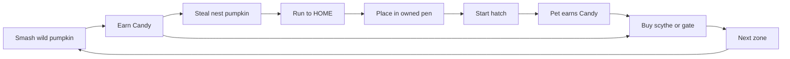
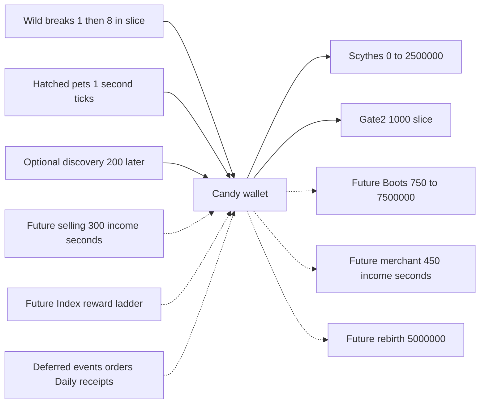
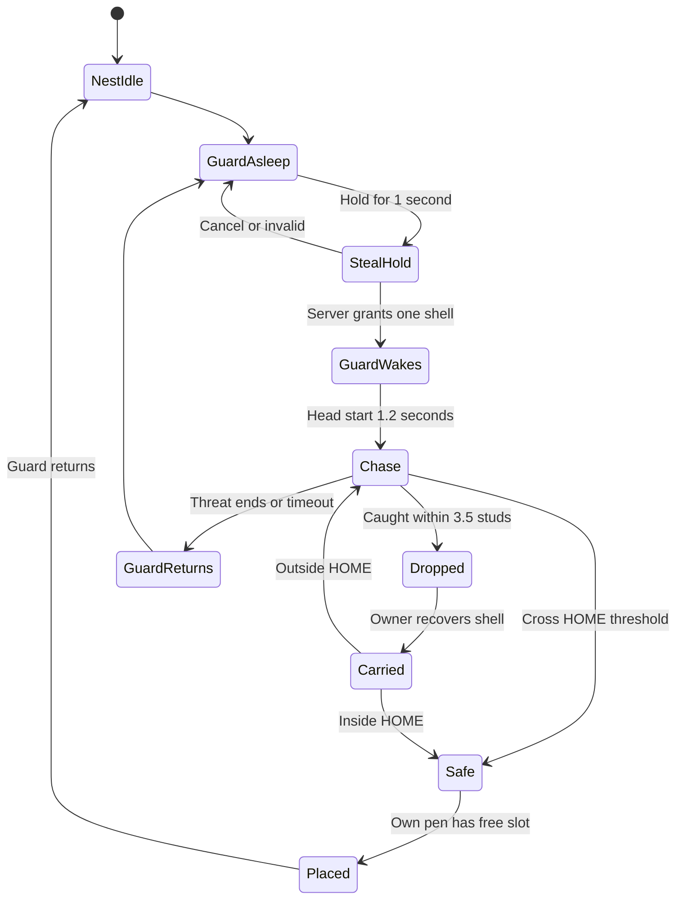
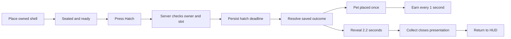
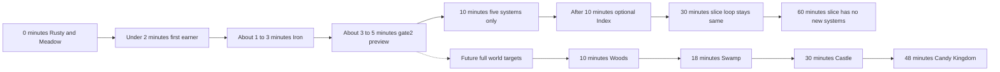
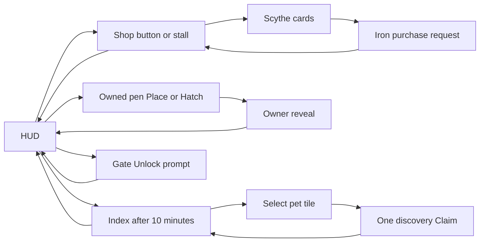
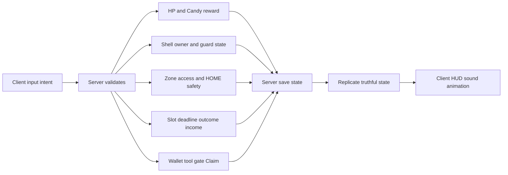

# Steal a Pumpkin — builder blueprint

2026-10-12. Design handoff only. No game code edits, commit, publishing, spending or imported game assets. All delivered files live here. **PROPOSED** means a design or tuning choice that has not been accepted or measured in Studio. Coordinate tables govern placement; generated images illustrate them and are not survey drawings.

Plans: [whole world](world-map.png), [hub](hub-blueprint.png), [Pumpkin Meadow](zone1-blueprint.png), [contact sheet](_overview.jpg). [Image prompts](IMAGE-PROMPTS.md) record built-in generation and refinements. **OWNER-REPORTED:** v4 is the approved look direction; these new plans have no recorded owner approval yet.

## Decision: a hub with seven radial branches

1. Put seven independent zone branches around one safe hub; all locked entrances face the hub, in PatchConfig order clockwise from north.
2. Put each nest 240 studs beyond its HOME threshold: 16–18.5 seconds carrying 1–3 pumpkins, with no earlier zone on the return route.
3. End danger at the hub rim, then use clear paths to eight pens; progression stays sequential through candy purchases while travel is non-linear.

**Evidence checked:** SLICE-SPEC.md including its bottom defaults; all six slice/tasks files; the complete PatchConfig.luau including appended economy/rarity/guard overrides; all 15 v4 PNGs in the existing contact sheet, with hub/Meadow/zone strips inspected enlarged; CONCEPTS.md identity locks; the Hit Game Bible's ten laws and launch limits; selected existing server economy handlers. No Studio route, live economy, device performance or independent critic score was measured: **UNKNOWN**. Keystone Roblox Process Playbook was not found in searched local refs/active-work copies and no Keystone tool is available; its full text remains **UNKNOWN**. Apply the owner-supplied playbook rules: real art, greybox the core moment first, compare with named references before acceptance.

**Authority:** latest owner request > slice defaults > slice contract for active Zone1 > final returned config for future reference > old layout/concept composition. Retain the v4 visual language, names, eight 38×28 pens and 248×160 inner plaza. **PROPOSED spatial replacements:** a 360-diameter safe hub apron, 120×320 zone branches, radial gates and nest at depth240 replace the old straight lane, 120×160 zone, nest20 and north Graveyard gate. The user requested caught = drop; a recoverable drop replaces the slice's retained-in-hands catch. These are explicit handoff changes, not existing behavior.

**Scope:** build one Zone1 loop first. The world map reserves all seven zones, but Zones2–7 are future content. The Zone2 purchase in the slice opens a safe preview and “Slice complete — Graveyard next”; no future earnings/enemies. Gate2 now sits on its own hub branch. Later-zone map art is a silhouette behind its gate. Do not imply seven playable zones ship in this slice.

**Reuse:** retain inspected ownership, save, remote, hit and UI foundations identified by T1–T6; no library migration or new game code. Concept images and Bible reference frames are review references, not licensed assets to ship. Future builders must inspect actual KayKit/Kenney/Quaternius or authored source, licence and script-free hierarchy before adoption. No new kit was downloaded or assumed licensed here.

## A. Core loop

- Wild breaks pay Candy only; SMASH never takes nest loot. Steal is the core verb; smashing is the requested second earning route, an explicit Bible exception.
- Start at 0 Candy with Rusty damage5; Zone1 HP13 takes 3 normal hits, cooldown0.55 seconds. **PROPOSED** first break1 Candy, later breaks8.
- Hold STEAL1 second, capacity3; preserve three faceless ghost-lavender shells. First hatch guarantees Pumpkin Pup/Common/+1 Candy/s.
- Pen placement does not start hatching; one pen interaction changes from Place to Hatch. Eight slots are free; no slot purchase.
- Iron costs150; slice Graveyard gate costs1,000. The first ten minutes teach exactly five groups: smash, steal/escape, pen/hatch/income, scythe, gate.

## B. Candy flow and payback

- Solid edges are the slice economy; discovery200 is **PROPOSED**, optional and deferred until after10 minutes to preserve five learned systems. Dotted edges are inactive reference channels, never onboarding income.
- Slice pet rate is the table's base rate: HoardMult1, no weight/Gold/Shiny/stamp/pass/mutation multiplier; waiting shells earn0. Current config still has HoardMult3 and additional multipliers.
- **INFERRED arithmetic:** normal single-target Rusty cycle3×0.55+2 search=3.65s; Iron0.55+2=2.55s. Rates8/3.65=2.19 and8/2.55=3.14 Candy/s; Iron marginal gain0.945/s gives150/0.945=159s payback. No lucky/crit/multi-target reward assumed.
- A gate buys access, not an automatic earner. Payback below uses eight replacement pets and excludes travel/hatch/other spending; it is a comparison estimate, not a promised session time.
- Preserve one currency. Purchases are exact once-only debits; catching, placing, hatching and Collect have no Candy fee. No offline pay or Robux receipt path is active in the slice.

### Final config zone values versus active slice

These are values after the appended overrides, not the older cost/candy/HP fields near the top. Guard ratios are relative to thief speed; heights are studs. Wild weights are **breakable type distribution**, not hatch odds.

| Zone in locked order | Gate, final config | Candy per normal break | Wild HP | Recommended scythe | Guard / height / ratio | Two nest-roll types |
|---|---:|---:|---:|---|---|---|
| 1 Pumpkin Meadow | 0 | 8 | 13 | Rusty | Scarecrow / 11 / .88 | Orange, Sunny |
| 2 Graveyard | 2,500 | 80 | 100 | Bone | Skeleton Knight / 9 / .90 | Ghost, Shadow |
| 3 Haunted Woods | 100,000 | 250 | 275 | Witch | Tree Ent / 13 / .92 | Moon, MothSeed |
| 4 Witch Swamp | 900,000 | 1,200 | 750 | Vampire | Swamp Toad / 16 / .94 | Crystal, ToadSeed |
| 5 Vampire Castle | 9,000,000 | 6,000 | 2,000 | Candy | Vampire / 18 / .95 | Golden, CandyCorn |
| 6 Candy Kingdom | 80,000,000 | 30,000 | 5,500 | King | Candy Golem / 20 / .96 | Inferno, GummySeed |
| 7 Pumpkin King's Throne | 540,000,000 | 150,000 | 5,500 | King | Pumpkin King / 24 / .97 | KingSeed, DragonSeed |

**Slice:** gate2=1,000, first break=1 then8, only Zone1 farming and Rusty/Iron buying. The initial 140M Zone7 price and HP7300 are stale; final values are540M and5500. The config's hoard.type fields remain legacy identities; Zones.pets supplies the two-outcome economy ladder. Use one authoritative table in future implementation, not shell colour to choose a pet.

### Pet rates by final rarity

Names are current display names. Rates are final Seeds.income/Economy.nestIncome, before current-code multipliers. Common has no Uncommon tier in the visible Index. Secret has a visual token but no configured pet or rate.

| Rarity | Pet name / seed ID / Candy per second |
|---|---|
| Common | Pumpkin Pup / Orange / 1; Crow / Sunny / 4 |
| Rare | Ghosty / Ghost / 15; Black Cat / Moon / 60; Moth / MothSeed / 75 |
| Epic | Candy Bat / CandyCorn / 900; Golden Pup / Golden / 700; Frost Owl / Crystal / 200; Toad / ToadSeed / 250 |
| Legendary | Bone Pup / Shadow / 18; Lava Slime / Inferno / 2,500; Gummy Bear / GummySeed / 3,200 |
| Mythic | King Cat / KingSeed / 9,000; Pumpkin Dragon / DragonSeed / 12,000; Pumpkin Kinglet / KingletSeed / 18,000 |
| Secret | No configured outcome: odds0, income not defined |

**Visible12:** exclude Moth, Toad and Kinglet from the slice Index; retain their legacy IDs in data. Rarity is not a universal rate multiplier: Legendary Bone Pup18/s is below Rare Black Cat60/s. Do not invent a single income value per rarity. Gold and size are cosmetic in slice.

### Scythe prices and modeled marginal payback

**INFERRED**: same 2s search +0.55s per required hit, same-zone single-target comparison, no critical hits. Upgrading a tool doesn't affect pet income. A 3-hit to1-hit improvement is two saved swings, not triple total throughput.

| Scythe / ID | Price | Damage | Comparison for marginal payback | Marginal Candy/s | Price / marginal gain |
|---|---:|---:|---|---:|---:|
| Rusty / RustySickle | 0 | 5 | Free starter | — | 0 |
| Iron / WoodenScythe | 150 | 15 | Zone1 Rusty3 to Iron1 hits | .945 | 159s |
| Bone / BoneScythe | 1,200 | 40 | Zone2 Iron7 to Bone3 | 8.24 | 146s |
| Witch / CursedScythe | 9,000 | 110 | Zone3 Bone7 to Witch3 | 25.76 | 349s |
| Vampire / MoonScythe | 60,000 | 300 | Zone4 Witch7 to Vampire3 | 123.64 | 485s |
| Candy / CandyScythe | 400,000 | 800 | Zone5 Vampire7 to Candy3 | 618.19 | 647s |
| King / PumpkinKingCleaver | 2,500,000 | 2,200 | Zone6 Candy7 to King3 | 3,090.97 | 809s |

Only Iron is purchasable in slice. Later tools' modeled paybacks exceed Bible1–3min under this model; **UNKNOWN** whether actual multi-target uptime closes the gap. Keep real prices; do not claim balance passed. Future tuning needs owner acceptance and measured play.

### Gate investment comparison

**PROPOSED evaluation model:** equal50/50 nest outcomes in each zone, unmodified rates, replace all8 pets, hold slot count8 for comparable arithmetic. Mean rates per pet=2.5/16.5/67.5/225/800/2,850/10,500. Increased slots at Zones3/5 are intentionally excluded from this marginal comparison. Unlock time depends on wallet, not this payback.

| Gate | Price | Eight-pet marginal rate gain | Price / gain | Config arrival hypothesis |
|---|---:|---:|---:|---:|
| Graveyard slice | 1,000 | 112/s | 8.9s after replacing8 pets; preview itself yields0 | 3–5min slice target |
| Graveyard full config | 2,500 | 112/s | 22.3s | 3min |
| Haunted Woods | 100,000 | 408/s | 245s | 10min |
| Witch Swamp | 900,000 | 1,260/s | 714s | 18min |
| Vampire Castle | 9,000,000 | 4,600/s | 1,957s | 30min |
| Candy Kingdom | 80,000,000 | 16,400/s | 4,878s | 48min |
| Pumpkin King's Throne | 540,000,000 | 61,200/s | 8,824s | 75min, outside first hour |

These fail uniform1–3min payback; eight replacement steals also take time. Current config arrival hypotheses were derived with swaps, sales, stamps, discounts and events; they are not valid measured predictions for the stripped slice or new radial map. Later progression needs a fresh simulation before gameplay promises.

### Complete source/sink boundary for this blueprint

| Channel | Amount or rule | Slice state |
|---|---|---|
| Starting wallet | 0 | Active |
| Smash | First1, subsequent8 Zone1; future zone base rewards above | First1 PROPOSED; active route |
| Pets | Table rates each1s after hatch | Active, no multipliers |
| First Index Claim | 200 once | PROPOSED, after10min, optional |
| Tool / gate debit | Exact price tables | Iron and gate2 only |
| Sell and full-pen sell | Current WitchSellSeconds/FullPenSellSeconds=300×pet income; old SellPerIncome30 is legacy | Disabled; later sale removes the earner |
| Current Index ladder | Pet claim floor(max(200,min(rate×600,rate×320))); milestone25/50/75/100%=40/50/60/70 income-seconds, minimum200 | Disabled; slice replaces with one200 Claim |
| Daily | Config100×streak day; final-day multiplier2 | Disabled |
| Rotating orders/tutorial rewards | Order base=max(1,total income)×OrderIncomeSeconds(60); per-order b/reward fields | Disabled; slice five instruction stages pay no bonus |
| Ghost/lackey bonks | Config floor3, income-base share.15, value caps; no active guard combat payment | Disabled |
| King rain | 80 drops×8=640 if all collected; crate/reward/farm-seconds policy is separate | Disabled |
| King rewards / update migration / legacy carry conversion | Current KingNight.farmSeconds1800 and rank/contribution policy; updateBonusSeconds1800; legacy PopCandySeconds3 | Disabled in clean slice; no debug/migration starter grants |
| Admin/debug grants | Config10,000 default, max1B | Not gameplay, disabled in acceptance routes |
| Robux Candy packs | Current receipt policy5/20 minutes of receipt-time income, floor1/s; product IDs0 | Disabled; no purchase/account/receipt activation |
| Boots | 750 /7,500 /75,000 /750,000 /7,500,000; +2 speed each, cap26 | Disabled |
| Merchant purchase | Config300 income-seconds×1.5=450 income-seconds | Disabled |
| Rebirth/Haunt | Config5,000,000 rebirth; legacy Haunt cost2,500,000 | Disabled |
| Cut upgrades Stack/Mallet/Lucky | Legacy40n²/50n²/120n²; cut flags, no active sales | Disabled |
| Gate discount | Current quest completion25%; these tables show undiscounted prices | Disabled in slice |
| Brew/fuse/Gold/Shiny/stamps/passes/events | May alter rates or consume pets, not a separate slice currency; current size/Hoard/pass path is not adopted | Disabled |
| Steal/drop/pickup/place/hatch/Collect | 0 Candy; item-state changes, not wallet sources | Active |
| Offline pay, slot shop, PvP theft, rent | No active slice payment path | Disabled; do not infer Bible default adoption |

This lists existing economic channels for isolation, not permission to add them. Exact payout of deferred contribution-dependent rewards requires their live handler state; **UNKNOWN** at blueprint level. No fixed number is invented for those payments.

## C. Steal and chase state machine

- Nest capacity3; config refill1 shell/30s. **PROPOSED** timer chip counts to next missing-shell refill, says “Nest full” when full; no fake5:00 timer. Defaults at spec bottom supersede stale King-chip instructions in tasks.
- Carry speed16−count: 15/14/13 studs/s. Zone1 guard speed.88×carrier speed; **PROPOSED** remove min14 floor so a full starter load isn't overtaken by tuning error.
- **PROPOSED caught policy per user:** all carried shells leave hands as one owner-reserved recoverable bundle;1s stumble and3s mercy. No deletion/20s expiry/automatic sale/Candy loss; first10min have0 permanent losses.
- **PROPOSED** after mercy, chasing resumes only once the owner recovers the shell outside HOME. Other players cannot take it; conserve item count on catch, death/reset/rejoin. Existing code has different return/expiry paths: implementation must reconcile them.
- Nest→HOME route240 studs takes16–18.46s from steal completion; headstart1.2s leaves14.8–17.26s actual moving pursuit. Add one stumble for17–19.46s elapsed; test corners/contact, not just arithmetic. 240 is the nest-centre route; individual shell offsets put the actual route at238–244 studs, or15.9–18.8s depending on load. All are inside the requested15–25s escape band before discretionary detours.
- **PROPOSED** radial HOME is the hub boundary radius180, not SafeLineZ. Guard return12; timeout config120s; ordinary correct escapes reach safety sooner. Safe has no catch even before pen placement; full pen blocks new theft, never discards an owned shell.

## D. Hatch and reveal

- New player playtime<1,800s:6s wait; thereafter Orange8s, other types20s. Record deadline and outcome once when Hatch is accepted; “Roll” reads that committed result after the wait, never rerolls on reconnect.
- First hatch guaranteed Orange/Pup/Common100%; **PROPOSED** subsequent Zone1 Orange50%/Sunny50%, both Common, rates1/4. Nest-shell glow never discloses rarity.
- **PROPOSED full-world roll policy** uses equal halves of each zone's Zones.pets ladder below. Wild weights stay separate. No general luck, pity or Secret roll is active.
- Reveal beats0/.3/.6/1/1.5/2.2s: pose, cracks, hollow rind, pet pop, rarity/name/rate, finish; <=8rays/12chips, owner-only card, neighbours see world animation.
- Pet starts earning on server hatch completion; Collect only dismisses the presentation. Repeat Hatch/Collect cannot duplicate income or pets. Input/camera/HUD restored by2.2s and on interruption.

| Zone | PROPOSED outcomes and odds | Resulting rarity odds |
|---|---|---|
| 1 after guaranteed first | Pup50%, Crow50% | Common100% |
| 2 | Ghosty50%, Bone Pup50% | Rare50%, Legendary50% |
| 3 | Black Cat50%, Moth50% | Rare100% |
| 4 | Frost Owl50%, Toad50% | Epic100% |
| 5 | Golden Pup50%, Candy Bat50% | Epic100% |
| 6 | Lava Slime50%, Gummy Bear50% | Legendary100% |
| 7 | King Cat50%, Pumpkin Dragon50% | Mythic100% |

The non-monotonic Zone2 Legendary is the existing config ladder, not a redesigned rarity ladder. Future owner decision is needed to change it; no secret odds invented. Hidden legacy Moth/Toad outcomes would need a future Index expansion before their zones ship.

## E. First hour progression

- All timestamps are **PROPOSED targets**, not observations. Slice ends progression at paid Graveyard preview; repeat stealing/pet collection thereafter, no accidental late-system activation.
- Five groups learned by10min. **PROPOSED** Index button appears only after10min; no forced modal. This intentionally narrows the slice's optional sixth early system; Shop visible from join.
- Full-world config arrival0/3/10/18/30/48/75min is a tuning hypothesis, not an unlock-by-clock rule. Sequential owned gate flags and sufficient Candy remain required even though every branch is visible.
- Current config PvP shield900s=15min, Brew/Lucky1800s, King600s; all remain disabled in slice at10/30/60min. Bible's suggested10min PvP and30min Sell do not override slice exclusions.
- **PROPOSED later release:** teach at most one new system per checkpoint: Index after10, selling after30 when designed; zone access adds environment/pets, not extra mandatory systems. Full pen does not activate Sell in slice.
- Tools beyond Iron, added slots10/12, merchant, mutation, boss, raids and rebirth are future reserves. King zone arrival75min is outside the first hour; rebirth UI trigger is not adopted.

## F. UI screens and visibility

- HUD: Candy +income/s, Carry n/3 contextual, one banner/arrow, scythe/pumpkin hotbar; purple Drop only carrying. Four prompt families: Steal, pen state, Shop, Unlock.
- Shop opens by HUD or Shop stall prompt. Rusty FREE, Iron150; Bone1.2K/Witch9K are locked previews. X closes; one panel at a time, opening a panel cannot mint a reward or disable server danger.
- **PROPOSED** Index hidden until>10min, then12 tiles in3×4, real discovered count, optional200 Claim once. This is the only extra learning group after onboarding.
- Sell/Upgrades are closed art shells without prompts per bottom defaults; hidden functional UI includes Daily, Pets management, quests, raids, teleport, boss, rebirth, boosts, Robux.
- One truthful top-right nest-refill chip30s when stock missing; other simultaneous waits stay on local pen labels, not extra global clocks. Fresh join has0 popups; neighbour reveal never opens your card.
- Phone landscape:32 logical-pixel safe inset, >=48px targets, Shop/Index top-left, currency above joystick, orange SMASH/purple STEAL; one Roblox JUMP. FredokaOne, cream/grape/orange kit, purple X; input focus prevents accidental actions through panels.

## G. Session minute 0–10

- **PROPOSED one-pumpkin route targets:** spawn local(0,126), first wild(10,204), nest(0,420), HOME(0,180), nearest available pen via clear paths. No teleport, speed cheat or free pet.
- First field is about79 studs from spawn, ~5s walk;3 normal hits plus input/candy arc aims at8s first reward, <30s hard bound.
- From first field to nest~216 studs/16=13.5s, plus search/hold allows nest24/steal25. Nest→HOME240/15=16s, safe at41. Assigned pen travel is variable;54 is a nearest-pen route target, not a guarantee for eight simultaneous joins.
- At hatch54 +6 wait=earner60; reveal ends62.2. Even longer pen routes must keep first earner<120s. **INFERRED:** nearest north pen entrance→HOME195 studs, then nest240: outbound435/16=27.19s; hold1 +escape16 +safe pen run195/15=13 +hatch6 +reveal2.2 gives~65.4s full repeat loop. This exceeds Bible15–45s even from that pen. **PROPOSED exception:** keep the requested15–25s escape and accept a longer complete loop; a shorter full loop requires relocating nests/pens or another owner-approved geometry change, not a claimed playtest pass.
- With one Pup1/s plus normal Iron farming3.14/s, gross1,150 for Iron+gate needs roughly4.6min after earning starts if rate stayed fixed; extra pets can shorten it.3–5min gate is a playtest target, not proved by this constant-rate approximation.
- At10min keep the five-group cap; no mandatory Index Claim. Test0/1/3 carried shells, farthest pen, two thieves, eight-player nest contention;30s refill can delay newcomers. First-hatch guarantee follows saved player state, not first thief in server.

## H. Server versus client ownership

- Client sends intent/target IDs, never payout, rarity, price, elapsed hold or safe-state authority. Server validates type, finite values, loaded state, cooldown, proximity, facing/target and zone ownership.
- Server reserves one contested shell/last-hit reward, validates1s hold, carry3, owned pen/free slot, saved deadline/outcome, exact-once purchase and Claim. Pending hatches and reserved drops survive rejoin without reroll or duplication.
- **PROPOSED spatial authority:** point-in-rotated-zone volumes replace lane-Z access tests; circle radius180 defines HOME; locked-branch access checked server-side even if client hides its gate collider. Crossing Zone1 HOME cannot authorize locked Zone2.
- Server owns guard motion/catch and relevant physics roots; client shows glow/pose/wake tell/candy arcs/reveal and can predict feedback, but reconciles money and item state to server events.
- Server rate limit and idempotent operations preserve wallet/item conservation. Reject remote replay, stranger slot, fake gate unlock, through-wall stealing and impossible movement into protected volumes.
- Existing Save/Profile/Remotes/attribute contracts are foundations, not proof of these new spatial rules. Isolated slice save namespace; no owner-profile reset or silent future-data migration. Runtime anti-exploit proof remains **UNKNOWN**.

## Exact spatial specification — all PROPOSED

### Datum and assembly rules

- Stud units; global datum **W=(1500,0,150)** at hub centre, ground topY0; north=+Z/right=+X in images. If ground differs, add groundY to every Y. Tables use hub-local coordinates; add W to obtain world coordinates.
- Size means X×Y×Z oriented before yaw; listed positions are part centres. Visible models use bounding box centre matching the listed box; their authored ground pivot sits Y=0. Invisible floor/query/collision roots are allowed, but final visible art uses accepted modular meshes.
- World terrain1040×2×1040 at(0,-1,0), limits±520. Hub is a disk radius180, groundtop0; inner plaza rectangle248×160 centred(0,0,0). Terrain outside zone volumes is decorative/inaccessible, never a route around locks.
- Each zone origin G lies at radius180. Local **u** is cross-branch, **v** is outward, **y** is up. θ increases clockwise from north. Transform: **X=Gx+u cosθ+v sinθ; Z=Gz−u sinθ+v cosθ; Y=y**. Roblox yawθ maps local+Z outward; no mirrored art. Numeric transforms rounded.01 studs.
- Zone playable flooru−60..60, v0..320; entry24 clear centeredu0; standard paths>=12 clear. Side walls25 high. Preserve zone IDs/names, Garden/Patches, owned Soil/Plot hooks, Spawns/Hoard, GateWall/UnlockPrompt; implementation changes must be explicit because current lane helpers cannot accept this world unchanged.
- HOME is entire safe disk, including approach apron. Inner plaza has low3-stud decorative rails, not25-stud sight-blocking walls. Gate arches24 high at rim, landmarks behind them visible above foliage; no giant hub buildings blocking opposite gates. Spawn sightlines need default-camera/touch checks.

### World parts common to all seven branches

| Part name (under each ZoneN) | Size X×Y×Z | Position in zone u,y,v | Yaw relative to zone | Function |
|---|---|---|---:|---|
| Floor | 120×2×320 | 0,-1,160 | 0 | Theme terrain mesh |
| GateWall | 24×20×2 | 0,10,0 | 0 | Owner-specific access root; Zone1 open |
| GateArch | 32×24×6 | 0,12,0 | 0 | Chunky theme arch and price sign |
| HomeThreshold | 24×.2×4 | 0,.1,0 | 0 | HOME label; actual safety uses disk |
| EntryPath | 16×.2×222 | 0,.1,111 | 0 | v0..222, nest approach |
| LeftPath | 12×.2×320 | -48,.1,160 | 0 | Alternate side route |
| RightPath | 12×.2×320 | 48,.1,160 | 0 | Alternate side route |
| NestPlatform | 20×1.5×20 | 0,.75,240 | 0 | Three shells, straw/root kit |
| GuardMarker | 6×1×6 | 16,.5,240 | 0 | Spawn/query marker, hidden |
| PatrolArea | 36×.1×36 | 16,.05,240 | 0 | Hidden radius18 planning circle |
| FarLandmark | 36×32×24 | 0,16,300 | 0 | Theme facade; Zone7 throne24×40×20 instead |
| WallLeft | 2×25×322 | -61,12.5,160 | 0 | Outside floor edge |
| WallRight | 2×25×322 | 61,12.5,160 | 0 | Outside floor edge |
| WallFar | 124×25×2 | 0,12.5,321 | 0 | Closed outside perimeter |
| EntryWingLeft | 48×25×2 | -36,12.5,0 | 0 | u−60..−12, blocks bypass |
| EntryWingRight | 48×25×2 | 36,12.5,0 | 0 | u12..60, blocks bypass |

**PROPOSED radial safe edge:** entry's straight threshold endpointsu±12 have radius180.40, so safe test tolerance must include the threshold strip or use a radius181 entry overlap; do not leave a .4-stud unsafe seam. Final design: server considers disk radius180 **plus owned entry HomeThreshold volume** safe. No safety overlap reaches the nest. Disable solid GateWall in Zone1; future locked gates block access per player with authoritative ownership tests.

### Ring transforms and world centre table

The following generated table expands the placement transform; positions are hub-local and all floor boxes share size120×2×320. Nest centre is(.75 high), guard centre uses half its height. Zone1 expands separately below.

| Zone | Yaw degrees | Gate centre X,Y,Z | Floor centre X,Y,Z | Nest centre X,Y,Z | Guard centre X,Y,Z | Safe spoke centre X,Y,Z |
|---|---:|---|---|---|---|---|
| 1 Pumpkin Meadow | 0.000000 | 0.00,10,180.00 | 0.00,-1,340.00 | 0.00,.75,420.00 | 16.00,5.5,420.00 | 0.00,.1,155.00 |
| 2 Graveyard | 51.428571 | 140.73,10,112.23 | 265.82,-1,211.99 | 328.37,.75,261.87 | 338.35,4.5,249.36 | 121.18,.1,96.64 |
| 3 Haunted Woods | 102.857143 | 175.49,10,-40.05 | 331.48,-1,-75.66 | 409.47,.75,-93.46 | 405.91,6.5,-109.06 | 151.11,.1,-34.49 |
| 4 Witch Swamp | 154.285714 | 78.10,10,-162.17 | 147.52,-1,-306.33 | 182.23,.75,-378.41 | 167.82,8.0,-385.35 | 67.25,.1,-139.65 |
| 5 Vampire Castle | 205.714286 | -78.10,10,-162.17 | -147.52,-1,-306.33 | -182.23,.75,-378.41 | -196.65,9.0,-371.46 | -67.25,.1,-139.65 |
| 6 Candy Kingdom | 257.142857 | -175.49,10,-40.05 | -331.48,-1,-75.66 | -409.47,.75,-93.46 | -413.03,10.0,-77.86 | -151.11,.1,-34.49 |
| 7 Pumpkin King's Throne | 308.571429 | -140.73,10,112.23 | -265.82,-1,211.99 | -328.37,.75,261.87 | -318.39,12.0,274.38 | -121.18,.1,96.64 |

### Hub blueprint part table

Safe apron is a disk360 across; the retained inner plaza is248×160. **PROPOSED** spawn moves from old south spawn to the north apron to meet first-reward bounds. No world boss at the hub throne; it is a static crown landmark distinct from Zone7's guardian.

| Part | Size X×Y×Z | Hub-local centre X,Y,Z | Yaw | Notes |
|---|---|---|---:|---|
| SafeHubDisk | 360×2×360 bounding cylinder | 0,-1,0 | 0 | Vertical axisY; radius180 |
| InnerPlaza | 248×.2×160 | 0,.1,0 | 0 | BoundsX±124,Z±80 |
| RingWalk | Outer radius172, inner radius156, height.2 | 0,.1,0 | 0 | Annular mesh;16 clear |
| NorthConnector | 16×.2×66 | 0,.1,123 | 0 | Z90..156 |
| SouthConnector | 16×.2×66 | 0,.1,-123 | 0 | Z−156..−90 |
| EastConnector | 32×.2×16 | 140,.1,0 | 0 | X124..156 |
| WestConnector | 32×.2×16 | -140,.1,0 | 0 | X−156..−124 |
| MainWalkWest | 12×.2×180 | -26,.1,0 | 0 | Z±90; clear fountain/throne |
| MainWalkEast | 12×.2×180 | 26,.1,0 | 0 | Z±90 |
| CrossWalkNorth | 64×.2×12 | 0,.1,90 | 0 | Joins connector, bypasses throne |
| CrossWalkSouth | 64×.2×12 | 0,.1,-90 | 0 | Joins connector |
| CrossWalkCentre | 136×.2×12 | 0,.1,0 | 0 | Clear between pen rows18/−18 |
| PenFrontWalkWest | 12×.2×160 | -62,.1,0 | 0 | X−68..−56 |
| PenFrontWalkEast | 12×.2×160 | 62,.1,0 | 0 | X56..68 |
| Shop | 20×18×20 | -44,9,-52 | 0 | Timber/grape roof; front+Z |
| SellLater | 20×18×20 | 44,9,-52 | 0 | Closed; no prompt |
| UpgradesLater | 20×18×20 | -44,9,32 | 180 | Closed; no prompt |
| Fountain | 20×16×20 | 0,8,-26 | 0 | Round pumpkin stone fountain |
| StaticThrone | 24×40×20 | 0,20,54 | 180 | Faces south; two12-wide bypasses |
| SpawnLocation | 8×1×8 | 0,.5,126 | 180 | Avatar faces north, mesh front−Z rotated180 |
| HomeSign | 12×8×2 | 0,12,146 | 0 | Keep spawn route clear; sign overhead root |
| GateShopPrompt | 2×2×2 | -44,2,-40 | 0 | Shop prompt outside facade |

Shop/pet pens do not intersect main12-stud corridors. CrossWalkCentre connects to front walks. For each pen row, add a12-wide connector from MainWalk±26 to PenFrontWalk±62 at its rowZ: size36×.2×12, centreX±44. AtZ−54 those connectors overlap the closed Shop/Sell footprints: **omit that row connector and the west row18 connector beside Upgrades**, enter the front walk from the centre crosswalk instead. AtZ54, the throne occupiesX±12 and does not obstruct the bypass corridors. Ring spokes below start radius130, beyond pen corners; do not draw diagonal paths through occupied pens.

| Pen root | Size | Centre | Entrance facing |
|---|---|---|---|
| Pen1 | 38×1×28 | -88,.5,-54 | +X |
| Pen2 | 38×1×28 | -88,.5,-18 | +X |
| Pen3 | 38×1×28 | -88,.5,18 | +X |
| Pen4 | 38×1×28 | -88,.5,54 | +X |
| Pen5 | 38×1×28 | 88,.5,-54 | −X |
| Pen6 | 38×1×28 | 88,.5,-18 | −X |
| Pen7 | 38×1×28 | 88,.5,18 | −X |
| Pen8 | 38×1×28 | 88,.5,54 | −X |

Each pen is one owner with8 slots, not one pet total. Rails height3; gate opening12 on inward edge. **Exact repeated pen kit**, offsets from pen rootXZ: rear rail38×3×1 at(0,1.5,+14); front rail38×3×1 at(0,1.5,−14); outside rail1×3×28 at(outwardX19,1.5,0); inward split rails1×3×8 at(inwardX19,1.5,±10), leavingZ−6..6 clear. Coordinates above are ground-relativeY. Soil pads6×.2×6 at slot offsets listed below; pen sign8×6×1 above outside edgeY5. Hatch shell uses8×8×8 envelope, centreY4; pet height follows rarity3.2/3.9/4.7/5.7/7. No free staged earners on fresh assignment.

| Slot ID in every pen | Offset X,Y,Z | Pad size |
|---|---|---|
| 1 | -12,.1,-6 | 6×.2×6 |
| 2 | -4,.1,-6 | 6×.2×6 |
| 3 | 4,.1,-6 | 6×.2×6 |
| 4 | 12,.1,-6 | 6×.2×6 |
| 5 | -12,.1,6 | 6×.2×6 |
| 6 | -4,.1,6 | 6×.2×6 |
| 7 | 4,.1,6 | 6×.2×6 |
| 8 | 12,.1,6 | 6×.2×6 |

Eight lanterns, each3×7×3 centreY3.5: L1(−72,−72),L2(72,−72),L3(−72,−36),L4(72,−36),L5(−72,36),L6(72,36),L7(−72,72),L8(72,72), where pairs are(X,Z). Bulbs sit on pen-side verges clear of the12-stud pen-front walks; these are the eight plaza lanterns.

For each gate add **SafeSpokeN**, size16×.2×50, centre(155sinθ,.1,155cosθ), yawθ; radial range130..180. Decorative hub apron between core/ring is walkable, with no tall trees or colliders in desire lines. Gates use the world transform table and common gate kit, no duplicate north Graveyard gate.

### Pumpkin Meadow exact layout

Zone1 θ0 and G=(0,0,180). Thus local(u,y,v) becomes hub-local(u,y,180+v), world(1500+u,y,330+v). Floor120×320 boundsworldX1440..1560,Z330..650. HOME entryworldZ330, nestworldZ570. **No gate at Meadow's far end:** Graveyard is its own clockwise hub branch.

| Part | Size X×Y×Z | Zone1-local u,y,v | Hub-local X,Y,Z |
|---|---|---|---|
| Floor | 120×2×320 | 0,-1,160 | 0,-1,340 |
| HOME threshold | 24×.2×4 | 0,.1,0 | 0,.1,180 |
| NestPlatform | 20×1.5×20 | 0,.75,240 | 0,.75,420 |
| NestShell1 | 4×4×4 | -6,3.5,238 | -6,3.5,418 |
| NestShell2 | 4×4×4 | 0,3.5,244 | 0,3.5,424 |
| NestShell3 | 4×4×4 | 6,3.5,238 | 6,3.5,418 |
| Scarecrow asleep | 6×11×6 | 16,5.5,240 | 16,5.5,420 |
| Patrol plan circle | radius18, hidden | 16,0,240 | 16,0,420 |
| Windmill | 16×32×16 | -28,16,294 | -28,16,474 |
| BarnFacade | 36×24×24 | 0,12,300 | 0,12,480 |
| Hay1 | 4×4×6 | -30,2,278 | -30,2,458 |
| Hay2 | 4×4×6 | 30,2,278 | 30,2,458 |
| PumpkinSign | 8×8×2 | -26,4,10 | -26,4,190 |
| DecorativeScarecrow1 | 4×7×4 | -30,3.5,310 | -30,3.5,490 |
| DecorativeScarecrow2 | 4×7×4 | 30,3.5,310 | 30,3.5,490 |
| Lantern1 | 3×7×3 | -32,3.5,12 | -32,3.5,192 |
| Lantern2 | 3×7×3 | 32,3.5,12 | 32,3.5,192 |
| Lantern3 | 3×7×3 | -32,3.5,286 | -32,3.5,466 |
| Lantern4 | 3×7×3 | 32,3.5,286 | 32,3.5,466 |

**Paths:** use common EntryPath and side paths. Nest access endsv222 before platform starts230; add approach bridge16×.2×8 centred(0,.1,226). Chase centreline=(0,240)→(0,222)→(0,0);240 length. The initial nest crossing is walkable; root doesn't trap carrier. Side routes from nest via(48,240)→(48,12)→(0,12)→(0,0) are336 studs,22.4s carrying1 or25.85s carrying3: faster central route is always legible. A player choosing the longest path may exceed25s; no mandatory detour.

**PROPOSED patrol rule:** radius18 is the awake idle planning envelope, not the chase leash. Scarecrow sleeps beside nest until theft; no autonomous patrol requiring a sixth lesson. Radius display in image is builder-only. Guard may chase inside its zone toward HOME but never into safe hub; prevent cuts through hay/walls. Five prop families only: hay, windmill, pumpkin sign, decorative scarecrows, lanterns; BarnFacade is the windmill/architecture kit, not another interactive system.

**Exactly40 wild spawn roots:** size1×1×1 invisible, centreY.5, visible faceless wild envelope3×3×3 centreY1.5; five rows×eight columns. All are beyond HOME, clear of centre escape and side paths. Roots are candidates, with configmax40/respawn8s. Do not add duplicate decorative breakables. The coordinate table below expands every root.

| Root | Size | Zone local u,y,v | Hub-local X,Y,Z |
|---|---|---|---|
| Wild01 | 1x1x1 | -36,.5,24 | -36,.5,204 |
| Wild02 | 1x1x1 | -26,.5,24 | -26,.5,204 |
| Wild03 | 1x1x1 | -16,.5,24 | -16,.5,204 |
| Wild04 | 1x1x1 | -10,.5,24 | -10,.5,204 |
| Wild05 | 1x1x1 | 10,.5,24 | 10,.5,204 |
| Wild06 | 1x1x1 | 16,.5,24 | 16,.5,204 |
| Wild07 | 1x1x1 | 26,.5,24 | 26,.5,204 |
| Wild08 | 1x1x1 | 36,.5,24 | 36,.5,204 |
| Wild09 | 1x1x1 | -36,.5,64 | -36,.5,244 |
| Wild10 | 1x1x1 | -26,.5,64 | -26,.5,244 |
| Wild11 | 1x1x1 | -16,.5,64 | -16,.5,244 |
| Wild12 | 1x1x1 | -10,.5,64 | -10,.5,244 |
| Wild13 | 1x1x1 | 10,.5,64 | 10,.5,244 |
| Wild14 | 1x1x1 | 16,.5,64 | 16,.5,244 |
| Wild15 | 1x1x1 | 26,.5,64 | 26,.5,244 |
| Wild16 | 1x1x1 | 36,.5,64 | 36,.5,244 |
| Wild17 | 1x1x1 | -36,.5,104 | -36,.5,284 |
| Wild18 | 1x1x1 | -26,.5,104 | -26,.5,284 |
| Wild19 | 1x1x1 | -16,.5,104 | -16,.5,284 |
| Wild20 | 1x1x1 | -10,.5,104 | -10,.5,284 |
| Wild21 | 1x1x1 | 10,.5,104 | 10,.5,284 |
| Wild22 | 1x1x1 | 16,.5,104 | 16,.5,284 |
| Wild23 | 1x1x1 | 26,.5,104 | 26,.5,284 |
| Wild24 | 1x1x1 | 36,.5,104 | 36,.5,284 |
| Wild25 | 1x1x1 | -36,.5,144 | -36,.5,324 |
| Wild26 | 1x1x1 | -26,.5,144 | -26,.5,324 |
| Wild27 | 1x1x1 | -16,.5,144 | -16,.5,324 |
| Wild28 | 1x1x1 | -10,.5,144 | -10,.5,324 |
| Wild29 | 1x1x1 | 10,.5,144 | 10,.5,324 |
| Wild30 | 1x1x1 | 16,.5,144 | 16,.5,324 |
| Wild31 | 1x1x1 | 26,.5,144 | 26,.5,324 |
| Wild32 | 1x1x1 | 36,.5,144 | 36,.5,324 |
| Wild33 | 1x1x1 | -36,.5,184 | -36,.5,364 |
| Wild34 | 1x1x1 | -26,.5,184 | -26,.5,364 |
| Wild35 | 1x1x1 | -16,.5,184 | -16,.5,364 |
| Wild36 | 1x1x1 | -10,.5,184 | -10,.5,364 |
| Wild37 | 1x1x1 | 10,.5,184 | 10,.5,364 |
| Wild38 | 1x1x1 | 16,.5,184 | 16,.5,364 |
| Wild39 | 1x1x1 | 26,.5,184 | 26,.5,364 |
| Wild40 | 1x1x1 | 36,.5,184 | 36,.5,364 |

## Art construction and side-by-side acceptance

| Reference evidence (local Bible/concepts, not fresh live testing) | Blueprint response | Acceptance gap |
|---|---|---|
| Steal an Egg: visible sleeping guard, hold steal, RUN/Home return and rate above earner | Guard beside three-shell nest, red wake tell, inward HOME route, truthfully labeled rates | Real feel/contested route UNKNOWN |
| Pet Simulator99: bright readable impacts, rewarding2–3s reveal and clear rarity/name/rate | Faceless ribbed shell, hollow rind reveal2.2s, cream/grape UI | Imported art/animation UNKNOWN |
| v4 hub: timber purple roofs, pumpkin fountain, crown throne, warm lamps, fenced straw pens | Preserve these silhouettes as modular mesh kit;8 pens,8 lamps, low foreground rails | Generated top-down images are concepts, not shippable meshes |
| Bible: reward<30s, earner<120s, <=5 learned systems | North-apron spawn, guaranteed Pup, Index deferred | Arithmetic only, no measured timing |
| Bible: short station walks and1–3min payback | Radial returns and Iron159s model | Later tool/gate paybacks fail the simple model;45s loop may fail from distant pens |

**Buildable richness:** one timber stall shell with3 roof/awning variants; pen rail/post/straw kit; one gate arch module recoloured per zone; stone/floor/path kit; five Meadow prop families. Bake studs/bevels into authored meshes, reuse material atlases, keep props along verges. No thousands of runtime stud parts or invisible procedural-art fallback. Sunset stays bright enough to read routes; tall zone facades sit at far edge, not in entry sightlines. Effects and foliage never obstruct12-stud escape corridors.

**One before many:** greybox one pen/nest/240-stud escape first, measure loaded route and first reward/earner; match one finished scene to v4 and Steal an Egg/PS99 reference moments, then Zion checks before duplicating pens/content. Independent critics/Claude review are **PENDING**, no self-awarded arena pass. The three requested images are complementary plans for that one layout, not eight approved finished pen variants.

Required implementation evidence: default camera and phone gate visibility; solo/two/eight-player new-user route; pen allocation/farthest-pen timings; shell conservation on catch/drop/death/rejoin; server locked-zone bypass rejection; no pre-hatch earnings; measured Iron/gate payback; no sixth mandatory system in first10min. Preserve isolated saves. No implementation is authorized by this document.

## Owner-only open questions (2)

1. For build acceptance, prioritize the requested15–25s escape with the modeled~65s complete loop, or require Bible15–45s complete loops and authorize further pen/nest geometry changes? This draft prioritizes the owner's escape duration; no teleport or speed cheat is proposed.
2. For the eventual full world, preserve the config's non-monotonic rarity/rate ladder and expensive gates, or authorize a separate rebalance before promising10/18/30/48-minute arrivals? Current numbers cannot be called Bible payback compliant.

## Lessons

- When config appends overrides, use the final values because initial costs, HP and rarity labels can be stale.
- When chase duration matters, specify route length and carrying speed because attractive map art does not prove escape timing.
- When first-session systems must stay at five, delay optional Index learning because an optional reward panel still adds a system to learn.
