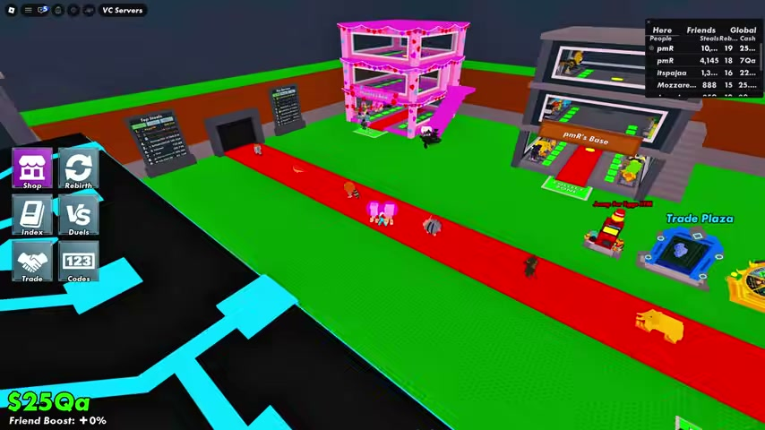
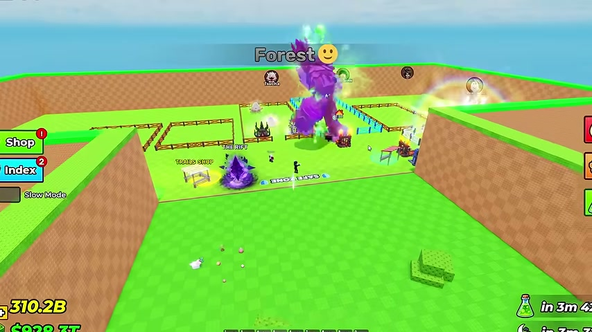
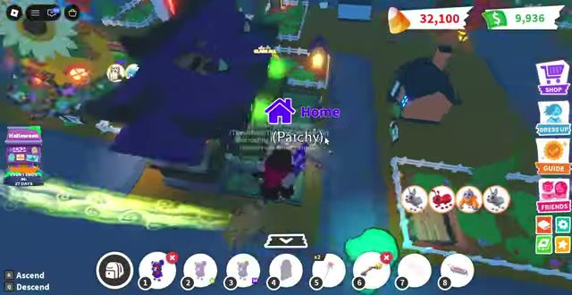
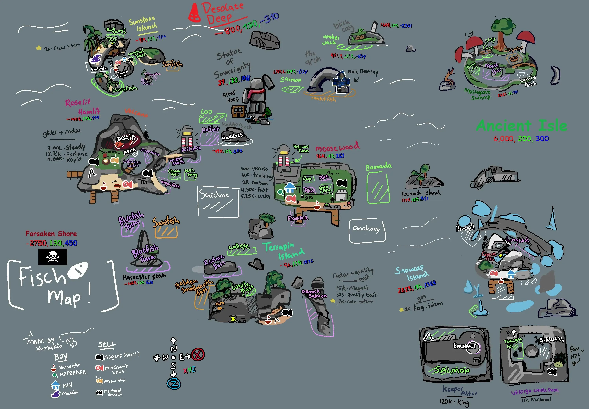
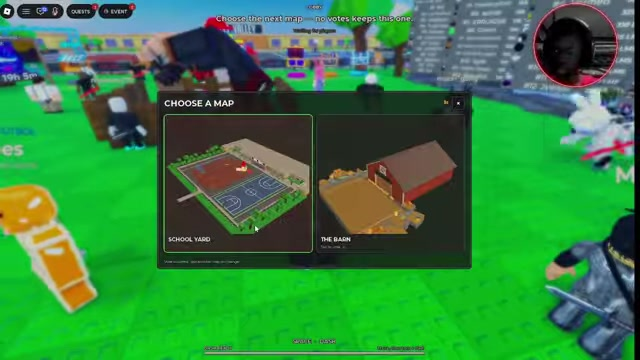

# Steal a Pumpkin — map review

**Pick B: compact shared plaza.** It keeps the guarded-nest → visible home pen loop, brings other players into the same scene, and gives a modeled **19–45 second steal-and-place loop**. Build one Meadow bay and one finished pen for Zion to judge before duplicating content. A preserves the long escape but spends too much of each loop walking safely. C is a viable expansion format, but portals break the continuous pursuit that makes stealing interesting.

Reviewed **2026-10-12**. Footage window: **2026-09-01 through 2026-10-12**, inclusive. Read-only game review; no code edits, commit, publish, purchase or messages. All new files are in this folder.

## Evidence and limits

- **Checked:** original `world-map.png`, `BLUEPRINT.md`, prior map-reference ledgers, the complete `PatchConfig.luau` including its appended overrides, fresh video upload metadata, sampled footage, downloaded source frames, public Roblox Games API, official/developer and community map sources.
- **Observed:** base placement, route topology and visible landmarks in the frames below. **Inferred:** why those arrangements fit Pumpkin, timing arithmetic, build budgets and recommendation. **UNKNOWN:** actual Pumpkin route times, phone usability, eight-player pursuit, performance, retention and independent critic acceptance. Popularity does not prove that a particular map caused success.
- The six primary games have current activity in [current-games.json](current-games.json), retrieved directly from the [Roblox Games API](https://games.roblox.com/v1/games?universeIds=7709344486,10563114921,383310974,5750914919,6504986360,10764627709). Recorded concurrent players: Brainrot 142,019; Egg 1,437,195; Adopt Me 378,665; Fisch 96,886; BGSI 10,569; Huss Valley 118,846. These are one snapshot, not revenue or stable rankings.
- Four fresh **map** comparisons are Adopt Me, Fisch, BGSI and Huss Valley. They appeared in broader earlier research, but the previous `MAP-COMPARE.md` and `board/map-world/TARGET.md` used Steal an Egg for map layout. This review does not claim these four are entirely new references to the project.
- Full official current world atlases were not available for every game. The delivered set uses recent overhead gameplay frames, Huss Valley's in-game overhead map-selection previews, an explicitly historical official Adopt Me overview, a historical community Fisch atlas, and wiki topology cross-checks. **Fisch's recent frame is a local view, not a complete world survey; its full atlas is historical.** Do not mistake map thumbnails or old atlases for measured current world dimensions.
- Exact Keystone “Roblox Process Playbook” was not located in the available local copies/tools. Read local `PLAYBOOK.md` and the Roblox production skill; applied the supplied rules: real art, core moment first, named references, one before many. Independent Claude/critic review remains pending; no self-awarded arena pass.

## What is wrong with the current radial proposal?

1. **Its short timing label stops at safety, not the pen.** The 240-stud nest-to-HOME route is 16.0 seconds carrying one, 18.46 carrying three. `BLUEPRINT.md` then adds a 195-stud safe walk to the near Meadow pen. Its own repeat calculation is 65.4 seconds including hatch/reveal, before an explicit placement allowance.
2. **The map fights its future social mechanic.** Seven isolated branches disperse thieves; a 360-stud globally safe disk interrupts pursuit before the valuable pets and rival pens. Future player stealing needs owner-specific pen protection instead of treating the entire arena as untouchable.
3. **Seven simultaneous gate choices hide the progression order.** Clockwise numbering helps a builder; a new player needs one visibly highlighted next gate, its price and benefit. Show the other themes as silhouettes rather than seven equally loud instructions.
4. **The original image promises more precision than its artwork supplies.** Its approximate 1,040-square envelope is larger than the 1,000-square radius-500 geometry; illustrative pen/building placement is not the coordinate contract. Its map shows gate prices from mixed slice/full-config states. Remove economy prices from these options until the selected slice's gate table is reconciled.
5. **Map logic migration is real work.** PatchConfig describes a straight +Z lane, `SafeLineZ`, zone Z bounds and a locked-zone guard inset. All three proposals require a future topology/safety migration. None can be dropped into those lane helpers unchanged.

Keep: eight pens, low fences, recognisable Halloween silhouettes, distinct floor colors, a clear nest/guard/HOME relationship, scythe farming along route margins, and the King in Zone 7. Simplify: giant central throne, symmetrical tall shop roofs blocking other pens, long empty safe approaches and seven fully dressed zones before the first slice works.

## Real layouts — four lines each

All six primary video upload dates were checked with yt-dlp during this review. Frame times below are source-video times. Character-size guesses are **not** Roblox measurements; no external game's exact stud length is asserted.

### Steal a Brainrot — best reference for later PvP

[Overhead frame](ref-steal-a-brainrot.jpg): [I STOLE OG Halloween Items in Public Servers](https://www.youtube.com/watch?v=6AQG8cQaZJA&t=105s), uploaded **2026-10-12**, frame **01:45**. [Current map/wiki cross-check](https://stealabrainrot-wiki.wiki/wiki/map-routes/), dated October 4; fan source, not official.

1. **Layout:** two facing base rows along the shared red conveyor/carpet; stations around its ends/edges.
2. **Bases:** face the same public purchasing and stealing space; valuables are visible through openings, with added floors in progressed bases.
3. **Core run:** adjacent-base or cross-carpet trip, rather than several biomes; exact uncut normal-speed steal time **UNKNOWN** in this clip (flight/admin actions make it unsuitable for stopwatch claims).
4. **Why it works — inferred:** you see who owns the desirable unit, the door state and the return destination in one scene; player movement becomes public information.

### Steal an Egg — best reference for guarded theft

[Overhead frame](ref-steal-an-egg.jpg): [I Spent 100 Days in STEAL AN EGG](https://www.youtube.com/watch?v=0sqILTHsdU8&t=1460s), uploaded **2026-09-23**, frame **24:20**. Reused the actual source frame, not an older artist reconstruction. [Zone/update cross-check](https://eggipedia.com/updates), September 26 update record.

1. **Layout:** widened base plaza at the mouth of one long lane of contiguous colored zones; safe line across the mouth.
2. **Bases:** fenced pens on both sides of the lobby, looking toward the same lane entrance.
3. **Core run:** late-game route samples in the earlier timestamp ledger show roughly 12–24 seconds back through many sections; high-speed account, not Pumpkin's 16-stud/s baseline. Starter length not remeasured here.
4. **Why it works — inferred:** one direction means deeper danger and one reverse direction means home; speed progression compresses the long lane. Borrow readable nest/guard/home staging, not its entire distance at our much lower speed.

### Bubble Gum Simulator INFINITY — fresh map comparison

[Overhead frame](ref-bubble-gum-simulator-infinity.jpg): [The Ultimate Guide to the Halloween Event](https://www.youtube.com/watch?v=Fe-04b8SQf8&t=335s), uploaded **2026-10-11**, frame **05:35**. [Official experience](https://www.roblox.com/games/85896571713843/Bubble-Gum-Simulator-INFINITY); [community island guide](https://bubblegumsimulatorinfinity.wiki/guides/worlds-and-islands/).

1. **Layout:** compact Nightmare Town plaza with peripheral egg displays, shops, chests and portal; broader progression uses separate/vertical islands.
2. **Bases:** no owned earner pens in the observed event town; players and their equipped pets share the hub.
3. **Core run:** local station-to-station walks inside one plaza; portal travel separates worlds. Exact walking and island-discovery times **UNKNOWN**; do not infer distance from inflated currency or bubble stats.
4. **Why it works — inferred:** a few large destinations surround a legible central space; portal/sky progression lets new content exist without making every ordinary shop trip longer. Useful for B's plaza and C's expansion, not for PvP rules.

### Adopt Me! — fresh map comparison

[Recent overhead neighborhood frame](ref-adopt-me.jpg): [Tour of Adopt Me Halloween 2026 map](https://www.youtube.com/watch?v=gMrhEJOLIUI&t=637s), uploaded **2026-10-11**, frame **10:37.5**. [Official developer overview](ref-adopt-me-official-2018.jpg), [Bethink's map post](https://x.com/Bethink_RBX/status/982512386979573760), **2018-04-07**: historical topology only. [Wiki map index](https://adoptme.fandom.com/wiki/Special:AllMaps), [Adoption Island](https://adoptme.fandom.com/wiki/Adoption_Island).

1. **Layout:** a social town arranged around a central island/water and connecting roads; residential neighborhood is a separate area reached through a tunnel.
2. **Bases:** player houses in the neighborhood, while shops, needs and gathering occupy Adoption Island; home has a conspicuous marker in the recent aerial frame.
3. **Core run:** home-to-task trips depend on neighborhood position, task and travel method; exact foot time **UNKNOWN**. The tour uses flight and cannot validate walking seconds.
4. **Why it works — inferred:** the town supports meeting and landmark navigation; residential separation suits pet care and roleplay. Pumpkin should borrow home visibility and distinct landmarks, not separate thieves from the pens they want to inspect.

### Fisch — fresh map comparison

[Historical world atlas](ref-fisch.jpg): XxMakio's community map reproduced by [Destructoid](https://www.destructoid.com/fisch-map-with-all-islands-and-npcs/), published **2024-12-25**, article updated **2025-04-14**; **not a current complete atlas**. [Recent local view](ref-fisch-recent.jpg): [2026 Ultimate Beginners Guide](https://www.youtube.com/watch?v=P72rR1yjGl4&t=315s), uploaded **2026-09-15**, frame **05:15**; also inspected [Nate quest footage](https://www.youtube.com/watch?v=NZcqxxrt-e4), uploaded **2026-10-10**. [Current wiki topology](https://fisch.wiki/wiki/the-ocean/) updated **2026-09-25**; [wiki map index](https://fisch.fandom.com/wiki/Special:AllMaps).

1. **Layout:** an archipelago with service clusters on islands, surrounding boat travel and special subareas/entrances.
2. **Bases:** ordinary shared service/spawn points rather than a row of owned theft pens; this is an exploration comparison.
3. **Core run:** local fish/sell route can stay on one island; inter-island travel is a separate boat trip. Exact current boat or foot times **UNKNOWN**, and the old atlas cannot measure today's full world.
4. **Why it works — inferred:** separated islands give destinations distinct identities and make travel an exploration activity. For Pumpkin that space would dilute the chase unless C uses short fixed transfers and keeps all pens together.

### Huss Valley — fresh map comparison

[In-game overhead map-selection previews](ref-huss-valley.jpg): [I tried to be the LAST MAN STANDING](https://www.youtube.com/watch?v=kMwDMi4fSMs&t=337s), uploaded **2026-10-11**, frame **05:37**. The game shows SCHOOL YARD and THE BARN overhead renders; these are small previews inside the unaltered frame. [Crossing view](ref-huss-valley-crossing.jpg) at01:50 confirms the schoolyard topology; inspected00:00–08:00 contact sheets. [Official experience](https://www.roblox.com/games/107535308163741/Huss-Valley).

1. **Layout:** observed schoolyard arena: adjacent sports court and playground, obstacle silhouettes, perimeter waiting/safe edges; players cross the same exposed field.
2. **Bases:** no owned persistent bases; waiting/safe edges give the crossing a clear start and destination.
3. **Core run:** one arena-width crossing per round, with chase/selection pauses between; exact studs and unbiased normal-speed time **UNKNOWN**. The overhead map-selection preview verifies the court/playground arrangement, not its stud scale.
4. **Why it works — inferred:** spectators see runners and threats at once; a few obstacles create choices without removing the shared action. Transfer that public chase visibility to B, without importing elimination rules.

**Rejected wiki evidence:** [this Huss Valley wiki map page](https://huss-valley-roblox.wiki/en/map/) describes an industrial grey-box “Folk Valley,” houses and rooftops. That does not match the inspected current schoolyard footage. Its named zones and measurements are not used here. Likewise, Fisch's wiki thumbnail resolved to a generic house icon, not a map, and is excluded.

**Additional seventh current gameplay comparison:** [99 Nights camp frame](ref-99-nights-in-the-forest.jpg), [Halloween badge guide](https://www.youtube.com/watch?v=i1JjcFxKL0k&t=355s), uploaded **2026-10-05**, frame **05:55**. Layout: camp-centered outward excursions. Base: one shared camp, not rival pens. Core run: resource pickup → camp; exact route time UNKNOWN because the guide is edited. Why it works, inferred: a known return landmark gives outdoor errands a home destination. This is a local camp view, not a verified procedural-world atlas; it is supporting evidence, not substituted for the six primary maps.

## Side by side

| Brainrot: visible rival bases | Egg: guarded nests and a clear home direction | BGSI: compact shared destinations |
|---|---|---|
|  |  |  |

| Adopt Me: marked homes | Fisch: islands | Huss Valley: public crossing |
|---|---|---|
|  |  |  |

| Option | Closest references | Keep / change relative to them |
|---|---|---|
| A | Egg's return direction; Adopt Me's destination identity | Keep themed branches and home marker; reduce tall hub clutter and highlight only the next gate. A has more safe travel and less public conflict than either steal reference. |
| **B** | **Brainrot's facing bases + Egg's nest/guard + Huss Valley's shared crossing** | Keep eight visible pens and guarded loot. Move danger into the shared route; gates are compact bays, not a kilometer-long speed ladder. Avoid copying Brainrot's conveyor purchase as Pumpkin's core verb. |
| C | BGSI's islands/portal progress + Fisch's separated identities | Keep discrete themes and a small home island. Replace long sea/jump travel with fixed transfers, accepting weaker pursuit and extra carry-state engineering. |

[Three options with the two most relevant real maps](compare.jpg).

## Common timing model

**Numbers below are design calculations, not playtests.** PatchConfig lines 809–812: walk 16, sprint 20, slowdown 1 per pumpkin, minimum carry 10. No subsequent override of those four constants was found. At zero Boots and without sprint: `v(n) = max(10, 16 - n)` → **one pumpkin 15**, **three pumpkins 13 studs/s**. No speed upgrades, lucky effects, guard catches or detours included.

`D` = one-way route from pen delivery approach to nest. **Steal-and-place loop** = `D/16 + D/v + 1 second steal + 2 seconds placement/interaction allowance`. Hatch is separate: add the blueprint's new-player **6-second hatch + 2.2-second reveal**. C additionally assumes **two 2-second transfers**. The existing 65.4-second A claim omits the explicit 2-second placement allowance used consistently here.

| Numbers / behavior | A — radial | **B — compact plaza** | C — portal islands |
|---|---|---|---|
| Geometry, studs | Hub R180; 7 × 120×320 branches; nest 240 beyond entry | Plaza 240×192 including pens; 7 × 56×144 bays; nest 64 beyond gate; full envelope 240×480 | Home 240×192; 7 × 96×144 islands; nest 112 beyond arrival dock; tier heights 80/160/240 |
| One-way steal route D | Meadow example **435–543** entrance-to-nest along retained clear paths; other zone/pen pairs not fully routed | **123.6–298.1**, rounded conservatively **124–299** across all 8 pens × 7 bays | Target **200–236** = 88–124 pen-to-dock +112 island run; extra transfer time separate |
| Outbound walk at 16 | 27.2–33.9 s, Meadow | 7.7–18.6 s | 12.5–14.8 s walking +2 s transfer |
| Loaded return, one / three | 29.0–36.2 / 33.5–41.8 s, Meadow | 8.2–19.9 / 9.5–22.9 s | 13.3–15.7 / 15.4–18.2 s walking +2 s transfer |
| Steal-and-place, one / three | 59.2–73.1 / 63.6–78.7 s, Meadow | **19.0–41.5 / 20.2–44.6 s** | 32.8–37.5 / 34.9–39.9 s |
| With new-player hatch + reveal | 67.4–87.0 s envelope, Meadow | **27.2–52.8 s** envelope | 41.0–48.1 s envelope |
| Hub dispatch origin → any zone entry | Ideal R180/16 =11.3 s; authored furniture/path detours add time. Nest from center 26.3 s ideal | 96–131.6 studs = **6.0–8.2 s**; nest10.0–12.2 s | 2 s transfer from dispatch dock, assumed; selection/wait time UNKNOWN. Nest7 s more |
| Actual NPC danger before safety | 240 studs =16.0 /18.5 s; then long safe walk | Proposed target-only pursuit through plaza to pen apron: about **7–22 s** depending on base/load; nearest routes are shorter than old15–25 s escape brief | 112 studs =7.5 /8.6 s before dock; teleport ends guard pursuit |
| Locked / next | Gates 1–7 clockwise; one bright NEXT beam; price+pet benefit; other gates quiet silhouettes | Four north, three south; numbered gate headers; one bright NEXT; home beam never shares a color/shape with locks | One low 7-pad selection rack shows all progress; only next pad bright; island silhouettes match pad icons |
| Mobile readability — inferred | Hardest: seven camera bearings and far gates. Needs home/next pointer and low hub skyline | **Best: rival pens flank one public field.** Gate labels still need camera-distance checks; avoid seven floating text stacks | Clear selection panel, but islands and heights cannot all be read from ground; transfer feedback essential |
| Slice content that must exist | 8 pen shells, hub, playable Meadow, 6 gate facades; Zone2 preview/locked test. No full distant zones needed | **8 pen shells, plaza, playable Meadow, 6 gate facades**, Zone2 locked preview; shared NPC chase must work | 8 pen shells, home dock/rack, playable Meadow island, return dock, 6 locked selectors; transfer with cargo must work |
| Part target: slice / all seven | ~910 /2,350 | **~590 /1,610** | ~744 /2,004 |
| Later PvP stealing | Pens can face each other, but globally safe disk must become owner-specific protection; radial exits spread opponents | **Strongest:** short cross-plaza interceptions, open pen fronts, visible lock states, multiple pursuit lines. Safe pens refer to NPC/new-player protection; later PvP needs owner locks | PvP stays on home island; rivals out on islands disappear from the home scene. Do not let portal selection become an instant cargo escape |

“19–45 seconds” means steal-and-place, **not** hatch completed; the far three-pumpkin B run with hatch/reveal is about53 seconds. The A Meadow range is not mislabeled as an all-zone maximum. An actual all-zone A route audit remains outstanding; that gap weighs against selecting it.

## Buildable dimensions and costs

**A:** retain the original numeric coordinate contract, not the illustration's slightly different pen numbering. Gates use radius180 at `theta=(N-1)*360/7`; nest is240 outward; branch ends320 outward. Eight38×28 pens at X±88, Z±54/±18. Suggested fixes are signs, roof heights, next-gate emphasis and clear routes, not an unsupported promise that the long loop is now short. Central King silhouette should be a small decorative crown; the gameplay boss remains Zone7.

**B:** coordinates use **north = -Z** (independent of A's original north=+Z). Pens P1–4: X=-96, Z=-54,-18,18,54; P5–8: X=96, same Z.38×28 rectangles leave an8-stud gap between pens; use inward front walks, not a12-stud passage squeezed between their sides. Pen entry X±77, clear approach X±67. Reserve17 studs from the approach to a near delivery pad. North gates Zones1–4: (-90,-96),(-30,-96),(30,-96),(90,-96); south Zones5–7: (-60,96),(0,96),(60,96). Bay width56 gives4-stud gaps north; slab walls must sit inside those bounds. Bay depth144; nest64 inward; 16-stud escape lane; prop families at edges. Eight near-side farm columns fit only with compact3-stud wild envelopes and explicit spacing; do not duplicate the radial120-wide crop layout unchanged.

For each B pen row `z` and gate `(gx,gz)`: `D=17+sqrt((±67-gx)^2+(z-gz)^2)+64`. [route-numbers.json](route-numbers.json) enumerates all56 combinations and timing results. Keep diagonal corridors empty: the southern safe nook must sit in a side margin, e.g. X20..48,Z72..92; leave X±10 clear for Zone6's gate. The image's center-south shop is illustrative and must be moved to that margin. No foliage, stalls or fountain on the shortest routes. The first slice can use8 pen shells, one fully finished pen and one Meadow bay.

**B safety proposal:** NPCs chase only the thief, never bystanders, through the shared plaza; stop at the thief's safe pen apron. A small spawn/shop refuge keeps new arrivals safe but must not become a shortcut granting loot or deleting another player's pursuit. Later PvP: owner locks and new-player shield protect pens; the shared arena allows interception. **These are proposed rules requiring future implementation and tuning**, not current behavior. If guards must stop at zone gates, B gives only64/15–13 =4.3–4.9 seconds of danger; in that case its dramatic chase benefit fails. That is B's main risk, not a detail to hide.

**C:** same compact pen arrangement, home dispatch dock centered at(0,0). Pen-to-dock88–124 includes a clear-path allowance beyond direct distances. Islands96×144; arrival dock at near edge; nest112 from it; no jumping or narrow bridges. Pad rack/UI is near the dispatch dock, not a separate long walk. The illustration is a schematic exploded view; drawn island spacing is not walk distance. Carrier stays in the same server through a local transfer; authoritative ownership/lock checks and guard reset required.2 seconds per transfer is an assumption, not measured loading. Put King only on the seventh island atY240.

**Part numbers are planning targets**, not measured Studio counts or labor estimates. Count BaseParts/MeshParts, including invisible roots and40 live wild pumpkins; exclude scripts/UI/particles, and do not bake studs as individual parts. Reuse the existing pen/gate/terrain kit.

| Target allocation | A | B | C |
|---|---:|---:|---:|
| Hub +8 pen shells + shared props | 600 |350 |450 |
| One playable zone: floor/walls/routes, guard/nest, props,40 spawn roots+40 wild bodies |250 |180 |220 |
| Six locked preview facades/selectors |60 |60 |60 |
| Active portal pair + selector rack extras |0 |0 |14 |
| Slice target sum |910 |590 |744 |
| Full-world target: hub +7 zone kits (+portal extras) |2,350 |1,610 |2,004 |

Actual labor, mesh triangle budgets, draw calls and streaming costs **UNKNOWN**. A covers more ground and sightlines; B needs the most careful pursuit/safety tuning; C needs the most transfer-state work. None needs seven fully built zones for the review slice.

## Decision and acceptance

**Choose B.** In the inspected set, Brainrot is the best example of readable player stealing, and Egg is the best example of guarded theft with a home return. B combines those spatial advantages while BGSI supplies a compact destination arrangement. That is a better fit to Pumpkin's title and future PvP than A's separated theme park or C's interrupted chase.

Accept one future greybox only after measuring: all8 base assignments to Meadow; one/three-pumpkin travel; actual safe entry; guard catch/reset; own home and NEXT visibility at default camera and640-pixel width; rival pen visibility; locked-bay bypass rejection; King entrance readability; and scythe/farm collision clearance. Test solo, two players and eight players. Expected B steals/place19–45 s; first hatch under60 s on the pure steal route; no accidental safe-plaza shortcut. Do not call arithmetic or generated art a playtest pass.

Then compare one real chase recording side by side with Brainrot's open shared space and Egg's nest/home staging, get independent Claude/critic review and Zion's check, then duplicate the kit. This review authorizes no implementation.

## Lessons

- When a map says “return time,” measure through the actual pen interaction, because a safe boundary can conceal half the trip.
- When a successful reference has huge speed progression, copy its route clarity before its distance, because Pumpkin's baseline speeds do not compress a long lane.
- When a wiki disagrees with current footage, discard its map claims, because a familiar game name does not verify the correct experience or build.
