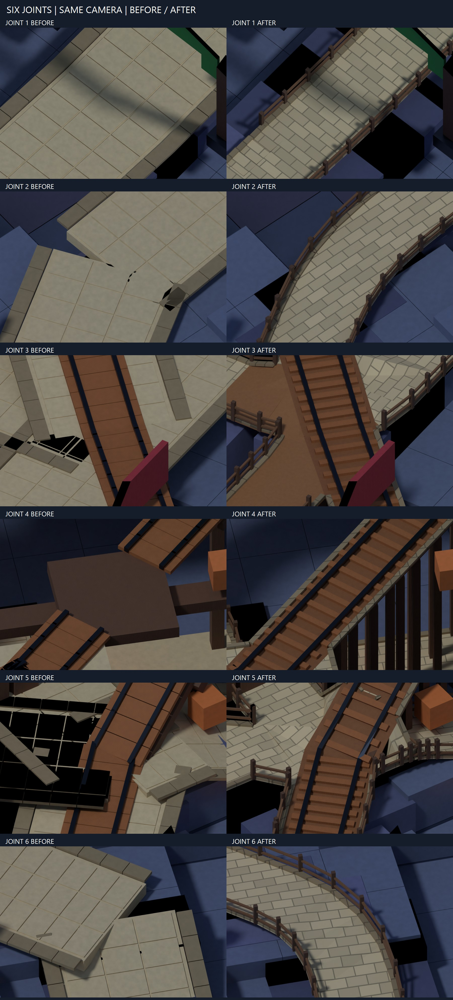

# Cave V2 — connection + path

Built in [cave-v2.rbxl](../cave-v2.rbxl). Owner-reported: paths/fences felt disconnected; round-3 shape was better; textures needed improvement. Checked the round-2/round-3 documents and render, current balance build, native builder, materials and route/collision auditors before editing. The final appearance is judged in Studio; Studio appearance and runtime remain UNKNOWN.

```text
BEFORE: unconnected 22 | gaps 22 | overlaps 503
AFTER:  unconnected  0 | gaps  0 | overlaps   0
KEEPER: clearance 0 | unreachable 0 | headroom 0 | cart 0 | flight 0 | fall 0 | floor 0 | floating colliders 0
```

These are measured static counts, not a Studio acceptance. The before count tests 532 original path/rail beam ends against the nearest compatible saved OBB; overlaps count endpoint penetrations over 0.05 stud. The after audit tests fitted surface/rail contour vertices and fence mating outlines, polygon intersections, and trestle foot contacts. Designed interfaces use 0.0001-stud tolerance; exported facet vertices use 0.001 stud after minimum-size normalization, well below the requested 0.05-stud excess-overlap limit. Fixture seating and all part-depth intersections are not exhaustively audited. The two methods are disclosed because a before center-contact estimate must not be presented as an exhaustive before profile measurement. The old build has no remaining tall fence rails; its fence-end count is zero. Accepted invisible collision-floor overlaps remain deliberately unchanged and are outside the visible-joint target.

## Shape and reference comparison

| Reference | Checked evidence | This round |
|---|---|---|
| Round-3 cave | Inspected `build-rr3-final-concept.png`, ROUND2.md and ROUND3.md. Winding strips hug the terrain; repeated paving/rail decorations do not establish flush joins. | Retain route centerlines; 12-stud visible strips, curved corner pieces, junction trimming and bright tan stone. |
| Current balance cave | Inspected saved binary/manifest and six-view sheet. Wide flat slabs are readable but appear like roads laid across the mine. | Preserve the readability colour; remove visible 18-stud slabs and independent paving/edge fragments. |
| [Deep Rock Galactic: On-site Refining](https://deeprockgalactic.wiki.gg/wiki/Refining) | Chosen best-in-class **connection benchmark for this round**. Documentation describes linked segments supported on ground, limited slope and clearance. No claim of having played it in this session. | Shared profiles, explicitly named next segments, continuous rail heads and ground-reaching supports. This is a design inference from the documented pattern, not copied geometry. |
| [Mining Simulator 2](https://www.roblox.com/games/9551640993/Mining-Simulator-2) | Verified Roblox listing; used as a genre reference only. No claim of inspecting its live path kit or borrowing its art. | Keep the mine's cyan/violet crystals and readable destination colours. |


## Built modules

- Path kit: shared end profiles; quadratic corner pieces; convex clipping at junctions; native WedgePart tessellation rather than overlapping rectangular overlays. Raised stone edging on exterior boundaries. The camp, portal, pit, siding and landing pads are retained as destination surfaces.
- Climbs: 4-stud stair strips beside 8-stud ramps on long main-route climbs, with fitted treads and real vertical riser faces. Junctions use continuous ramps. Original collision ramps are retained under the visual stair strip; this pass does not certify Studio foot placement on those stairs.
- Fences: one post/two-rail recipe along exterior edge splines. Shared corner posts; complete board profiles trimmed against the post footprint, including diagonal corners. Through-junction dividers are suppressed. Rails are noncolliding art, like the previous decorative infrastructure.
- Cart: two continuous mitered Metal rail heads, individual WoodPlanks sleepers, a fitted timber deck and stringers, and 126 ground-ray-fitted trestle legs. Each leg's saved foot names its exact accepted ground/support or fitted skin target. Terminal profiles meet metal end plates. Track deck footprints take priority over nearby paving so stone cannot bury a rail.
- Breakable span: matching deck, rails and legs span the original 16-stud breakable interval in the closed state. A separate cosmetic script follows the existing span's CanCollide state; it changes no route, speed, timing, hook or original gameplay source. The original wide floor/beam stay invisible collision carriers under the fitted kit. Broken-state visibility requires a Studio check.
- Supports: visible top-course skins sit below rounded ramps where accepted support colliders would poke through the paving. The original support collider volumes are retained exactly. Cliff/mountain geometry and crystal geometry/colours remain unchanged.

Materials are saved as Roblox enum values: Slate/Basalt/Rock on cliffs; Cobblestone on paths; WoodPlanks on timber; Neon with Glass facets on crystals; Metal on rails. Colours and crystal geometry remain matched to the balance build. Material choices were checked against [Roblox materials documentation](https://create.roblox.com/docs/parts/materials). Offline previews use repeating world-scale cobble/grout, wood grain and rock-grain textures with roughness/bump, plus metal/glass approximations. These textures are preview proxies, not Roblox's exact shaders.

## Evidence

- [Joint audit](CONNECT-AUDIT.json), [all saved path/rail/fence/trestle contacts](CONNECT-ENDS.json), [before end ledger](CONNECT-BEFORE-ENDS.json).
- [Stair ends and graph check](CONNECT-RISERS.json): 172 riser ends, zero unmatched profiles; one connected surface component. Analytic barycentric checks include branch edges meeting inside larger deck faces, with explicit zero-gap T-contact profiles. The cart landing also has saved sleeper contacts.
- [Native check](CONNECT-NATIVE-CHECK.json): unchanged collision geometry, route dictionaries, native hook attributes and all existing gameplay sources; ten scripts compile. Native/render transforms agree within 0.0001 stud; material/transparency values are also checked.
- Export normalization: 36 decorative facets had at least one dimension below Roblox's 0.001-stud visual minimum. The exporter raises only those dimensions; largest change is 0.00098922 stud. All new native dimensions now satisfy the engine limit. [Roblox Size documentation](https://create.roblox.com/docs/reference/engine/classes/BasePart) distinguishes visual size from the 0.05-stud physics minimum; the new kit is noncolliding art.
- AUDIT.json and STRUCTURAL-AUDIT.json were rerun this round. Their eight hit/unreachable counts are zero; mountain collider components remain one. The audits are sampled static geometry checks, not continuous physics.
- [Six-view comparison](CONNECT-SHEET.jpg), [six same-camera joint comparisons](CONNECT-JOINTS.jpg). Every view is generated from the saved native-part manifest. The top view has no coloured route overlay obscuring joints.

Joint crops below are actual close renders at identical cameras, not paintovers: 1 main lower climb/entry; 2 main bend; 3 crosslink/rail junction; 4 breakable span; 5 lower rail/bypass; 6 upper cave bend.



## Blind review

R1: **FAIL**, connection 4/10; benchmark look 6/10 PARTIAL. The independent critic inspected only the seven primary/reference images and six joint crops. It found a fence crossing the rail corridor, paving hiding a rail, and a black seam across the upper bend. Historical evidence: [R1 review](CONNECT-CRITIC-R1.md), [upper seam](connect-r1-joint-6.png), [buried rail](connect-r1-joint-5.png). Those images describe the earlier build, not the final one.

Corrections: post-ended openings at cart crossings, priority timber track footprints, fitted visible support skins beneath rounded ramps, triangulation after each polygon cut, and corrected inward-facing wedge normals in the offline renderer. Both before and after are re-rendered with the same corrected renderer. Static zero counts alone did not establish a visually connected result.

R2: **PARTIAL**. Fresh blind critic: pedestrian continuity **8/10 PASS**, fences **8/10 PASS**, rails/bridges **7/10 PARTIAL**, benchmark appearance **7/10 PARTIAL**. [Final review](CONNECT-CRITIC.md). It inspected all seven broad/reference images and six joint crops without code, previous reviews, audit counts or a target verdict. Rails read continuous; remaining concerns are crowded sleepers/paving tips at joints 3/5 and a darker, sparser presentation than the reference. The suspected top-view slit was not established as a confirmed gap. This is a delivered connection round, not a fully accepted visual result. Visual inference does not certify the joint audit or Studio appearance. The subsequent sub-0.001-stud export normalization leaves the reviewed layout/materials unchanged; the final deliverable is re-rendered afterward.

## Reproduce and limits

From the production root, use bundled Blender Python for `connect-generate.py`, pinned Lune 0.10.5 for `build.luau 4`, `connect-check.luau` and `tests.luau`, bundled Python for `connect-audit.py` and `connect-riser-check.py`. Blender runs `connect-render.py -- connect-final portal main-eye cart-eye cave-eye far top-routes joint-1 joint-2 joint-3 joint-4 joint-5 joint-6`; `connect-sheet.ps1` composes the pixels. The original before binary/manifest are immutable task snapshots. New baseline capture is only for a new task.

Reused and read the local native builder/renderer/auditors. No external art or source kit was adopted; project code has no newly asserted external licence. NumPy is bundled with the existing Blender Python runtime; no new package installation succeeded. The exact Keystone-titled Roblox Process Playbook was not found in the bounded Pages search or local note paths. The local project PLAYBOOK.md and supplied owner rules were read instead; the Keystone note is not claimed read.

All delivery files are in the requested production folder. Desktop is outside the writable root. No publishing, purchase, account, password, commit or external message. Studio physics, stair foot placement, cart boarding/dismount, span visibility, frame time and multiplayer remain UNKNOWN. The increased decorative part count needs Studio profiling before acceptance.

Studio checks: walk the main bends and cave approach, inspect the stair strip beside the preserved ramps, and ride the full cart line. Activate the existing bridge hook; confirm fitted deck/rails/legs disappear with the broken span and return with its reset. Compare materials and lighting at the six saved camera positions before judging the final look.

Lessons:
- When a rail meets a post diagonally, trim its whole profile against the post footprint, because center contact can hide floating corners.
- When clipping changes a polygon, triangulate it before the next height calculation, because collinear leading vertices can misclassify an overlap.
- When a build passes its joint audit, inspect bend crops too, because protected support blocks can occlude fitted paths and rails.
