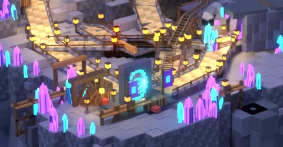
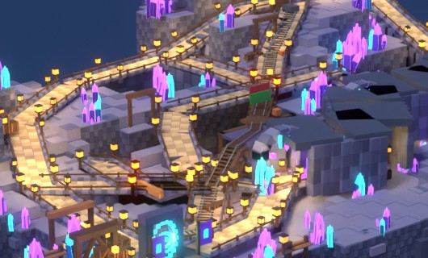
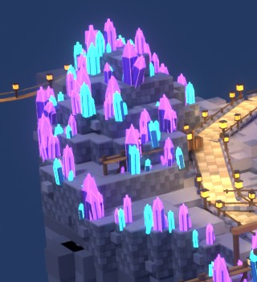
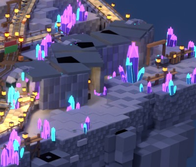
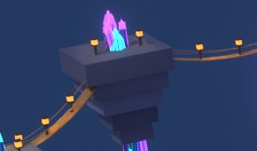
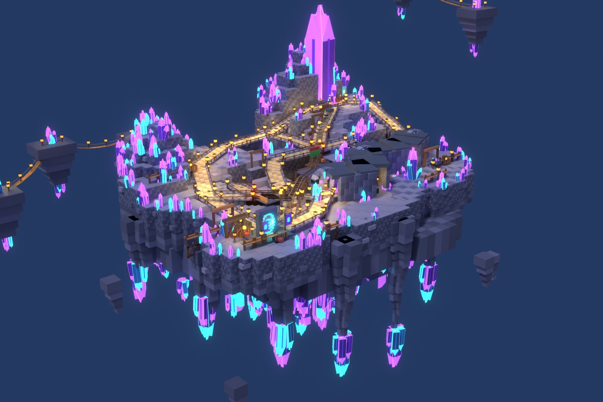

# Cave readability — before changes

Owner-reported: confusing; camera angle suspected. Reviewer-reported: far 3/4 hides paths, cart line and route destinations. Inspected: saved Round3 native-manifest render, builder, art module, route data and collision auditors.

| Confusion cause | Before crop | Gameplay correction |
|---|---|---|
| Portal foreground contains crates, gantries, fences and crystals; no obvious three-way choice. |  | Clear apron; green main banner, yellow cart station, cyan cave arch at actual route mouths. |
| Walkways and rail share brown timber outlines; crossing fences and duplicate trestles form false routes. |  | Continuous light tan cobble and low edges; dark steel on warm rail planks; sparse, aligned trestles. |
| Route shoulder crystals compete with both entrances and destinations. |  | Shift whole gems into cliff corners/faces and underside; retain giant camp crown. |
| Dense lanterns flatten rock and make every shelf equally important. |  | Lift ambient/exposure; directional cool moon; small warm pools confined to routes. |
| Decorative rope bridges imply playable destinations. |  | Remove non-route bridge planks/cables and their lights. |
| Far camera compresses elevation and intersections; tiny landmarks do not explain next action. |  | Closer portal camera, three eye views and colour-overlay top plan; retain far view for mass. |

Constraints: all accepted collider transforms, terrain height/mass, route points, five hook contracts and gameplay sources must remain unchanged; existing static audit hit counts must stay zero. No new external assets/dependencies. Reuse inspected local Lune builder and Blender manifest renderer. Exact Keystone Roblox Process Playbook not found in available local copies/tools; UNKNOWN, not claimed read.

Reference priority: gameplay readability over generated concept-v2.1. Compare before/after side by side. Blind critics receive renders only, no change history or target verdict. A visual inference about three-second navigation is not a measured new-player test. Studio runtime and lighting remain UNKNOWN until checked in Studio.

## Implemented and checked

- Walkable native slabs and continuous cobbles use light tan; low stone edges replace tall fence rails. Rail sleepers are warm, nearly continuous planks with dark steel. Other timber props use muted colours; protected amber hooks retain their original colour and complete dictionaries.
- Removed decorative scaffold decks/gantries, redundant crossing trestles, fences and all non-route rope bridges. The real breakable span, bearing colliders, recovery routes, bypass and cross-links remain.
- Green banner and MAIN / CAMP sign mark the north walkway. Yellow CART STATION marker sits beside the original lower rail mouth. Cyan arch frames the eastbound cave approach. The giant camp crown remains above the route fan. Portal art is smaller and moved within the apron; spawn and floor geometry stay fixed.
- Complete near-route gems move rigidly into cliff/underside space with their native lights. The hero crown remains unchanged. Warm lantern pools are spaced only on routes; removed background/scaffold lamps and reduced crystal light spill.
- Native exposure +0.65; ambient RGB 113/122/149; outdoor ambient 132/143/166; brightness 2.7; moon latitude 35 at clock 0.2. Lower bloom retains crystal glow. Offline cool directional moon and fill approximate these settings; native SurfaceGui labels are approximated from saved panel frames and text.
- Saved closer portal 3/4 at 18-stud camera height, three route-mouth views at 5.5-stud eye height, colour-overlay top plan and the original far camera. Only the top route lines are review overlays; every other object and sign originates in the saved place.

Evidence: [native checks](READABILITY-NATIVE-CHECK.json), [bound evidence](READABILITY-EVIDENCE.json), [six-view sheet](READABLE-SHEET.jpg), [same-camera before/after](READABILITY-BEFORE-AFTER.jpg). Exact collider geometry, terrain height/mass, route dictionaries, hook dictionaries, native hook attributes and gameplay sources match the original readability baseline. Nine native scripts compile. Shared-core idempotence/refusal/place/open/repeat and sloped-slab checks pass. New landmark bodies also pass a sampled walkway-body check, beyond the inherited collider-only audits.

All eight requested static hit/unreachable counts remain zero; mountain collider component count remains one. These checks sample geometry and do not certify continuous Roblox physics, cart dismounts, multiplayer, performance or real new-player timing. Those runtime results remain UNKNOWN. Source/binaries/images are delivered in the explicitly requested prototype folder; Desktop is outside the permitted writable root.

## Blind review rounds

1. [R1](READABILITY-CRITIC-R1.md): FAIL. Portal hid the cart choice; oversized signs blocked destinations; labels missing in the initial offline renderer. Fixed native signage, exported its actual text, reduced/moved portal art and reframed the camera.
2. [R2](READABILITY-CRITIC-R2.md): PASS by visual inference. Main/camp and cave choices read quickly; cart sign/mouth association was weaker and a station post obstructed the eye view. Final correction puts the yellow marker beside the rail start and the support outside both route envelopes.
3. [R3](READABILITY-CRITIC-R3.md): PASS by visual inference. Main banner/walkway, central rails and cyan cave arch communicate three immediate choices. Remaining concerns: cave sign can overlap rail meaning, the cart boarding point is not explicit, posts are prominent and deep cave shadows reduce visibility. No further review rounds after this bound.

Residual limits: accepted collider mass still has regular masonry/stepped silhouettes and dark voids at some crossings. Some hanging gems/background islands look disconnected from player height. Route readability takes priority over restoring the previous decorative density. No Studio screenshot, player timing measurement or performance certification is claimed.

Rebuild with pinned local Lune 0.10.5: `build.luau 4`, `readability-check.luau`, `tests.luau`; bundled Blender Python: `audit.py`, `structural-audit.py`; Blender: `readability-render.py -- r3-final portal main-eye cart-eye cave-eye far top-routes`. Compose with `readability-sheet.ps1 -RenderId r3-final`, then `readability-evidence.py`. The source sheet commands can be evaluated in the current PowerShell session where external script execution is disabled; no execution-policy setting is changed.

Lessons:
- When a camera cannot expose three route mouths, clear or move foreground art first, because framing alone cannot remove an obstruction.
- When a sign marks a route, put its support beside the actual mouth, because colour alone does not establish the connection.
- When art audits exclude noncolliders, check new landmark bodies separately, because a passable post can still hide a route.

Balance follow-up: BALANCE.md records restored magic while protecting readability. READABLE-SHEET.jpg now contains the balance result from the same six cameras. BALANCE-BEFORE-AFTER-01.jpg compares view 01 against the saved readability result. Earlier settings and scores above describe the historical readability pass; current evidence is BALANCE-EVIDENCE.json.
