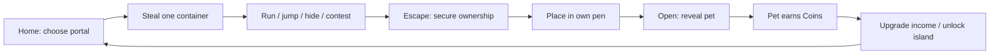
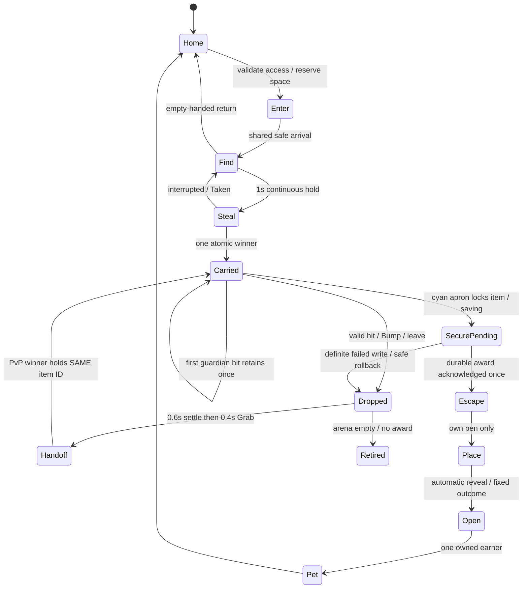
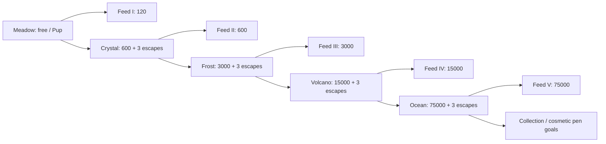

# Steal a Treasure — whole-game plan

2026-10-12. **OWNER DECISION:** evergreen **Steal a Treasure**; Halloween title **[🎃] Steal a Treasure**. Currency: **Coins**.
Planning only. No game-code edits, commit, upload or publication. Tomorrow's order: [BUILD-PLAN.md](BUILD-PLAN.md). Visuals: [REFS.md](REFS.md).

## Evidence and authority

- **CHECKED:** SLICE-V2 (both TikTok sections), ISLAND-V2, ISLAND-PIECES, all five tasks, T1-greybox, v7 concepts/contact sheet, v5 BUILDABILITY, BLUEPRINT text/diagram, Hit Game Bible, TikTok delta b, approved Pup A LEFT/Crow/FX images; prototype mapping and item-rule excerpt.
- **SOURCE-REPORTED:** T1 static/build checks pass; runtime NOT RUN. Side routes measured in its report at 201.65/256.22 studs versus proposed 110–130. Not retested here. Existing dirty work is preserved.
- **OWNER-REPORTED APPROVED:** Pup A, Crow, Rare+ outline/glow/rising sparkles. Generated pictures are concepts; instance real meshes rather than remodelling from pixels.
- **PROPOSED:** every new number, pet variant, guardian, progression, event date, purchase and rule below unless explicitly owner-decided. Arithmetic is modeled, not observed pacing. **UNKNOWN:** Studio feel, retention, device performance, upload rights and owner acceptance.
- Exact Keystone Roblox Process Playbook is unavailable in supplied local sources; local PLAYBOOK.md is a different document. Use supplied greybox, real-art and named-reference rules; no claim the Keystone source was read.
- Latest owner facts and this whole-game scope replace pumpkin-only names, Candy, solo slots, preview-only island 2 and linear/no-jump/no-PvP assumptions. ISLAND-V2 provisional ownership rules remain the foundation.

## Pitch and brief

**“Steal guarded treasure, outrun friends, raise pets that earn Coins.”** Core verb: **Steal**.
Fantasy: one coveted container changes hands during a frantic escape, then becomes a visible earner at home.
Target: desktop, landscape touch and controller; eight-player server, runs playable immediately solo and shared with 4–8 players. Real minimum phone UNKNOWN.
Free existing tooling/assets first. No Store scripts, paid kits, accounts or publication. New meshes need source/rights and script-free hierarchy checks.
Whole-game v1: one safe home, five playable guardian islands, seven container identities including two event overlays, fifteen base pet entries, one Shop, one passive Index.
Tomorrow's minimum complete milestone is **one Meadow loop + PvP + pen opening/income + one upgrade**, judged by Zion before scaling. No promise all five islands finish in one day.

## Core loop

Home has eight **38×28** player pens with eight active pet pads each; PROPOSED **240×192** envelope. Pen centres X=±88, Z=-54/-18/18/54; inward openings, paths ≥12 studs. Shop (0,-72), spawn (0,-12), active portal (0,0). Four compact locked destination selectors fit north of the central portal; only the next price is emphasized. Coordinate tables govern, image compression does not.
PROPOSED same-place island transfers, one arena per island, eight total server players distributed among them; no queues/minimum population. Friends choosing an island share it. Geometry freezes while occupied or provisional treasure exists.
Each arena has exactly **one contested container and one guardian**; after secure escape, nest refills after 3s. Waiting rivals can pursue the next container. No periodic world reset interrupts cargo.
Reserve one collection destination before entry; secure cargo prevents another entry until placed/opened. Full storage refuses entry safely, with an own-pen hint.

## First ten minutes — stopwatch targets, not claims

| Time target | One next action / visible consequence |
|---|---|
| 0–5s | Spawn facing cyan Meadow portal; one arrow/banner; no popup. |
| 5–30s | Enter shared pad, see camp, hold Steal 1s; golden acorn attaches. Pickup is provisional, not owned reward. |
| By30s | Return to cyan boundary through short walking route; durable treasure award secures; own-pen arrow replaces run arrow. Target first **secured** reward <30s from fresh spawn; report provisional pickup separately. Misses fail the Bible gate. |
| 45–120s | Place → automatic 2.2s Open/reveal → guaranteed Common Pup → first actual +1 Coins tick. No separate hatch timer or button. |
| 2–4min | Repeat, reach 120 Coins, buy Feed I; base +1 becomes +2 Coins/s. Five tutorial verbs: Enter / Steal / Open / Upgrade / Unlock. |
| 5–10min | Save 600 Coins and complete three escapes; portal offers Crystal Cave. Permanent access, a real island when built, never a misleading preview. |
| After 10min | Optional Index browsing, replacing active pets and island-specific hazards arrive through world play, one hint at a time. |

Bible audit: core learned systems **5** (run, pen/open, passive income, feed, island access); visible core **6** including passive Index. Optional PvP and hide bring learned count to **7** if encountered, a deliberate exception to default five, within the Bible's broader 5–7 guidance. Do not hide this complexity in counts.
Two HUD menus Shop/Index; two numbers Coins + aggregate Coins/s; carry 0/1 contextual. Four prompt families: portal/access, treasure actions (Steal/Bump/Grab), pen (Place/manage), Shop. Native movement/jump; hide by stopping in a marked socket. No tool hotbar/dash/HP/stamina.
One goal slot, one arrow, zero join/forced-sale popups; optional tutorial Skip. Only one local cooldown/hold indicator shown at a time; no global clock. Deviation from Bible's five-minute clock: continuous shared contest would suffer reset interruptions.
Bible zero-loss/player-theft-later default is deliberately replaced by provisional PvP loss now. Explain once: **“Treasure is yours when you escape.”** Home pets/Coins are safe. First nest pickup gives once-only 12s PvP shield, not ten minutes of exclusive ownership.
PROPOSED uncontested portal→portal 20–45s; full repeat loop through opening 30–60s. Measure both; full-loop Bible 15–45s can fail at far pens/side routes. Fix geometry before promising pacing; contested/failure times reported separately, never averaged away.

## Run state and fairness contract

- Server owns itemID/version, holder, island, outcome seed, first-pickup time/event, mercy, holds, debit and secure/place/open. Client sends intent only; validate type, finite values, proximity, line of sight, state and cooldown.
- Bump: empty hands, same arena, ≤4-stud root distance and ≤3 vertical separation, clear sight throughout 0.4s hold; 2s cooldown even on cancellation. Physical contact alone does nothing. Bump drops; it never grants ownership directly.
- Drop to validated reachable socket within 6 studs; bounded bounce, settle 0.6s, then fresh Grab 0.4s, range≤4. No rolling into void, precharging, exclusive reclaim, reroll or hit income. Simultaneous grabs/hit+Bump accept one transition.
- Every legal hit/pickup grants shared 3s guardian/PvP mercy. First carrying guardian hit before first escape retains once; use flag survives re-entry. Once-only first nest pickup PvP shield 12s or escape; shielded players cannot Bump. Persist use flags safely, never reset them on every Grab.
- Cyan pad + 8-stud apron is safe; three ≥12-wide approaches. Crossing locks cargo in SecurePending, then durable award acknowledgment secures/returns home; no attackable saving wait or safe camping. Reject attacks/discs overlapping safety; airborne rocks cannot damage there. Players cannot body-block.
- Before escape, reset/leave drops on last legal danger socket for rivals; outer fall returns player safely and drops treasure there. Empty arenas retire abandoned cargo without award. After escape, persistent recovery restores the same secured item once; no pre-escape home escrow.
- First nest pickup freezes base roll and event eligibility. Handoffs never change them. At secure return, winner without a first pet gets Common Pup override; temporary holders consume no guarantee. Store final result before presentation.
- Idle carrier outside combat 10s → 2s warning → same-item drop; concealment≤5s, re-hide cooldown3s. Hide socket two exits, 0.5s stillness; guardian searches/sniffs “?”2s, opening poke with clear sight/1.2s tell. Hiding cannot cancel airborne projectiles or lawful rival interactions.

## Islands 1–5 — all entries PROPOSED except container identities

Every island: continuous base, three camp↔pad routes, two cross-links, two ramped hills, optional jumps with recoverable gullies, tall hard cover and two-exit hide socket. Start from implemented 160×160 T1; shorten side walks toward 110–130 studs, quick90–105. Max slope25°, path≥12; walking/carry speed16/15, explicit height-mode jump7.2. Keep carry6.0 disabled until tested. Guardian can follow all summits; no permanent safe perch.

| # / island / container | Guardian + one added mechanic | Pets: rarity, base Coins/s, proposed odds |
|---|---|---|
| 1 Meadow / **golden acorn** | Meadow Keeper, approved-direction straw hat/green apron; learns locked red-disc rock throws, hills/jump shortcuts/hide, basic handoff. | **Pup** Common **1** (70%); **Crow** Rare **4** (25%); **Golden Pup** Epic **8** (5%). First secured item overrides to Pup. |
| 2 Crystal Cave / **geode** | Crystal Keeper, broad rock body/purple crown; **banked throw** off one marked reflector. Telegraph final landing from start; ordinary rocks still stop at other cover. | **Cave Mole** Common **6** (70%); **Crystal Crow** Rare **12** (25%); **Geode Pup** Epic **24** (5%). |
| 3 Frost Peak / **ice crystal** | Frost Keeper, cream/cyan parka/ice arms; **short ice slides** on marked optional route; steer normally, walking snow bypass. No hidden global friction change. | **Snow Pup** Rare **26** (70%); **Frost Owl** Epic **52** (25%); **Aurora Crow** Legendary **104** (5%). |
| 4 Volcano / **magma orb** | Magma Keeper, dark rock/orange seams; **timed vent crossing** on shortcut. One bright red tell≥1.2s, one active vent, permanent safe walking bypass; shares hit/mercy rules. | **Ember Pup** Epic **126** (70%); **Lava Crow** Legendary **252** (25%); **Magma Dragon** Mythic **504** (5%). |
| 5 Ocean / **pearl clam** | Pearl Keeper, cream shell armour/blue scarf; **surge timing** on low optional bridge, wave tells≥1.2s; knockback/drop, no drowning. Dry ramps/bypass always available. | **Shell Turtle** Legendary **626** (70%); **Pearl Pup** Mythic **1,252** (25%); **Tide Dragon** Secret **2,504** (5%). |

Pup/Crow keep approved geometry; colour/costume variants are proposed, not existing approved meshes. Mole/Owl/Dragon/Turtle need new model review. Common green/grey, Rare blue, Epic purple, Legendary gold, Mythic red, Secret black/white; Rare+ bounded outlines/glow/sparkles. Rarity/name/rate visible in home, not through island cover.
Keeper rig and state machine reused, cosmetic shells differ; one enemy archetype, one new hazard per island. Meadow throw8-diameter disc, 1.2s lock→impact, windup interval≥4s, chase0.88×starter carry speed. Later islands keep≥1.2s readability baseline until tested; terrain creates difficulty first. No aim snap/homing after lock, splash through floors or simultaneous windups.
Later island access requires previous island secured escapes≥3 plus Coins. No speed threshold or compulsory luck. Future Standard is optional after three escapes; freeze difficulty server-wide per occupied arena, never per entrant.

## Economy and progression — PROPOSED numbers, Coins only

Eight active income pads per player; all opened pets persist in collection (initial cap64), only active pads earn. Before full active pen, placement uses reserved empty pad; afterward owner picks one active pet to archive and places cargo, same pen prompt family, no deletion/forced sale. Block runs only when active+collection cannot accept another pet. At collection64 show a manual non-first-session release flow with explicit confirmation; protected favourites/last pet cannot release. No auto-release, cash payout, trade or fuse.
Rates tick once per online second server-side; unopened cargo/reveal waiting and offline time earn0. Open commit creates pet once, then ticks; skip changes only presentation. Owned pets persist after events. No Coins for theft, Bump, Index, login, quest or holding.

| Purchase | Cost / effect | Payback calculation and condition |
|---|---|---|
| Feed I | **120**; fixed **+1 Coins/s** on assigned lowest-ID first Pup; once | 120/1 = **120s incremental**; one Pup becomes2/s. If absent, block purchase with clear reason. |
| Feed II | **600**; fixed **+5 Coins/s** on that pet; after Crystal unlocked | 600/5 = **120s incremental**; cumulative bonus6. |
| Feed III | **3,000**; fixed **+25 Coins/s** on that pet; after Frost unlocked | 3,000/25 = **120s incremental**; cumulative bonus31. |
| Feed IV | **15,000**; fixed **+125 Coins/s** on that pet; after Volcano unlocked | 15,000/125 = **120s incremental**; cumulative bonus156. |
| Feed V | **75,000**; fixed **+625 Coins/s** on that pet; after Ocean unlocked | 75,000/625 = **120s incremental**; cumulative bonus781. Protect upgraded pet from release; bonus dormant if archived. |
| Crystal access | **600**; permanent, after3 Meadow escapes | First floor6 replacing Meadow floor1: Δ5 → **120s**; before first recovery Δ0, so acquisition delay is additional. |
| Frost access | **3,000**; after3 Crystal escapes | Floor26 replacing Crystal floor6: Δ20 → **150s** plus acquisition. |
| Volcano access | **15,000**; after3 Frost escapes | Floor126 replacing Frost floor26: Δ100 → **150s** plus acquisition. |
| Ocean access | **75,000**; after3 Volcano escapes | Floor626 replacing Volcano floor126: Δ500 → **150s** plus acquisition. |

Gate payback assumes replacing an unupgraded floor pet from previous island, or an empty slot (faster); never replace upgraded first Pup for that comparison. If player has a lucky stronger roster, gate return is collection/variety, not guaranteed income advantage. Costs rise×5; floor increments rise×5; no false claim of×10 zone growth.
Gate savings at a stated baseline: 600/4=150s; 3,000/20=150s; 15,000/100=150s; 75,000/500=150s. These are time-to-afford examples, **not incremental paybacks**. Real roster, competition and purchases change them.
Floor first-session model (not runtime): one Pup/sec earner by60s, one additional Pup each60s, no luck; cumulative gross at180s=180, spend120 FeedI then +1/s; by300s gross720 minus120=600 for Crystal. Three escapes satisfied; humans may take longer. Test actual lower-income/contested routes, no debug grants. One contested container makes every novice earning by120s unproven: run eight fresh novices together and report each pickup/secure/earner and losers, not just the first winner. If it fails, shorten routes/refill first; no fake free pets or false timing compliance.
Free cosmetic Boots after3 Meadow escapes, no movement bonus; all competitors retain same speeds. Faster earnings are visible home progression, never stronger attacks/shields. Repeat sinks after all islands: coin-only pen trim/titles, clearly cosmetic, no promised cash payback. No rebirth in v1.

## Events and monetisation ideas — PROPOSED, not enabled tomorrow

One EventConfig overlay, server version/time and tagged visual sockets; same maps/collision/routes/Coins/base rates. Halloween Meadow container swaps to **pumpkin**; Christmas to **present**. Other four island identities remain recognizable, dressed seasonally. No eighth island or second currency.
Suggested Halloween2026 window Oct16–Nov2 UTC; Christmas Dec15–Jan5 UTC: owner-unapproved dates, config values only. Title overlay matches active window; ordinary title returns after expiry.
First nest pickup pins eventId/version/time and container skin; later handoff/escape/open retains that snapshot even after expiry. 10% proposed later rolls receive cosmetic event costume of the rolled pet, same rarity/rate; first guaranteed Pup remains base Pup. No paid rerolls/event stat multiplier; old costumes remain owned. In-flight server overlay stays until arena empties; new steals after expiry cannot earn expired costumes.
Cosmetic gamepass ideas: **Pen Decor Pack** 99 Robux (exclusive fence trim), **Pet Style Pack**149 (optional hats), **Supporter**49 (nameplate). Never add speed, PvP immunity, extra earning slots, better odds or Coins multipliers.
Developer-product ideas: **Celebration Burst**9 (repeatable, bounded home-only FX), **Pen Theme Voucher**29 (one chosen cosmetic skin, duplicates become vouchers). Exact prices PROPOSED; local mock shop only until separately authorized setup. No random paid container, timer skip, recovery fee or pay-to-win revive.
Receipt granting must be server-side, retry-safe by purchase ID; use official [developer-product guidance](https://create.roblox.com/docs/production/monetization/developer-products) when implemented. Shop visible from start; cosmetic offers only after first earner, no unsolicited purchase modal. No claim of revenue from concepts, builds or Robux ideas; received money currently UNKNOWN.

## TikTok-first moments and presentation

| Beat / source anchor | Playable clip requirement |
|---|---|
| Ridge jump→rock near miss / Catastrophic Horse Racing | Carrier, locked red disc and landing remain central in9:16; audible windup/impact, readable muted; no obstacle teleport. |
| Log hide→guardian “?”→rival at exit / Steal and Hide | Two usable openings, HIDDEN text, visible sniff gag; concealment expires, escape still controlled. |
| Bump→bounce→Grab→cyan safety / Steal an Egg clarity + shared twist | Same item visibly changes hands, 0.6s settle, no cash-on-hit; both players can react. |
| Acorn cap pops→Pup rarity burst / PS99 + Package-A-Pet | 2.2s max, real name/rarity/Coins/s; “tap to skip” every reveal frame; skip/reduced motion restores control. |
| Event container swap / supplied TikTok delta | Same shot/route, pumpkin then present; costume reveal gives new clip topic without a new tutorial. |

Moment stingers for steal, drop, escape and rare reveal; distinguish nearby danger from UI purchase sounds. One bold banner, bounded landing dust/shake, no forced camera lock during competition. No replay system v1; Clipper takes actual recordings, no posting authorized.
PROPOSED art: broad colour-separated meshes, native seven-material contract from v5, cyan daylight, modest Neon/local lamps, chunky silhouettes. No painted world illumination, micro foliage or depth blur. Target active effects≤120 live sprites in crowded scene; actual performance UNKNOWN until measured on chosen phone.

## Carry-over and build evidence

- **Reuse inspected prototype:** greybox.project.json, GreyboxConfig, Layout, LootRules, Arena, server/client adapters, LoopTest/check. It already models shared arena/hills/throws/Bump/drop/safe secure/place; no actual pet/income/save implementation yet. First fix long routes and run the existing gates, never overwrite unrelated dirty files.
- **Reuse approved art:** actual Pup A hierarchy/mesh, Crow Blender/FBX, rarity effects reference; old pumpkin mesh becomes Halloween container only. Hollow golden acorn is new focal asset. v7 Meadow Keeper is proposed art, not an approved/imported working rig.
- **Source-reported production donors:** giant Patch load/save/session-lock/retry, pens, tween/viewport/FX utilities; inspect actual current code/rights before copying narrowly. Preserve real saves/legacy IDs; isolated TreasureQA schema first. No second concurrent legacy main loop.
- Disable old smash/Candy/scythe/King/raid/quest/sell/fuse/offline/pass grants in new assembly. Preserve source history and real profiles. Profile schema: Coins, collection pets/active slots, pending secured cargo, unlocks, feed target/levels, first flags, schemaVersion/session owner.
- Secure persistence: boundary entry CAS-locks same item into SecurePending/winner; freeze final outcome once and write pending award into winner's session-owned profile under same itemID. No nest refill, rival Grab, home transfer, Open or success toast before acknowledgment. Retry unknown writes under same ID; verified existing award deduplicates. Definite failed/no-write rolls back to legal danger socket after warning; ambiguous write remains locked for reconciliation. Disconnect never gives that uncertain item to another winner. Crash after durable write recovers once on load; crash with no durable write awards nothing and was never an acknowledged escape. Do not promise RAM survives shutdown; failed storage blocks acceptance. Test both crash windows/repeated requests in isolated data.
- Existing prototype/generated concepts introduce no external kit/code licence dependency. User approval of visual refs is not asset permission evidence. Actual approved mesh paths/IDs and provenance recorded at intake; no copyrighted comparison frames shipped as game art.
- Named reference bar: **Steal an Egg** guarded objective, **BGSI** hub/portal, **PS99** reveal; **Steal and Hide** hide beat and **Catastrophic Horse Racing** anticipation. Compare matched shots side by side; these are supplied offline studies, not current popularity claims.
- Acceptance stays split: static/build, Studio solo, real2/4/8 clients, visual critic, owner10min, real-device. Exact Keystone text, independent runtime verdict, fun and phone pass remain UNKNOWN. One Meadow + one pen + one reveal is owner gate before four more islands.

Lessons: When treasure changes hands, conserve one ID because pickup is provisional. When new terrain is added, time real carrying paths because bounds checks miss long detours. When title/events change, keep the economy stable because seasonal cosmetics should not fragment progression.
