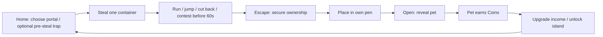
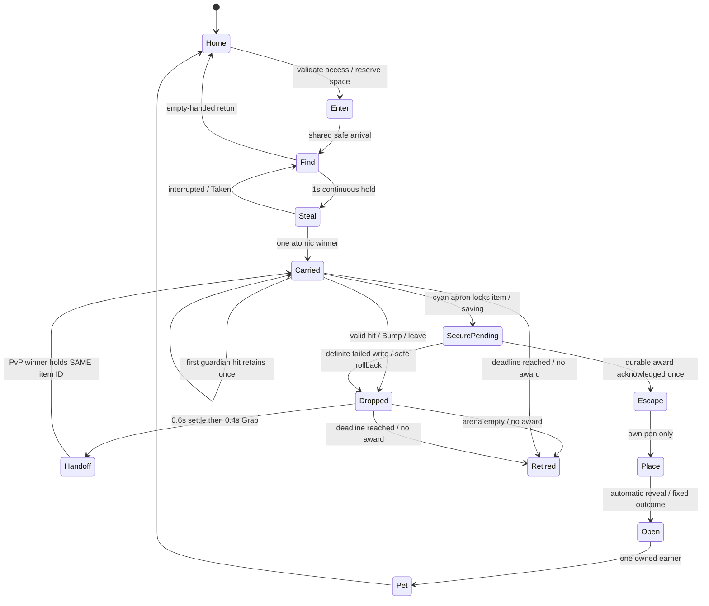
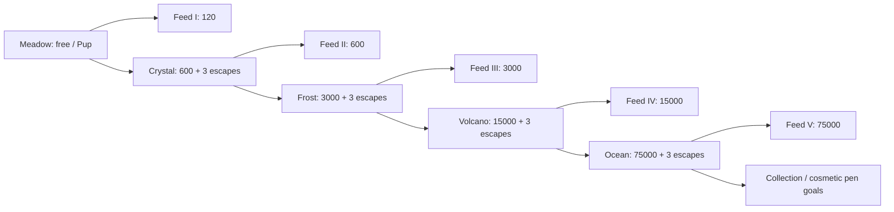

# Steal a Treasure — whole-game plan

2026-10-13 owner brief, revised 2026-10-12. **PROPOSED arena revision:** [ARENA-1013.md](ARENA-1013.md). **OWNER DECISION:** evergreen **Steal a Treasure**; Halloween title **[🎃] Steal a Treasure**. Currency: **Coins**.
Planning only. No game-code edits, commit, upload or publication. Original preserved byte-for-byte as [GDD-v1.md](GDD-v1.md). This GDD and arena supersede conflicting hide/pad/timer rules in [BUILD-PLAN.md](BUILD-PLAN.md), ISLAND-V2 and v2/CHANGES; those files remain historical and untouched. Visuals: [REFS.md](REFS.md).

## Evidence and authority

- **CHECKED THIS REVISION:** original GDD, full BUILD-PLAN, v2/CHANGES and all five v2 PNGs; production/slice-v2/ISLAND-V2; external refs Bible and TikTok delta b; prototype LootRules excerpt; Roblox production skill/gates. Requested workspace refs/TIKTOK-DELTA-2026-10-12b.md is absent; actual source is C:/dev/codex-lab/refs/TIKTOK-DELTA-2026-10-12b.md. Prior checked-source claims below belong to v1, not fresh re-verification.
- **OWNER-REPORTED:** six 1013 ideas in arena. **PROPOSED:** three independently submitted document takes merged by judge; no owner acceptance yet. **UNKNOWN:** all new runtime, fun, phone and pacing outcomes. No gameplay tests run for this document revision.

- **CHECKED:** SLICE-V2 (both TikTok sections), ISLAND-V2, ISLAND-PIECES, all five tasks, T1-greybox, v7 concepts/contact sheet, v5 BUILDABILITY, BLUEPRINT text/diagram, Hit Game Bible, TikTok delta b, approved Pup A LEFT/Crow/FX images; prototype mapping and item-rule excerpt.
- **SOURCE-REPORTED:** T1 static/build checks pass; runtime NOT RUN. Side routes measured in its report at 201.65/256.22 studs versus proposed 110–130. Not retested here. Existing dirty work is preserved.
- **OWNER-REPORTED APPROVED:** Pup A, Crow, Rare+ outline/glow/rising sparkles. Generated pictures are concepts; instance real meshes rather than remodelling from pixels.
- **PROPOSED:** every new number, pet variant, guardian, progression, event date, purchase and rule below unless explicitly owner-decided. Arithmetic is modeled, not observed pacing. **UNKNOWN:** Studio feel, retention, device performance, upload rights and owner acceptance.
- Exact Keystone Roblox Process Playbook is unavailable in supplied local sources; local PLAYBOOK.md is a different document. Use supplied greybox, real-art and named-reference rules; no claim the Keystone source was read.
- Latest owner facts and this whole-game scope replace pumpkin-only names, Candy, solo slots, preview-only island 2 and linear/no-jump/no-PvP assumptions. ISLAND-V2 provisional ownership rules remain the foundation.

## Pitch and brief

**“Steal guarded treasure, outrun friends, raise pets that earn Coins.”** Core verb: **Steal**.
Fantasy: one coveted container changes hands during a frantic escape, then becomes a visible earner at home.
Target: desktop, landscape touch and controller; eight-player server, runs playable immediately solo and shared with 4–8 players. Real minimum phone UNKNOWN.
Free existing tooling/assets first. No Store scripts, paid kits, accounts or publication. New meshes need source/rights and script-free hierarchy checks.
Whole-game v1: one safe home, five playable guardian islands, seven container identities including two event overlays, fifteen base pet entries, one Shop, one passive Index.
Tomorrow's minimum complete milestone is **one Meadow loop + PvP + pen opening/income + one upgrade**, judged by Zion before scaling. No promise all five islands finish in one day.

## Core loop

Home has eight **64×48-stud plots**, each with **56×40 usable interior** (4-stud inset) and eight logical active earning slots; **zero fixed pet pads or preset rows**. PROPOSED home **216×320**, plot centres X=±52, Z=-96/-32/32/96. Inward gates12 wide, central corridor40 wide, row gaps16; reserve12×12 inside each gate. Shop(0,-144), first spawn(0,-16), Meadow portal(0,0), four compact locked selectors near Z=144; only next price emphasized. Secure returns arrive at own gate outside reserve, rather than adding a long cargo walk from central spawn. Validate assembly/farthest-plot travel; coordinates govern, generated image compression does not.
PROPOSED same-place island transfers, one arena per island, eight total server players distributed among them; no queues/minimum population. Friends choosing an island share it. Geometry freezes while occupied or provisional treasure exists.
Each arena has exactly **one contested container and one guardian**; after secure escape or expiry retirement, nest refills after3s with a new item ID. Waiting rivals can pursue the next container. The first Steal starts that item's **60.0s escape deadline**; portal usable immediately, no forced60s wait. Drops/handoffs preserve it. SecurePending never expires during saving/reconciliation. No periodic world reset interrupts cargo.
Reserve one collection destination before entry; secure cargo prevents another entry until placed/opened. Full storage refuses entry safely, with an own-pen hint.

## First ten minutes — stopwatch targets, not claims

| Time target | One next action / visible consequence |
|---|---|
| 0–5s | Spawn facing cyan Meadow portal; one arrow/banner; no popup. |
| 5–30s | Enter shared pad, see camp, hold Steal 1s; golden acorn attaches. Pickup is provisional, not owned reward. |
| By30s | Return to cyan boundary through short walking route; durable treasure award secures; own-pen arrow replaces run arrow. Target first **secured** reward <30s from fresh spawn; report provisional pickup separately. Misses fail the Bible gate. |
| 45–120s | Place → automatic 2.2s Open/reveal → guaranteed Common Pup → first actual +1 Coins tick. No separate hatch timer or button. |
| 2–4min | Repeat, reach 120 Coins, buy Feed I; base +1 becomes +2 Coins/s. Five tutorial verbs: Enter / Steal / Open / Upgrade / Unlock. |
| 5–10min | Save 600 Coins and complete three escapes; portal offers Crystal Cave. Permanent access, a real island when built, never a misleading preview. |
| After 10min | Optional Index browsing, replacing active pets and island-specific hazards arrive through world play, one hint at a time. |

Bible audit: initial core learned systems **5** (run, plot/open, passive income, feed, island access); passive Index adds one visible system. Encountered PvP makes6; optional trap planning after three escapes makes7. Free placement belongs to plot management but adds a real interaction; count any separate teaching burden in playtests rather than claim strict five-system compliance. Dedicated hide system is deleted. Initial five tutorial verbs stay Enter / Steal / Open / Upgrade / Unlock; trap hint is deferred, no sixth forced tutorial step.
Two HUD menus Shop/Index; two numbers Coins + aggregate Coins/s; carry0/1 contextual. Initial four prompt families: portal/access, treasure actions (Steal/Bump/Grab), plot (Place/manage), Shop. Unlocked trap placement adds a **fifth contextual family**, explicit Bible four-prompt exception; no permanent HUD button or hotbar. Native movement/jump, ordinary line-of-sight cover; no HIDDEN/crawl/dash/HP/stamina.
One goal slot, one arrow, zero join/forced-sale popups; optional tutorial Skip. One local hold/cooldown indicator. **One shared item clock while provisional cargo exists**, replacing carry-banner text with “Escape · 0:SS”; amber≤15s/red≤5s, bounded enlarged final5s, no centre-obscuring numeral/event clock. One-minute escape window replaces Bible's five-minute reset pattern; no periodic reset interrupts occupied geometry or saved cargo.
Bible zero-loss/player-theft-later default is deliberately replaced by provisional PvP loss now. Explain once: **“Treasure is yours when you escape.”** Home pets/Coins are safe. First nest pickup gives once-only 12s PvP shield, not ten minutes of exclusive ownership.
PROPOSED uncontested portal→portal 20–45s; full repeat loop through opening 30–60s. Measure both; full-loop Bible 15–45s can fail at far pens/side routes. Fix geometry before promising pacing; contested/failure times reported separately, never averaged away.

## Run state and fairness contract

- Server owns itemID/version, holder, island, outcome seed, first-pickup time/event, mercy, holds, debit and secure/place/open. Client sends intent only; validate type, finite values, proximity, line of sight, state and cooldown.
- Bump: empty hands, same arena, ≤4-stud root distance and ≤3 vertical separation, clear sight throughout 0.4s hold; 2s cooldown even on cancellation. Physical contact alone does nothing. Bump drops; it never grants ownership directly.
- Drop to validated reachable socket within 6 studs; bounded bounce, settle 0.6s, then fresh Grab 0.4s, range≤4. No rolling into void, precharging, exclusive reclaim, reroll or hit income. Simultaneous grabs/hit+Bump accept one transition.
- Every legal hit/pickup grants shared 3s guardian/PvP mercy. First carrying guardian hit before first escape retains once; use flag survives re-entry. Once-only first nest pickup PvP shield 12s or escape; shielded players cannot Bump. Persist use flags safely, never reset them on every Grab.
- Cyan pad + 8-stud apron is safe; three ≥12-wide approaches. Crossing locks cargo in SecurePending, then durable award acknowledgment secures/returns home; no attackable saving wait or safe camping. Reject attacks/discs overlapping safety; airborne rocks cannot damage there. Players cannot body-block.
- Before escape, reset/leave drops on last legal danger socket for rivals; outer fall returns player safely and drops treasure there. Empty arenas retire abandoned cargo without award. After escape, persistent recovery restores the same secured item once; no pre-escape home escrow.
- First nest pickup freezes base roll and event eligibility. Handoffs never change them. At secure return, winner without a first pet gets Common Pup override; temporary holders consume no guarantee. Store final result before presentation.
- Idle carrier outside combat10s →2s warning →same-item drop; original deadline keeps running. **No dedicated hide socket, concealment, HIDDEN label, crawl exit, occupancy, re-hide cooldown, sniff or opening poke.** Tall solid geometry blocks real sight/projectiles across all routes. Guardian searches last seen point2s, then patrols without omniscient tracking. Cover creates no immunity; visible rivals can Bump normally.

## PROPOSED 60s escape deadline

Judge interpretation: **escape before60s**, not portal opening after60s. This adds urgency, not a guaranteed minute of running; guardian pursuit/idle-drop and real route tests must establish motion. Owner-only timer question remains in arena. Mandatory60s survival would require revised <30s secure/15–45s loop targets and a fresh arena before implementation.

Server sets item deadline at first completed nest Steal (`now+60.0`), not entry/planning/Grab. Same ID carries deadline/roll/event snapshot through all handoffs, falls, resets and drops. Empty-handed exits always work. Server boundary entry at `now < deadline` atomically locks SecurePending; `now >= deadline` expires. Client clock is presentation only. Durable save acknowledgment still commits ownership; no attackable saving wait. Deadline is suspended while pending/uncertain saving, no expiry/refill/rival award. Definite no-write rollback drops same ID at legal danger socket with retry deadline **max(originalDeadline, rollbackNow + 10s)**, preserving any longer original time; only server-verified definite failure permits the adjustment, never a normal handoff. Ambiguous writes remain locked for reconciliation.

At0 while Carried/Dropped: clear holder/holds, retire unresolved ID with a short dissolve-to-nest cue, award0, remove arena traps, guardian resumes patrol; new nest ID/roll after3s, clock starts only on first Steal. Keep occupants and geometry, no pet/Coins loss, damage, death or forced teleport. Do not recycle expired ID into a fresh roll. SecurePending/secured cargo cannot expire. Empty arenas retire abandoned cargo without award. Existing3s pickup/hit mercy,12s once-only PvP shield and idle10+2s drop remain; late joins see remaining clock, never reset it.

## PROPOSED pre-steal planning traps

Optional **Decoy Bell after three durable Meadow escapes**; **Sticky Patch after Crystal access**, implemented only after Decoy's real two-client gate and one Crystal trial. First run/first earner need no trap. Free choices, identical effect strength for everyone; no paid charge, resistance, Coins cost, power upgrades, crafting, trap shop or hotbar. Unlocks add variety rather than stronger attacks; every route works with zero traps.

Choose one type in existing portal prompt before entry; one free charge/entry, previous active trap removed on re-entry. Placement only empty-handed **before any Steal/Grab that entry**; losing cargo does not reopen planning. One active/player across all arenas; max4/island and8/server. Valid reachable floor within8 studs/clear sight/slope≤10°,6-stud footprint,1s hold,2s visible arm,15s cooldown including cancelled/refused attempts,90s life from placement. Invalid/cancelled placement spends no charge; valid placement spends it. Full arena limit rejects without charge loss. Recall before pickup removes but does not refund charge.

Trap centre≥19 studs from nest and outer protected apron (16 clear +3 radius),≥12 from other traps; exclude spawn, compulsory landing/recovery paths, cross-link junctions, narrow bridges/chokes. Place only on≥18-wide open sections with≥6-stud bypass both sides. No fixed trap sockets, concealed traps, player collisions or body blocking. Remove on owner exit/reset/disconnect/secure escape, arena expiry/retirement or90s. Placement cooldown carries across re-entry and is never reset by charge refill. Server validates membership/entry/type/charge/cooldown/floor/range/limits; client never supplies victim/effect.

- **Decoy Bell:** guardian approaches within6 studs →1.2s rattle tell →2s investigation, one-shot; guardian decoy immunity8s after effect ends. No player effect or hard stun. Defer trigger during committed throw/close-hit windup; do not cancel/retarget a locked projectile.
- **Sticky Patch:** one-shot against unshielded provisional carrier other than owner; ignores guardian/empty hands. Armed disc applies25% speed slow1s (carry15→11.25 studs/s), steering/jumping unchanged. No damage, stumble, knockback, forced drop or ownership/income effect. Respect first-run shield/shared3s mercy; immune contact does not consume it. Successful trigger grants shared3s guardian/PvP/trap mercy, so no slow→Bump/rock chain or stacked slows. Restore configured speed safely on expiry/exit/reset. Cut or defer if real play shows unavoidable loss; never sell immunity.

## Islands 1–5 — all entries PROPOSED except container identities

Every island: continuous base, three camp↔pad routes, two cross-links, two ramped hills, optional jumps with recoverable gullies and ordinary tall hard cover; **zero dedicated hide spots**. Start from existing160×160 T1; shorten side walks toward110–130 studs, quick90–105. Max slope25°, path≥12; walking/carry speed16/15, explicit height-mode jump7.2. Keep carry6.0 disabled until tested. Guardian follows all summits; no permanent safe perch.

| # / island / container | Guardian + one added mechanic | Pets: rarity, base Coins/s, proposed odds |
|---|---|---|
| 1 Meadow / **golden acorn** | Meadow Keeper, approved-direction straw hat/green apron; locked red-disc throws, hills/jump shortcuts/rock cutbacks, basic handoff. Optional Decoy after3 escapes. | **Pup** Common **1** (70%); **Crow** Rare **4** (25%); **Golden Pup** Epic **8** (5%). First secured item overrides to Pup. |
| 2 Crystal Cave / **geode** | Crystal Keeper, broad rock body/purple crown; **banked throw** off one marked reflector. Telegraph final landing from start; ordinary rocks still stop at other cover. | **Cave Mole** Common **6** (70%); **Crystal Crow** Rare **12** (25%); **Geode Pup** Epic **24** (5%). |
| 3 Frost Peak / **ice crystal** | Frost Keeper, cream/cyan parka/ice arms; **short ice slides** on marked optional route; steer normally, walking snow bypass. No hidden global friction change. | **Snow Pup** Rare **26** (70%); **Frost Owl** Epic **52** (25%); **Aurora Crow** Legendary **104** (5%). |
| 4 Volcano / **magma orb** | Magma Keeper, dark rock/orange seams; **timed vent crossing** on shortcut. One bright red tell≥1.2s, one active vent, permanent safe walking bypass; shares hit/mercy rules. | **Ember Pup** Epic **126** (70%); **Lava Crow** Legendary **252** (25%); **Magma Dragon** Mythic **504** (5%). |
| 5 Ocean / **pearl clam** | Pearl Keeper, cream shell armour/blue scarf; **surge timing** on low optional bridge, wave tells≥1.2s; knockback/drop, no drowning. Dry ramps/bypass always available. | **Shell Turtle** Legendary **626** (70%); **Pearl Pup** Mythic **1,252** (25%); **Tide Dragon** Secret **2,504** (5%). |

Pup/Crow keep approved geometry; colour/costume variants are proposed, not existing approved meshes. Mole/Owl/Dragon/Turtle need new model review. Common green/grey, Rare blue, Epic purple, Legendary gold, Mythic red, Secret black/white; Rare+ bounded outlines/glow/sparkles. Rarity/name/rate visible in home, not through island cover.
Keeper rig and state machine reused, cosmetic shells differ; one enemy archetype, one new hazard per island. Meadow throw8-diameter disc, 1.2s lock→impact, windup interval≥4s, chase0.88×starter carry speed. Later islands keep≥1.2s readability baseline until tested; terrain creates difficulty first. No aim snap/homing after lock, splash through floors or simultaneous windups.
Later island access requires previous island secured escapes≥3 plus Coins. No speed threshold or compulsory luck. Future Standard is optional after three escapes; freeze difficulty server-wide per occupied arena, never per entrant.

### PROPOSED signature arrivals and surrounding art

Every arrival32×24 with8-stud protected apron, three≥12-wide approaches inside base. Themed shells open on front/back/sides, at least two12-wide exits, third approach outside shell; never force all returns through one cave/igloo door. See objective landmark within20 studs of walking. Same safe boundary instantly attempts secure; no required spawn jumps.

| Island | Signature spawn | Required themed decoration / cosmetic weather |
|---|---|---|
| Meadow | Open orchard gate/pergola at cyan arch, oak/windmill beyond acorn | Three orchard islets, windmill, waterfall, chunky oak canopy; open split timber/tall rocks; light leaves/clouds. |
| Crystal Cave | Cut-geode cave chamber open front/back/sides, nest beyond cave mouth | Three crystal-spire islets, split geode backdrop, cave ribs/stalactites outside paths, one reflector, glowing seams; sparse crystal dust/local haze. |
| Frost Peak | Open-front igloo courtyard with broad side arches, glacier framing nest | Three snowy pine islets, glacier/aurora, igloo blocks, snowbanks/flags/marked ice; light snow, no whiteout. |
| Volcano | Cooled-basalt forge shelter/open lava arch, magma camp visible | Three basalt satellites, one smoking volcano, distant lava falls, cooled ribs/forge props/marked vent; sparse ash/embers outside lanes. |
| Ocean | Pearl-shell airlock pavilion inside dry underwater bubble | Bubble radius≥130 around arena; three reef satellites, shipwreck/fish/kelp outside, coral ribs/pearl lamps inside; bubbles/soft caustic colour. Normal dry movement, no swim/breathing/pressure/refraction systems. |

Three distant set pieces +one landmark+one weather layer per arena; scenery beyond bounds≥40 studs from edge, anchored/noncolliding/no reward icons/gameplay scripts. Bubble visual only. Weather off at low settings; proposed≤24 weather particles per viewed arena within≤120 total live scene sprites; device performance UNKNOWN. Cyan exit/red disc/trap ring remain readable. Same one-new-hazard/island progression above; art does not move colliders or add weather damage. Reuse guardian rig/native art modules; one Meadow vista accepted before future island kits. Distinct silhouettes, not five colour swaps.

## Economy and progression — PROPOSED numbers, Coins only

Eight logical active income slots/player, **not pads**; all opened pets persist in collection64, only active slots earn. Reserve collection capacity before entry; also reserve an active slot when fewer than eight are active, otherwise record an archival-required flag. Reserve no fixed world position. Owner chooses any legal floor point in own56×40 interior: visible footprint preview, optional1-stud snap off by default,15° rotation, model bounds/minimum4×4 footprint,2-stud edge gaps, no overlapping objects or reserved12×12 entrance. Pets noncolliding/anchored with idle animation only; no stacking/platform placement/roaming initially. First hint recommends an available gate-near spot without forcing it. Invalid Place keeps cargo with a reason. Open2.2s at chosen point; move/rotate costs0 and changes no ID/rate/feed. Save pet ID+local X/Z/yaw; map to assigned plot on rejoin. Invalid legacy positions request safe re-placement without loss or loss of earning; never rebuild pad rows.
At eight active, owner explicitly archives one then places/opens new cargo. While carrying secured cargo, the same plot/manage prompt permits moving/archiving pets and moving/removing decor without dropping or consuming cargo; floor crowding never forces reward loss. No deletion or forced sale. Cap16 cosmetic script-free decorations/plot, each≤12×12 footprint/16 height, noncolliding with same bounds/gaps/reserve validation, no income/combat benefit or new first-slice shop. Server validates owner/floor/bounds/overlap/count and duplicate actions; cosmetics cannot duplicate awards. Block runs only when collection cannot accept another pet. At collection64 show manual non-first-session release with explicit confirmation; protect favourites/last/upgraded pet. No auto-release, cash payout, trade or fuse.
Rates tick once per online second server-side; unopened cargo/reveal waiting and offline time earn0. Open commit creates pet once, then ticks; skip changes only presentation. Owned pets persist after events. No Coins for theft, Bump, Index, login, quest or holding.

| Purchase | Cost / effect | Payback calculation and condition |
|---|---|---|
| Feed I | **120**; fixed **+1 Coins/s** on assigned lowest-ID first Pup; once | 120/1 = **120s incremental**; one Pup becomes2/s. If absent, block purchase with clear reason. |
| Feed II | **600**; fixed **+5 Coins/s** on that pet; after Crystal unlocked | 600/5 = **120s incremental**; cumulative bonus6. |
| Feed III | **3,000**; fixed **+25 Coins/s** on that pet; after Frost unlocked | 3,000/25 = **120s incremental**; cumulative bonus31. |
| Feed IV | **15,000**; fixed **+125 Coins/s** on that pet; after Volcano unlocked | 15,000/125 = **120s incremental**; cumulative bonus156. |
| Feed V | **75,000**; fixed **+625 Coins/s** on that pet; after Ocean unlocked | 75,000/625 = **120s incremental**; cumulative bonus781. Protect upgraded pet from release; bonus dormant if archived. |
| Crystal access | **600**; permanent, after3 Meadow escapes | First floor6 replacing Meadow floor1: Δ5 → **120s**; before first recovery Δ0, so acquisition delay is additional. |
| Frost access | **3,000**; after3 Crystal escapes | Floor26 replacing Crystal floor6: Δ20 → **150s** plus acquisition. |
| Volcano access | **15,000**; after3 Frost escapes | Floor126 replacing Frost floor26: Δ100 → **150s** plus acquisition. |
| Ocean access | **75,000**; after3 Volcano escapes | Floor626 replacing Volcano floor126: Δ500 → **150s** plus acquisition. |

Gate payback assumes replacing an unupgraded floor pet from previous island, or an empty slot (faster); never replace upgraded first Pup for that comparison. If player has a lucky stronger roster, gate return is collection/variety, not guaranteed income advantage. Costs rise×5; floor increments rise×5; no false claim of×10 zone growth.
Gate savings at a stated baseline: 600/4=150s; 3,000/20=150s; 15,000/100=150s; 75,000/500=150s. These are time-to-afford examples, **not incremental paybacks**. Real roster, competition and purchases change them.
Floor first-session model (not runtime): one Pup/sec earner by60s, one additional Pup each60s, no luck; cumulative gross at180s=180, spend120 FeedI then +1/s; by300s gross720 minus120=600 for Crystal. Three escapes satisfied; humans may take longer. Test actual lower-income/contested routes, no debug grants. One contested container makes every novice earning by120s unproven: run eight fresh novices together and report each pickup/secure/earner and losers, not just the first winner. If it fails, shorten routes/refill first; no fake free pets or false timing compliance.
Free cosmetic Boots after3 Meadow escapes, no movement bonus; all competitors retain same speeds. Faster earnings are visible home progression, never stronger attacks/shields. Repeat sinks after all islands: coin-only pen trim/titles, clearly cosmetic, no promised cash payback. No rebirth in v1.

## Events and monetisation ideas — PROPOSED, not enabled tomorrow

One EventConfig overlay, server version/time and tagged visual sockets; same maps/collision/routes/Coins/base rates. Halloween Meadow container swaps to **pumpkin**; Christmas to **present**. Other four island identities remain recognizable, dressed seasonally. No eighth island or second currency.
Suggested Halloween2026 window Oct16–Nov2 UTC; Christmas Dec15–Jan5 UTC: owner-unapproved dates, config values only. Title overlay matches active window; ordinary title returns after expiry.
First nest pickup pins eventId/version/time and container skin; later handoff/escape/open retains that snapshot even after expiry. 10% proposed later rolls receive cosmetic event costume of the rolled pet, same rarity/rate; first guaranteed Pup remains base Pup. No paid rerolls/event stat multiplier; old costumes remain owned. In-flight server overlay stays until arena empties; new steals after expiry cannot earn expired costumes.
Cosmetic gamepass ideas: **Pen Decor Pack** 99 Robux (exclusive fence trim), **Pet Style Pack**149 (optional hats), **Supporter**49 (nameplate). Never add speed, PvP immunity, extra earning slots, better odds or Coins multipliers.
Developer-product ideas: **Celebration Burst**9 (repeatable, bounded home-only FX), **Pen Theme Voucher**29 (one chosen cosmetic skin, duplicates become vouchers). Exact prices PROPOSED; local mock shop only until separately authorized setup. No random paid container, timer skip, recovery fee or pay-to-win revive.
Receipt granting must be server-side, retry-safe by purchase ID; use official [developer-product guidance](https://create.roblox.com/docs/production/monetization/developer-products) when implemented. Shop visible from start; cosmetic offers only after first earner, no unsolicited purchase modal. No claim of revenue from concepts, builds or Robux ideas; received money currently UNKNOWN.

## TikTok-first moments and presentation

| Beat / source anchor | Playable clip requirement |
|---|---|
| Ridge jump→rock near miss / Catastrophic Horse Racing | Carrier, locked red disc and landing remain central in9:16; audible windup/impact, readable muted; no obstacle teleport. |
| Rock cutback→impact blocked→rival crosses / replace Steal and Hide log beat | Ordinary sight/impact cover,≥12-wide open passages, carrier stays visible in clip; no HIDDEN/sniff/crawl. Owner rejection overrides the reference hide interaction. |
| Pre-steal Decoy→guardian investigates→carrier changes route / planning hypothesis | One visible trap setup and1.2s tell/2s payoff; no locked-throw cancellation, forced cinematic or extra hotbar. Fun UNKNOWN until played. |
| Bump→bounce→Grab→cyan safety / Steal an Egg clarity + shared twist | Same item visibly changes hands, 0.6s settle, no cash-on-hit; both players can react. |
| Acorn cap pops→Pup rarity burst / PS99 + Package-A-Pet | 2.2s max, real name/rarity/Coins/s; “tap to skip” every reveal frame; skip/reduced motion restores control. |
| Event container swap / supplied TikTok delta | Same shot/route, pumpkin then present; costume reveal gives new clip topic without a new tutorial. |

Moment stingers for steal, drop, escape and rare reveal; distinguish nearby danger from UI purchase sounds. One bold banner, bounded landing dust/shake, no forced camera lock during competition. No replay system v1; Clipper takes actual recordings, no posting authorized.
PROPOSED art: broad colour-separated meshes, native seven-material contract from v5, cyan daylight, modest Neon/local lamps, chunky silhouettes. No painted world illumination, micro foliage or depth blur. Target active effects≤120 live sprites in crowded scene; actual performance UNKNOWN until measured on chosen phone.

## Carry-over and build evidence

- **Reuse inspected prototype:** greybox.project.json, GreyboxConfig, Layout, LootRules, Arena, server/client adapters, LoopTest/check. It already models shared arena/hills/throws/Bump/drop/safe secure/place; no actual pet/income/save implementation yet. First fix long routes and run the existing gates, never overwrite unrelated dirty files.
- **Reuse approved art:** actual Pup A hierarchy/mesh, Crow Blender/FBX, rarity effects reference; old pumpkin mesh becomes Halloween container only. Hollow golden acorn is new focal asset. v7 Meadow Keeper is proposed art, not an approved/imported working rig.
- **Source-reported production donors:** giant Patch load/save/session-lock/retry, pens, tween/viewport/FX utilities; inspect actual current code/rights before copying narrowly. Preserve real saves/legacy IDs; isolated TreasureQA schema first. No second concurrent legacy main loop.
- Disable old smash/Candy/scythe/King/raid/quest/sell/fuse/offline/pass grants in new assembly. Preserve source history and real profiles. Profile schema: Coins, collection pets/active slots, pending secured cargo, unlocks, feed target/levels, first flags, schemaVersion/session owner.
- Secure persistence: boundary entry CAS-locks same item into SecurePending/winner; freeze final outcome once and write pending award into winner's session-owned profile under same itemID. No nest refill, rival Grab, home transfer, Open or success toast before acknowledgment. Retry unknown writes under same ID; verified existing award deduplicates. Definite failed/no-write rolls back to legal danger socket after warning; ambiguous write remains locked for reconciliation. Disconnect never gives that uncertain item to another winner. Crash after durable write recovers once on load; crash with no durable write awards nothing and was never an acknowledged escape. Do not promise RAM survives shutdown; failed storage blocks acceptance. Test both crash windows/repeated requests in isolated data.
- Existing prototype/generated concepts introduce no external kit/code licence dependency. User approval of visual refs is not asset permission evidence. Actual approved mesh paths/IDs and provenance recorded at intake; no copyrighted comparison frames shipped as game art.
- Named reference bar: **Steal an Egg** guarded objective, **BGSI** hub/portal, **PS99/Package-A-Pet** reveal, **Catastrophic Horse Racing** anticipation. **Steal and Hide** documents the now-rejected hide interaction; compare open cutback instead of rebuilding its log. Compare matched shots side by side; supplied offline studies, not current popularity claims.
- Acceptance stays split: static/build, Studio solo, real2/4/8 clients, visual critic, owner10min, real-device. Exact Keystone text, independent runtime verdict, fun and phone pass remain UNKNOWN. One Meadow + one pen + one reveal is owner gate before four more islands.

## PROPOSED greybox changes and acceptance

Next authorized implementation follows [ARENA-1013](ARENA-1013.md), not conflicting older hide/pad tasks. Keep Meadow160×160/camp(0,32)40×40/+4, west hill(-40,12)40×40/+10, east(40,12)40×40/+8, jumps(-32,-28)32×24/floor-3, existing central hard cover/pad(0,-58)32×24/west arch(-24,-58) flush extension. Replace log(40,-24) and bush(56,-36) with open rock/split-timber cover, each former area≤two8×12 pieces6–8 high and≥12-wide through passages; shrink if route/overlap tests fail. Remove hide state/pose/occupancy/poke/Hide test steps; substitute sight loss/2s search/interception/cutbacks. Add deadline and atomic expiry/secure/save-failure tests. B2 replaces home plot geometry and adds free placement persistence, not more earning capacity. Decoy after first earners/three escapes; Sticky at Crystal only after real Decoy acceptance. B3 one Meadow vista/composed plot/approved Pup-Crow/2.2s reveal; later distinct cave/igloo/forge/bubble sections one at a time.

**NOT RUN:** solo first secure<30s/earner<120s; true3D routes and10 live carrying walks; real2/4/8-client unchanged ID/deadline handoff, exact0 tie, storage rollback/reconciliation; trap margin/cap/shield/mercy/nonstack/owner exit/zero-trap routes; concurrent Place/archive/move/rejoin/full storage; portal↔farthest gate≤15s/full repeat30–60s; every novice's times and losses; muted9:16 and selected real phone. Keep static, Studio, visual critic, Zion10min and device verdicts separate. One finished scene then owner check then many; no document arena victory claims.

Owner-only questions, not blocking this document task: **escape before60s or portal opens after60s survival?** Default before60s. **Pets remain where placed or wander?** Default anchored/idle. Both choices require owner verdict before dependent future implementation; see arena for consequences.

Lessons: When owner dislikes a reference mechanic, delete that interaction because a successful reference cannot override their game direction. When cargo changes hands, conserve ID/deadline because refreshed timers invite collusion. When plots grow, separate earning slots from positions because more space should not silently inflate income.
