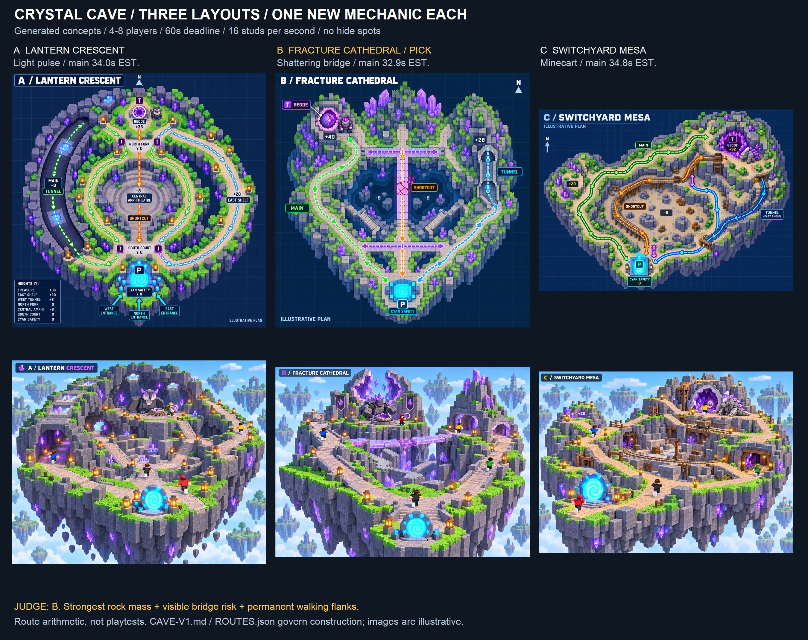

# Crystal Cave v1 — design arena
**Judge pick: B / Fracture Cathedral.** Two massive spires, one readable optional breaking bridge, and two permanent walking flanks. Design recommendation for Zion's review; no owner approval or playable build.

## Evidence and scope
CHECKED: MAP-V3.md, MAP-V4.md, full GDD.md, ROADMAP-TO-LAUNCH.md, HANDOFF-NOW.md; visually inspected v2/meadow-island.png and map-v4/concept.png; read current models/meadow-keeper/ATTACKS.md and animation README, both relevant skills and existing contact-sheet helpers. OWNER-REPORTED via handoff: height and rock mass need priority, tunnel approved as balanced route, no hiding, Keeper art approved. Earlier source reports of Studio tests are not fresh cave evidence.
PROPOSED: every dimension, attack, mechanic, route and effort estimate here. Calculated proposed centreline lengths are arithmetic, not measured walks. UNKNOWN: actual shortest paths, pursuit, fun, clearance, performance, owner acceptance. Exact Keystone Roblox Process Playbook was not found in exposed tools or checked local paths; supplied lessons applied, no claim it was read.
Only this folder contains task-authored project files. No game code edit, commit, build, Studio operation, publication, purchase or message to others. Built-in image generation produced six originals and three blueprint corrections; exact prompts preserved in PROMPTS.json and CORRECTION-PROMPTS.json. Tool-managed originals remain in generated-image storage; final project copies are here. True overhead plans are A/B/C-plan.svg. File paths stay in the requested repo, which overrides the general Desktop preference.
Reuse: v2 voxel language, v4 supported rock mass/ramp practice, existing portal, safety, Bump, Decoy and item rules. Read existing helper code before reusing its contact-sheet pattern. No downloaded kit, third-party code, licensed comparison frame or new asset dependency; generated references are not importable production meshes. Check rights of any future external kit before adoption.

## Three mechanic options — choose exactly one
| Option | What the player learns | Layout | Decision |
|---|---|---|---|
| Crystal light pulse | Follow bright landmark crystals; dim phases obscure distant route signage, never avatars, cargo, floor edges or attack tells | A | Cheapest; modest navigation value, weakest chase payoff |
| Shattering crystal bridge | Commit before cracks finish, or use a permanent flank/recovery floor | B | Pick: visible risk and shared consequence with no new input |
| Mine-cart shuttle | Ride a predictable vulnerable route or take the walk bypass | C | Defer: vehicle replication and interception cost most |

This request replaces the GDD's proposed banked throw for these arena alternatives. **Defer banked throw and Sticky Patch on all three**; do not combine them with the selected environmental mechanic. Existing optional Decoy remains existing Meadow vocabulary, not an additional cave lesson. Three requested guardian attacks form the guardian's replacement repertoire, rather than three new world systems. No new status, HP, stamina, weapon, dash, hiding or economy rule.

## Shared construction and chase contract
Coordinates in ROUTES.json are **(X,Z,Y)**, north +Z, local floor Y0. Documents/coordinates govern; generated diagrams are illustrative and not to scale.
- One guardian, one geode, 4–8 players, 2-second Steal; original same-item deadline starts on completed Steal and expires at60s. Portal usable immediately. Handoff/drop never refresh it.
- Continuous solid land and rock support, deep tapered stone underside. Two substantial ramped hills per layout. Broad mountain bodies first, faceted purple crystal clusters second. Cave roofs are thick rock, not thin floating boards.
- Three complete routes, two cross-links. All paths18 wide; turns/courts28×28. At least20 vertical studs clear above routes, plus actual guardian/cargo swept-envelope verification later. Maximum ramp25°. Minimum horizontal ramp runs: +8=18, +16=35, +20=43, +28=61, +32=69, +36=78, +40=86 studs. Reserve full runs and tangent pads outside tower footprints.
- Ordinary solid cover blocks sight/hits. No dedicated hide spots or immunity in darkness. Each tunnel has two open ends, three skylights,18-wide walkable floor and20 headroom; guardian follows inside. No ranged casts or projectiles inside roofed segments. Only narrow local melee with lateral dodge space; exposed mouths and cross-link courts remain contestable.
- Optional gaps4/6 studs with12×12 landings and shallow reachable miss floors; walk bypass everywhere. Decorative stalactites outside clearances. No lethal fissure or inaccessible dropped geode.
- Portal pad32×24 plus8-stud protected apron =48×40; shell open front/back/sides. Three18-wide approaches stay separate until safety. Rock mass must frame a visible cyan beacon, not seal it.
- Shared guardian attack spacing≥5.5s; each lock tell≥1.2s, one windup at a time, no homing/retarget after lock, cover/floors stop attacks. Existing knock/drop, first-hit retention, shield and3s mercy apply. No hits or attack footprint through cyan safety. These are design requirements, not implemented code.
- Tunnel balance: hard cover costs distance or departure timing; enough room to Bump and pass, no bodies block, no safe interior perch. Mouths/courts are not attack-free zones: ranged attacks can threaten exposed courts and mouth approaches, stopping at roof/rock boundaries; local melee requires a clear lateral bypass and cannot sweep across an entire narrow mouth. This supersedes the earlier blanket24-stud mouth/court exclusion. Measure tunnel against open main with same guardian start and report clean/contested losses separately. C's first tunnel estimate28s was too advantageous; final southern bends extend it to36.3s,1.5s slower than main. The generated plan predates those added bends; C-plan.svg and ROUTES.json include them.

## A — Lantern Crescent
[A true overhead construction plan](A-plan.svg)

**Shape:**384×384 irregular crescent, huge north-west curved mountain/roof, open bowl floor−8, treasure(0,128,+36), east hill(110,−15,+20), west mountain(−100,30,+36). Portal(0,−144,0). Treasure terrace40×40, north roof up to+72 outside lanes. West tunnel runs from(−50,50,0) to(−104,−114,0), via offsets in ROUTES.json; three roof windows make depth and pursuit readable. East shelf remains open. Cross-links at north fork(30,45,0) and south bowl court(25,−82,0), branch to each route without forcing a merge. Main west enters safety(−24,−144); bowl(0,−124); east(+24,−144).
**One mechanic:** crystal lamps globally pulse bright8s/dim4s with2s visible fade. Same phase for everyone, no interaction button. Dim affects distant landmark/sign contrast only; low-level seams, every player/geode silhouette and red tells stay visible. Carrier can pick the open bowl for uninterrupted distant sight. No guardian accuracy change or detection state. If this does not create a real route choice, simplify to permanent crystal lighting and reject A as the new-mechanic island.
| Route | Proposed 3D length (studs) | At16 studs/s |
|---|---:|---:|
| West lantern tunnel / MAIN | 544.7 | 34 s |
| Bowl shortcut | 370.8 | 23.2 s |
| East high shelf | 482.2 | 30.1 s |
**One-line walkthroughs**
- West main: geode → broad north descent → lantern tunnel bends → west apron; dim signage tests route familiarity, guardian follows.
- Bowl: geode → fork → exposed−8 bowl cutback → two-ramp south lip → north apron; fastest, visible to rivals.
- East: geode → fork → +20 shelf → east descent → east apron; view interceptors, give up tunnel cover.
**Guardian: LUX / Prism Owl.** Square basalt owl torso, cream mask, heavy slab wings, violet brow prisms, broad planted feet; no hat/apron. One guardian.
1. **Prism Gaze:** narrow3×28 locked straight eye-beam,1.6s tell/.2s active; sidestep or rock-cover, no ground splash or lob.
2. **Wing Gate:** single5×10 local lateral slab sweep on one side,1.4s tell; go behind opposite wing. No radial slam or moving body.
3. **Floor Stitch:** one3×20 advancing straight ridge from feet,1.8s line tell; cross sideways before it advances, no ring/fan, ridge stops at wall/height break.
In tunnel only Wing Gate, range≤8 and footprint≤5 wide; retain13 clear lateral studs. No sweep across an entire mouth.
**Risk:** light pulse may be cosmetic; camera/roof hides pursuit;34s main leaves26s before deadline for interference. Surface cuts may undercut route budget. Keep skylights, delete excess roof before increasing brightness effects.
**Build cost, estimate:** LOW–MEDIUM relative to this arena; six rock/roof modules, two ramped hills, three paths, one global lighting state and one guardian shell/three animations. No new movement. Animation/runtime work still substantial.

## B — Fracture Cathedral — PICK
[B true overhead construction plan](B-plan.svg)

**Shape:**384×384 triangular connected rock island; massive west treasure tower at(−45,110,+40), east spire hill(110,20,+28). Solid tower bodies roughly88×88 and72×80 before extended ramp skirts; nonwalkable crystal crowns to+76. Broad transverse fissure floor−8. One geode on40×40 terrace. West causeway+8 is permanent. East skylit tunnel floor0 passes through spire rock; entry(35,40) and exit(80,−115), three roof windows. North fork(−45,35,0) and south court(0,−70,0) have links to all branches. Portal(0,−144,0), west/north/east entries as A.
**One mechanic:** **optional18×32 crystal bridge at+8**, centre(0,0), endsZ±16. First footstep arms ALL panels; whole bridge shows the same2.5s cracks countdown, including followers. Crossing32/16=2s leaves only0.5s ideal margin; already-cracking bridge is a risk, never recommended to a late follower. No random collapse.
At warning end panels lose support without damage; shallow floor below at−8 remains ordinary chase terrain. Two18-wide recovery ramps, each rise16/run≥35, leave floor toward opposite banks. Reserve runs along bank rather than under bridge approaches. Proposed recovery add80–112 walking studs ≈5–7s, plus unknown fall/turn delay. Same-item drop sockets always on reachable floor. Rebuild after12s, only when bridge/rebuild volume empty; defer otherwise, never materialize around people. Guardian takes permanent flank while bridge unavailable. A dropped bridge never closes main/tunnel or portal.
| Route | Proposed 3D length (studs) | At16 studs/s |
|---|---:|---:|
| West buttress causeway / MAIN | 525.9 | 32.9 s |
| Fracture bridge shortcut | 407.2 | 25.5 s |
| East skylight tunnel | 569.8 | 35.6 s |
**One-line walkthroughs**
- West main: geode → supported switchback descent → north fork → west buttress turns → west apron; reliable, hard-cover cutbacks.
- Bridge: geode → north fork → crystal approach →32-stud cracking span → south open run → north apron; commit early or take recovery.
- Tunnel: geode → fork → east spire tunnel and skylights → south-east court → east apron; cover costs2.7s versus main, guardian can follow.
**Guardian: FACET / Geode Warden.** Broad basalt tortoise biped with heavy split-geode shell, blunt violet crown, huge square mittens and short feet. Silhouette is a walking rock mass; one guardian.
1. **Facet Ray:** shell prism projects one3×30 fixed line,1.6s tell/.25s active; move laterally or use rock. Stops at bridge/floor geometry, never bounces.
2. **Shear Arm:** planted guardian swings one rectangular forearm across a6×12 lateral strip,1.5s tell; opposite side/rear stays clear. No radial impact or charge.
3. **Quartz Comb:** one4×24 straight ridge travels outward after1.8s locked line tell; exits sideways stay open. One ridge, not three projectiles; no through-wall spikes.
Only reduced Shear Arm inside tunnel:5-wide,8 range,1.8s tell, side space preserved. During cracks, defer only new attacks whose footprint overlaps the bridge or its two recovery ramps; guardian attacks elsewhere continue. If an already locked attack overlaps that area, defer bridge arming until it finishes. Walking on bridge during deferral is safe, costs no hidden countdown. Rival bridge triggers cannot suppress guardian attacks at the treasure or other routes.
**Risk:** late followers can be stranded, first carrier may gain excessive advantage, tunnels can become dominant, huge towers may hide exit. Cyan beacon high in frame, no tall front crystals. Keep warning persistent/muted-readable; recovery clock and follower fairness are highest-priority future tests.
**Build cost, estimate:** MEDIUM; two tower bodies, switchback module, roofed tunnel module, optional3-panel bridge, two full recovery ramps, bridge state presentation/server rules, one guardian shell/three animations. Reuse native rock/portal/ramp language; no asset Store dependency. Fewer physics/replication unknowns than carts.

## C — Switchyard Mesa
[C true overhead construction plan](C-plan.svg)

**Shape:**448×320 elongated diagonal island, northeast mining mesa +32 with thick buttresses/roof rising+64, southwest hill(−125,−10,+20), quarry−8. Geode(100,100,+32); portal(−90,−112,0). North causeway wraps rock shoulders; south tunnel from(65,−70,0) through winding bends to(−150,−140,0), with three daylight cuts and an open final link to west safety. Centrally swooping rail runs above supported ordinary walk route. Cross-links at fork(65,5,0) and lower quarry court(−45,−30,−8); link every branch, no compulsory rails. North main enters(−90,−92); tunnel(−114,−112); cart/bypass(−66,−112).
**One mechanic:** two-seat open minecart on predictable fixed shuttle. Shared visible schedule≤4s departure wait,2s boarding,24-stud/s cruise,1s dismount. No private summon/sprint/weapon/immunity. Players/geode remain exposed, existing hits and Bump validation continue; no cart collision damage. Emergency dismount allowed anywhere onto the parallel supported18-wide walk lane, with validated same-item drop socket. Guardian walks parallel lane; ranged attacks outside tunnel can threaten carriage. Boarding cannot refresh mercy. Fixed route/grade follows walking-bypass polyline; no jump across unsupported quarry.
| Walking route | Proposed 3D length (studs) | At16 studs/s |
|---|---:|---:|
| North terrace causeway / MAIN | 556.2 | 34.8 s |
| South skylight tunnel | 581.2 | 36.3 s |
| Cart walking bypass | 393.5 | 24.6 s |
**Cart estimate:** common approach length is calculated in ROUTES.json vertices1–4; remainder cruises at24. Approach172.4 studs/16≈10.8s plus track221.1/24≈9.2s plus boarding/dismount3s and wait0–4s =≈23–27s. These rounded estimates exclude interruption, network and actual vehicle acceleration.
**One-line walkthroughs**
- North main: geode → mesa descent → north terrace loop → southwest hill skirt → north apron; longest but visible rival approaches.
- South tunnel: geode → quarry fork → south skylit tunnel → west exit bend → west apron; real guardian pursuit, limited distant vision.
- Cart: geode → fork dock → vulnerable scheduled ride → east dock/apron; occupied/missed cart means walk beside rails or switch via quarry link.
**Guardian: BORAX / Quarry Pangolin.** Low broad segmented rock miner, quartz helmet crest, thick rectangular tail, purple shoulder plates and square digging paws; not the Keeper's farmer silhouette.
1. **Survey Ray:** single3×32 forward locked visor ray,1.8s tell; rock and lateral movement stop it. No bank throw.
2. **Tail Bar:** one5×12 rear-side rectangular sweep,1.5s tell; move forward/opposite side, no spinning circle.
3. **Cut Line:** one4×22 advancing straight stone seam,1.8s tell; sidestep, no homing/radial shockwave. Does not move rails/cart colliders.
Tunnel only reduced Tail Bar,5×8,1.8s tell; no rays/seams inside.
**Risk:** transport removes steering and may reduce live theft despite exposure; grief/seat sync, emergency drop, guardian intercept and latency dominate. Cart advantage may be too small after queue; do not solve with immunity or more speed. If contested cart fails, defer C entirely.
**Build cost, estimate:** HIGH; mesa/roof kit, two hills, three paths, two docks, track, seat/shuttle synchronization, hit/Bump/cargo/dismount handling and one shell/three animations. No imported vehicle framework chosen; future reuse must inspect license/code.

## Judge and reference arena
Named best-in-class supplied anchor: **Steal an Egg**, for guarded treasure and obvious escape line; **Catastrophic Horse Racing** for readable anticipation. These are offline reference bars already documented in map-v3/GDD, not fresh popularity research or observed cave comparisons.
| Reference bar | A | B | C |
|---|---|---|---|
| Steal an Egg objective → safety clarity | Crescent roof can obscure cyan | Twin spires frame one exit; three visible crossings | Diagonal goal and docks need strongest signs |
| Catastrophic Horse Racing tell → close call | Light shift is weakest consequential beat | Cracks → commit → floor recovery is visible without audio | Timed departure → rival interception, depends on vehicle feel |
| v4 rock mass/height, not flat paths | Roofed36-high crescent, east20 hill |40-high tower +28 spire, supported ramps, strongest silhouette |32-high mesa +20 hill, longest footprint |
| Tunnel balance / build risk | Covered main34s vs exposed23.2s; may dominate at dim phase | Tunnel35.6 vs main32.9; optional bridge25.5 | Tunnel36.3 vs main34.8 after extending southern bends; cart untested |
| Decision | Art fallback; weak mechanic | **Pick for one future greybox** | Defer vehicle work |

Independent read-only critic checked prompts and references before final doc: provisionally picked B; challenged bridge span/warning, full recovery ramps, light pulse value, cart immunity and similar guardian attack shapes. Those corrections are incorporated. Their original critique was pre-final, not acceptance of the revised plan or images; see CRITIC.md.
**Reasons for B:** clearest consequential one-mechanic choice; stronger vertical rock landmark than A; retains rival interceptions and optional flank choices from Split Valley; lower implementation uncertainty than C. Simplify: one bridge state, three panels, no chain-collapse puzzle, no moving bridges, no bank throw/Sticky, no spectacle in tunnel. Keep A's bright seams as static art in B only; pulsing light would be a second mechanic.
Main clean estimates34.0/32.9/34.8s meet25–35s at16. Contested target is a hypothesis of40–50s, leaving10–20s for the60s deadline; no forced laps or guaranteed outcome. B main leaves27.1s nominal interference reserve. Cross-links and surface cuts may shorten paths; centreline arithmetic cannot certify true minimum travel.

## Next owner gate / lessons
Zion reviews this arena; only B would be greyboxed after authorization for implementation. Future tests:10 clean runs each route at actual carry16, both directions/guardian access, shortest surface cuts, late-follower bridge and full recovery, dropped geode under roof/bridge, 4/8-client same-ID deadline, portrait-muted warning clarity and real phone frame time. Compare matched spawn/steal/escape shots to v2 and v4 side by side before more islands.
1. When a shortcut breaks, size crossing length against its warning because a spectacular collapse still needs reaction margin.
2. When cave cover blocks ranged pressure, add travel cost and melee bypass space because protection must remain contestable.
3. When height increases, reserve ramp runs before decoration because chunky rock mass must support playable routes.
