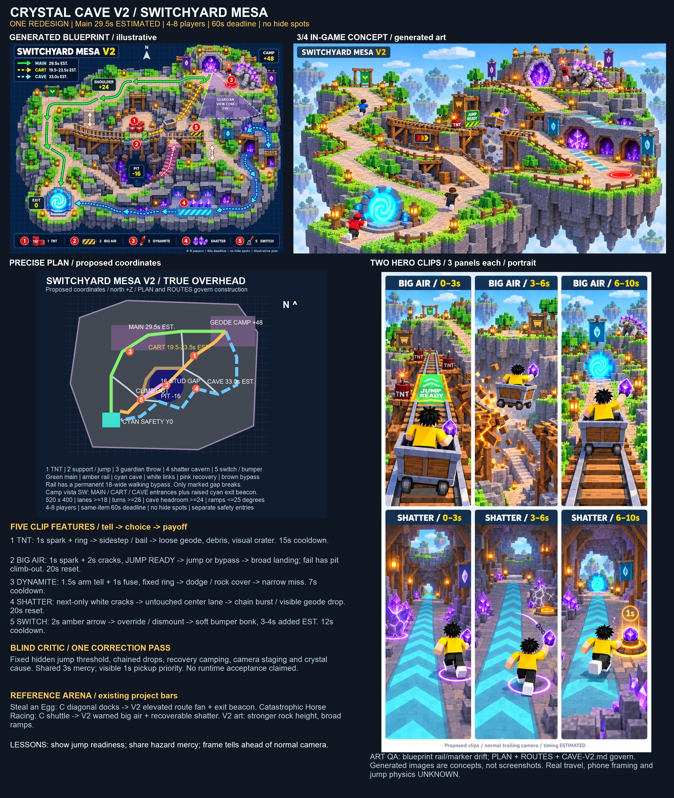

# Crystal Cave v2 — Switchyard Mesa
**One redesign of owner-picked C: higher camp, readable route fan, recoverable big-air cart, and five clip features.** Main escape **29.5 s ESTIMATED**; 4–8 players; same-item **60 s** deadline.

## Evidence and scope
CHECKED: cave-v1/CAVE-V1.md, _sheet.jpg, C-plan.svg, C-concept.png; v2/meadow-island.png; GDD.md and REFS.md excerpts; Roblox production skill/gates; imagegen skill; existing cave-v1/make-sheet.ps1 code. Reuse: C's rock/crystal identity, pangolin guardian, three-route escape, geode, safety and chase rules; v2 chunky voxel style and existing native System.Drawing contact-sheet pattern. No third-party kit/code/art adopted; no new dependency or license claim. Generated concepts are reference art, not importable meshes or gameplay screenshots.
OWNER-REPORTED: owner chose C and wants caves, minecarts, changed layout, TikTok moments and explosions. Prior v1 recommendation B is superseded by this choice.
PROPOSED / INFERRED: every new dimension, mechanic and pacing claim here. UNKNOWN: actual shortest paths, cart trajectory, clearance, network behavior, fun, phone framing/performance. No Studio/build/runtime test; no revenue evidence.
The exact Keystone “Roblox Process Playbook” was not available in exposed tools or checked local active-work/research filenames. The supplied real-art, greybox-first and named-reference rules were applied; no claim the exact note was read.
Only treasure/cave-v2 contains task-authored files. No game code, commit, publication, purchase or messages to third parties. Requested repo destination overrides Desktop preference. Built-in image generation only; exact prompts in PROMPTS.json. Tool-managed originals remain in generated-image storage; all deliverables copied here.

## Layout and first view
520 × 400 connected solid rock island, deep supported underside. Coordinates are **(X,Z,Y)**, north +Z. [PLAN.svg](PLAN.svg), PLAN.png and [ROUTES.json](ROUTES.json) govern geometry; generated blueprint/concept are illustrative.

- **Geode camp:** (160,120,+48), 48 × 48 front terrace. Solid cave facade/crystal crown rises behind it to +80. No tall props within SW viewing cone. From ordinary carrier camera, see west MAIN ramp, center CART dock, east CAVE mouth/sign, plus a cyan exit beacon above foreground rock. View all entrances; the roofed cave interior remains a cave.
- **Height:** camp +48, western shoulder +24, rail jump +24, pit −16, exit 0. Continuous broad ramps, grade ≤25°, no mandatory stairs. A 48-stud descent requires ≥103 horizontal studs, spread across supported turns. Rail has its own proposed vehicle grades; passenger clearance is still UNKNOWN.
- **Main:** north shoulder to west switchbacks; permanent, no forced explosions or breaking track. Optional 18-wide interception court has a separate 18-wide walk flank.
- **Cave:** east descent → two-ended thick-roof crystal tunnel → south bends → west safety approach. Three skylights and ordinary baseline illumination preserve avatars, geode, ground rings and exits. Floor ≥18 wide, headroom ≥24, junctions ≥28. No hiding alcoves, invulnerability, fog concealment or one-way locks. Guardian follows.
- **Rail:** camp dock → central diagonal trestle → TNT court → launch gap → switch court → own safety approach. Permanent ≥18-wide supported walking bypass stays continuous around the gap. Two cross-links connect branches at open courts; bodies never block movement.
- **Safety:** center (−150,−120,0), 48 × 40 protected apron/open portal shell. Main ends at (−150,−100), cave at (−124,−120), cart at (−126,−96), each meeting a different apron edge. No attack footprint, switch punishment or item contest reaches cyan safety.

## Routes and pacing — ESTIMATED
Lengths are 3D polyline arithmetic, **not measured walks or certified fastest paths**. Carry speed assumed 16 studs/s. Escape timing starts after completed 2 s Steal; do not add the Steal duration to the 60 s same-item deadline.

| Route | Proposed length | Clean travel ESTIMATED | Play choice |
|---|---:|---:|---|
| Main north/west | 471.6 studs | **29.5 s** | Reliable height/visibility; permanent footing |
| Cave east/south | 527.2 studs | **33.0 s** | Roof cover costs 3.5 s; local guardian pressure remains |
| Rail walking bypass | 42.4 + 358.3 studs | **25.0 s** | Exposed optional shortcut; track-hazard courts have walk flanks |
| Minecart | 42.4 approach + 332.4 rail | **19.5–23.5 s** | 2.7 approach + 13.8 ride at 24 + 2 board + 1 dismount + 0–4 wait |
| Missed jump recovery | 87.1-stud floor/ramp | **5.4 s walk; 8–10 s total added** | Fall/turn penalties UNKNOWN; recover to lower +8 bypass court, never reset timer |

Rail centerline length includes the gap; flight/acceleration can change real ride time. Main nominal deadline reserve = 30.5 s; cave = 27 s. Contested 40–50 s is only a tuning target. True surface cuts and cross-link shortcuts must be measured before accepting pacing. All proposals retain one guardian/one geode, 4–8 players, immediate portal access, and no hiding.

## Five clip-worthy features
All cooldowns below are **PROPOSED**, counted from payoff. Every damaging event respects shield/mercy and cover; one event arms per connected encounter zone. Cooldowns do not secretly shorten with player count.

| Feature / location | What happens | Telegraph | Counterplay | Cooldown/reset | 10 s portrait framing |
|---|---|---|---|---|---|
| **1 TNT court** near (74,54) | Player holds ignite 0.4 s or guardian dynamite hits barrel; 10-stud blast can knock geode loose. Sparse voxel debris, ≤0.25 s opt-out shake, visual crater; floor collider stays level. Two barrels, one can arm at a time. | **1 s fuse spark**, accelerating tick and persistent 10-stud ground ring; bright even muted. Disabled barrel shows dark cap. | Leave ring, use rock, or emergency-dismount onto adjacent broad bypass. Arming rejected if passenger cannot have ≥1 s escape margin; ignition never instant on hit. | **15 s** per barrel; reset only when blast zone empty. | Normal trailing camera: fuse ahead, rival silhouette, blast and amber item socket within center crop; 0–3 spark, 3–6 burst/drop, 6–10 scramble. |
| **2 Breakable support / BIG AIR** at (0,−25,+24) | Explode marked support: **1 s fuse + 2 s cracks** then one 16-stud track span drops. Permanent launch ramp remains. Green-ready cart follows a fixed proposed jump trajectory to broad ≥24 × 32 landing. Fail: deliberately slow cart drops into reachable pit −16, broad ramp climbs to bypass. | Spark repeats on eye-height launch post; amber cracks, gap-state sign, speed gauge and **JUMP READY** green marker. Fall-safe arrow marks pit recovery. | Walk bypass, brake and dismount BEFORE commitment, or coast at 24 into green marker. Below threshold: red STOP/BAIL pad permits safe exit; continuing after red warning is the explicit fail choice. Once green committed, speed/jump state locks; no input trick or random miss. | **20 s minimum** broken state; repair only with span/flight/recovery volumes empty. Block new launch for whole transition, reopen visibly. Existing flight freezes state. | Same trailing portrait view: warning on far edge ahead, broken span below frame center, landing ahead. 0–3 ready/cracks, 3–6 big air, 6–10 landing with geode. No camera cut required. |
| **3 BORAX dynamite throw** on open courts | One cartoon stick lob to fixed 8-stud blast ring; ordinary knock/drop if unprotected. Throws can ignite ONE legal barrel/support, never detonate immediately or arm extra hazards. | **1.5 s raised-arm lock tell**, landing ring at lock; **1 s fuse after landing** with lit tip/countdown. | Step outside ring or behind solid rock. No homing, through-wall blast, offscreen retarget or cast under roof. | **7 s** minimum throw interval; shared guardian attacks ≥5.5 s apart. | Over carrier shoulder, guardian upper-center, fixed ring beneath runner, lit stick foreground: tell → dodge → narrow miss. |
| **4 Chain-shatter cavern** near (80,−35) | Rival hits marked first crystal using existing Bump contact; guardian local sweep can hit it. Three clusters shatter in sequence. Each local 6-stud pressure ring may knock loose geode; cosmetic shards never hurt. Center lane remains intact. | First cluster **1 s white cracks**; next bursts at +0.8 s and +1.6 s, each warned ≥1 s beforehand. Only NEXT cluster bright; later clusters dim. Cracking floor ring marks each exact footprint. | Take continuous ≥18-wide cyan-striped center lane outside ALL rings; reverse through open mouth or cross-link. Roof stays solid; no rubble closure. | **20 s**; rebuild only when cluster volumes empty. | Trailing camera along skylit tunnel. 0–3 cracks beside runner, 3–6 wave and visible grip-tether snap if runner enters side ring, 6–10 geode in amber socket/recovery. Safe lane never gets hit. |
| **5 Optional switch / bumper comedy** near (−70,−65) | Exposed lever redirects next uncommitted cart to short 24-wide padded dead-end siding; slow soft bonk, then free dismount/walk exit. No cage or injury; adds **3–4 s ESTIMATED**. | **2 s amber arrow** and visible switch blade/bumper; lever identity indicator. | Driver uses approach override during warning or dismounts to bypass. Lever cannot change committed cart; only one cart redirected per activation. | **12 s**; new diversion refused while siding occupied; auto-return after cart clears. | Slightly offset trailing view keeps lever, arrow and bumper ahead of driver; actor cameo on far edge. Pull → turn → bonk and reaction. Secondary clip, weaker than big air/shatter. |

### Shared recovery and cart fairness
One same itemID, no timer refresh on drop, ride, pickup, handoff or pit rescue. Existing once-only first-12-second hit retention/shield takes precedence: a protected blast may show feedback but **must not force a geode drop**. Explosive drop clips depict an unshielded carrier after that window; never promise every blast drops cargo.
Every forced hit/drop starts **carrier-wide 3 s mercy** against ALL guardian, TNT and crystal sources, including adjacent courts. Mercy cannot be bypassed by moving zones. A newly forced drop has 0.6 s settling inside a **1 s visibly amber former-carrier pickup-priority window measured from drop**, then ordinary contested fresh 0.4 s Grab; voluntary drops/handoffs get no priority. This is a proposed addition requiring future owner/playtest evaluation, not an implemented change. Other players can contest after priority; no automatic transfer.
Drop uses reachable floor sockets within 6 studs; on bridge/flight use paired launch/landing sockets, never suspend cargo over void. Preserve ≥1 s pursuit/reaction margin after recovery before arming an overlapping hazard. If protection prevents a hit/drop, spend the hazard normally; never retry immediately.
No damaging guardian/event arming in committed jump/landing envelope until 1 s after landing. Armed nearby blast cannot overlap that reservation; launch waits until it finishes. TNT can change track only before commitment. Seat departure wait ≤4 s, 2 seats, two staggered carts proposed for 8-player capacity; no collisions, no ram damage, no immunity outside flight envelope. Cart availability/queue behavior UNKNOWN. Emergency dismount maps to validated bypass floor; airborne dismount deferred to landing, or pit rescue if failed. All rules need server validation in a future implementation.

## Guardian
**BORAX / Quarry Pangolin**, reused from C: low broad slate body, violet plated shoulders, quartz crest, square paws and thick tail. Dynamite replaces Survey Ray and Cut Line; keep one local **Tail Bar** (1.8 s locked tell, 5 × 8 footprint, leave ≥13 studs lateral escape in cave). Never throw under cave roof. Guardian takes permanent flank around broken span and can pursue down pit ramp; no teleport interception. Guard camp and open junctions; do not camp recovery socket or safety. Only one windup at a time; fixed ground target, solid cover stops blast.

## Blind critic → one correction pass
Independent agent saw only REVIEW-BRIEF.md, without owner choice, original art or creator rationale. Verdict: promising; big air strongest; fun/fairness/clipability unproven. [CRITIC.md](CRITIC.md) retains findings and decisions.
Applied once: speed gauge/green marker plus precommit bail; carrier-wide mercy; visible short pickup priority; shared trailing camera staging; next-only crystal lighting and grip-tether snap. Concept edited once. Storyboard edited once to extinguish unrelated fuses and move struck runner outside safe lane. No independent post-fix acceptance or runtime validation claimed.
Visual QA: inspected every final image and assembled sheet. Generated blueprint uses an oblique overhead-like view, misplaced guardian marker and a rail connection that does not accurately complete to safety; use the precise PLAN/ROUTES instead. It labels the camp view cone “guardian”; interpret it as the camp/carrier viewing cone. Generated cave portals/crystals and storyboard dynamics are art staging, not verified collision. Concept sign/ramps improve readability; gauge, recovery clearance and actual three-route camp vista still require greybox verification.

## Side-by-side reference arena
Existing project named bars, **offline design comparison; no fresh footage or popularity claim**.

| Best-in-class reference bar | Original C | V2 response | Still unknown / simplify |
|---|---|---|---|
| **Steal an Egg**: guarded treasure → visible safe destination | Diagonal geode/docks need strong signs | Camp +48 route fan, cyan beacon, separate safety approaches | Inspect first view at actual camera; delete front crystal props if blocked |
| **Catastrophic Horse Racing**: anticipation → close call → consequence | Scheduled supported ride; no jump payoff | Green-ready support break → big air → landing; shatter → loose geode → recovery | Phone-muted real capture; remove switch first if five features overload learning |
| **Approved v2 art language**: chunky readable authored forms | +32 mesa and purple caves | +48 camp/+24 shoulder, broad supported ramps, thick-roof cavern | Generated art only; future real meshes and core-moment greybox before scale |

## Next evidence gate and lessons
One future greybox slice only after gameplay-work authorization: steal → route decision → support fuse → jump or pit recovery → portal. Measure main 25–35 s, cave cover cost, bypass cuts and every cart state with 4 and 8 clients. Test shielded/unshielded forced drops, late followers, fuse during boarding, cart queue, siding spam, empty-only reset, pit item recovery and camera visibility. Film both hero clips using normal controls, center 9:16 crop, muted and reduced effects. No cinematic camera needed; actual clip success UNKNOWN.

1. When jump success depends on speed, show readiness and a bail lane, because a hidden threshold makes failure feel random.
2. When hazards share a chase, share recovery protection, because local cooldowns cannot prevent chained drops.
3. When a clip needs a warning and payoff, stage both ahead of the normal camera, because a cinematic angle does not prove gameplay readability.
