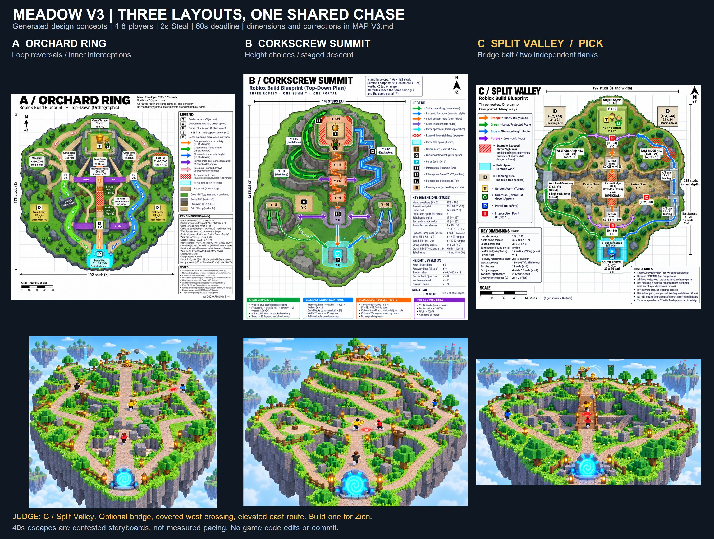

# Meadow map v3 — design arena

**Judge pick: C / Split Valley.** Keep the bridge as an optional high-risk stage, with a covered west causeway and an east hill/jump route. Greybox this one layout for Zion before making variants. This is a design recommendation, not owner approval or observed fun.

## Evidence, scope and authority

- **CHECKED:** `treasure/GDD.md`, `ARENA-1013.md`, `slice-v2/ISLAND-V2.md`; visually inspected both v2 Meadow PNGs and `slice-v2/evidence/sbs-meadow-2.jpg`. Read the supplied TikTok delta at its actual location, `C:/dev/codex-lab/refs/TIKTOK-DELTA-2026-10-12b.md`, and the local `BIBLE-STEAL-AN-EGG.md` study. Workspace `refs/` source is absent. Read Roblox production and imagegen skills.
- **OWNER-REPORTED:** current layout/shape does not look right or fun. The Studio screenshot shows a broad rectangular field, a dominant straight central path, scattered blocks and two side ramp masses. This screenshot does not establish how the current game feels.
- **INFERRED:** larger hills alone will not fix the corridor feeling; routes need different exposure, interception opportunities and visible reasons to change lanes.
- **PROPOSED:** every new dimension, placement, route budget, storyboard time and build-cost comparison below. **UNKNOWN:** actual carrying clearance, jump success, NPC traversal, fun, device performance and owner acceptance. No Studio test was performed.
- Latest user brief controls: **4–8 players, one guardian, one golden acorn, 2-second Steal, 60-second escape deadline**. The 2-second hold supersedes historical 1-second proposals for this design. Portal accepts immediately before the deadline; this is not forced 60-second survival. Bump, drop/Grab, mercy, guardian throws and optional pre-steal Decoy use the existing GDD contracts. No new movement system, hiding state or rules implementation is authorized here.
- All task-authored outputs are in this folder. No game code edits, commit, purchase, publication or external messages. Existing unrelated dirty files were left alone. Built-in image generation produced the six raster concepts; exact prompts are in [PROMPTS.json](PROMPTS.json). Generated art is not an imported Roblox asset or runtime proof.
- **Reuse first:** preserve v2's chunky grass/rock/tree language, cyan arch, golden acorn, lantern/fence modules and Keeper silhouette. No external kit, code or asset was adopted; no new licence dependency. Model provenance/import rights still require checking before a future build. Exact Keystone “Roblox Process Playbook” remains unavailable in checked local sources, as earlier documents also report; no claim it was read.

## Shared build contract

Coordinates below are **(X,Z,Y)**, north = +Z, heights relative to walkable ground Y0. These textual dimensions govern the future greybox; generated diagram spacing is illustrative.

One continuous land base; no compulsory jump, lethal ravine, single mandatory bridge or permanently safe summit. All heights have walking ramps the guardian can use. Walking lanes ≥12 studs; covered route 18; bridge 12; junction courts ≥24×24. Ramp slope ≤25°: required horizontal runs are **rise / tan(25°)**, rounded up: +6 needs13, +8 needs18, +10 needs22, +12 needs26, +14 needs31. Reserve ramp footprints separately from flat terrace footprints.

Optional jumps use 4/6-stud edge gaps, 2–3-stud upward steps and ≥12×12 landings; miss to a -3/-4 shallow floor with two ramp exits. Test with actual avatar, cargo and touch input before accepting any gap. No wall-run, dash, ladder or special slide physics. Ordinary rock cover 6–8 high blocks real sight/impact; bushes are decoration. No HIDDEN logs or magic immunity.

Portal sits on a 32×24 pad with an 8-stud protected apron and three independent ≥12-wide approaches. Branches stay separate until safety. Final danger courts sit outside this boundary; no Bump/throw/decoy in the apron. Treasure crossing locks its existing deadline/item identity per GDD.

Blueprint colours: **orange** short/exposed; **green** longer/covered; **blue** height/alternate; **purple** cross-links. Red hatching shows example exposed sightlines, **not fixed throw range or a new damage volume**. Keeper moves; GDD's proposed 12–36-stud throw distance and locked disc determine actual threat at its current position. Cliff edges and cover cannot be shot through. I1–I3 are tactical meeting points, not traps or forced encounters.

`D` marks an open planning meadow, not a fixed trap socket. Decoys remain optional, placed before stealing on flat ≥18-wide sections with ≥6 bypass each side, ≥19 from nest and outer apron, ≥12 between traps; exclude junctions, bridge, landing and recovery routes. No trap is needed to finish a route. Decor stays outside collision clearances and cannot obscure the red tell.

## A — Orchard Ring

**Shape:** a rounded 192×176 island with an annular running course around a central guardian mountain. The ring is land around a solid centre, not a hole in the island. Treasure `(0,20,14)` on 40×40 camp; portal `(0,-68,0)`. A 56×56 central rock core supports the terrace, but its three ramps extend **outside** that core with ≥31 horizontal run. Do not squeeze +14 rise into its 8-stud skirts.

West orchard hill `(-60,6,8)` and east ridge `(60,6,10)` have two descents each. Green west route uses staggered cover; blue east route trades cover for a view of interceptors. Orange south descent offers optional shallow-gully jumps and a walking bypass. Two cross-links around Z+4/-32 let rivals cut the inner edge while carriers use the outer circuit. I1 west junction `(-40,4,0)`, I2 east saddle `(40,4,0)`, I3 south cover court `(0,-32,0)`.

**Why it could be fun:** runners can reverse direction around the mountain, lose the guardian behind its mass, then reappear on the other side. Rivals see a carrier commit to the long arc and take an inner link. A throw at the east crest forces either a jump cut or a switch to the covered west circuit. The signature clip is carrier disappearing behind a rock shoulder and reappearing beside a rival at the next junction.

**Illustrative 40-second contested escape, clock starts after the 2-second Steal:**

| Escape time | Choice and consequence |
|---|---|
| 0–6s | Descend east ramp. A red disc locks on the exposed crest; choose the lower turn instead of stopping. |
| 6–13s | Rival takes inner link to I2. Carrier sees interception from above and turns west around the mountain. |
| 13–21s | Break sight at two offset rocks; Keeper follows the walking ring. A preplaced decoy may buy a turn, but the route also works without it. |
| 21–28s | Rival Bump at I1 drops the same acorn. After settle/Grab, carrier reclaims or becomes pursuer; clock keeps running. |
| 28–34s | Take orange jump cut at south gully; miss costs a ramp scramble rather than death. Rival takes walk bypass. |
| 34–40s | Feint at I3, select one of three approaches and cross cyan safety. Deadline has about20s left. |

**Risks:** circle-running can become repetitive; symmetric silhouettes hide which side is safer; centre ramps can consume the ring. Keep asymmetric hills, a low west orchard and high exposed east crest. Cut a cross-link if it gives pursuers guaranteed interception. No reward for doing a full lap.

**Build cost — relative estimate:** LOW–MEDIUM. Reuse camp, two hills, cover court and jump module; author outer loop and two inner links. Main work is fitting extended camp ramps and avoiding terrain overlaps. No new movement feature. Proposed shortest/covered/height path budgets: 110–145 / 190–240 / 160–205 studs, **unmeasured**.

## B — Corkscrew Summit

**Shape:** 176×192 island dominated by an off-centre terraced summit. Treasure `(0,26,24)` on 32×32 camp above an 88×88 core; portal `(0,-76,0)`. A green 16-wide spiral wraps roughly1¼ turns through +8/+16/+24; a blue 12-wide east switchback offers a second complete walking route. Ramp footprint can extend beyond the core. No stacked tunnels or hidden crossing decks.

Orange south descent has broad +18/+12/+6 shelves connected by ≥13-run ramps for each6 rise. Optional 4/6-stud jump cuts shorten bends; downward motion uses ordinary movement/gravity, **not a scripted slide**. Two low foot hills at `(-58,-30,8)` and `(56,-30,10)` supply final route choices. Cross-links at the +12 saddle and Z-38 foot court; I1 summit fork, I2 east +12 landing, I3 foot court. Landings and missed-jump recovery stay on island.

**Why it could be fun:** stealing commits the carrier to a visible descent while rivals climb toward the likely exit. Height shows pursuers below; a shelf cut lets a carrier switch levels, but a rival already below may meet the landing. The signature clip is the golden acorn dropping between grass terraces as a thrown rock strikes the shelf just vacated.

| Escape time | Illustrative contested beat |
|---|---|
| 0–6s | Leave summit on spiral. Keeper winds up on rim; rival appears on opposite switchback. |
| 6–13s | See rival climbing toward I1; reverse and cross +12 saddle rather than follow the obvious descent. |
| 13–20s | Take optional shelf jump. Red disc remains on old surface; next landing and rival remain visible. |
| 20–27s | Miss a second cut; use shallow recovery ramp. Rival reaches I2 first and threatens Bump. |
| 27–34s | Change direction at foot hill; use ordinary cover, or a pre-steal decoy on the open base meadow. No invincible summit camping. |
| 34–40s | I3 cutback routes around final interceptor; take east approach into cyan safety. |

**Risks:** terrace occlusion, unclear paths and tiny-looking players; long climb slows the approach before stealing. A quick descent can leave Keeper far behind. Avoid one-way drops: ramps give the guardian access, although actual pursuit timing is UNKNOWN. Simplify to fewer broad terraces if cargo/camera collides with shelves. If ramp packing fails, enlarge geometry or cut height; do not silently steepen it.

**Build cost — relative estimate:** HIGH. Custom spiral ramp, three staged descents, east switchbacks and recovery joins; most collision/camera/NPC verification. No scripted slide is included. Proposed fast/spiral/east path budgets: 125–165 / 220–280 / 185–235 studs, **unmeasured**. This is a later-island candidate if Meadow clarity matters more than spectacle.

## C — Split Valley — judge pick

**Shape:** 192×192, two asymmetric grassy lobes separated by a shallow east–west ravine at Z0, with continuous traversable ground at Y-4. Treasure `(0,62,12)` on 40×40 north camp; portal `(0,-70,0)` on south lobe. Three camp ramps require ≥26 horizontal run each. North ramp must fit within the edge: orient the three ramps south/west/east, **not north toward Z96**.

Orange direct route crosses an **optional** timber bridge, 12×32 deck at Y+6, centred `(0,0,6)`. Its ramps need ≥13 horizontal run beyond each deck end. Green west causeway at X-66 is 18 wide at Y0 with offset hard cover; blue east ridge has walking switchbacks and optional +2 stone jump cuts with 12-wide walk bypass near X+70. West hill `(-60,24,8)` and east hill `(60,24,10)` each have two walkable ramps. Nothing requires crossing the centre bridge.

**Construction correction to generated plan:** move north cross-link and I1 from nominal Z+22 to **Z+34**, outside the bridge's ramp foot at aboutZ+29. The camp's south descent must **dog-leg laterally along the north bank** to reserve its26-stud ramp run: a straight ramp from the terrace's south edgeZ42 toZ16 would overlap the bridge approach. Reconnect its ground-level foot to I1 with a walking link; do not use the picture's compressed straight staircase as collision. Keep south cross-link at Z-34 with I3 court; I2 sits by east landing `(52,-20,0)`. Give all junctions ≥24×24 clear turning space. These adjustments govern construction, not diagram pixel spacing.

Green, orange and blue leave the south cross-link through **separate** west/north/east approaches to the protected pad. At this portal position the outer apron is X[-24,+24], Z[-90,-50]. West/east approaches enter its side edges near Z-70; central enters Z-50. No final merge outside safety. Ravine floor has two ramps to opposite banks; dropped acorns cannot settle under inaccessible bridge scenery. Keep decoys on open west-north/east-south meadows, never at I1/I2/I3 or on bridge/landings.

**Why it could be fun:** one glance shows three crossings with different costs. The bridge is fastest and visible, so rivals can intercept; west cover protects against throws but gives a pursuer time to use cross-links; east height shows pursuit and offers risky jump cuts. Players can switch crossing plans on the north lip and switch exits on the south lip. The signature clip is a carrier starting onto the bridge, spotting a rival, dropping into the shallow valley while the rock impacts above, then racing up the east recovery ramp beside a new interceptor.

| Escape time | Illustrative 40-second contested run |
|---|---|
| Before Steal | Empty-handed player may place a Decoy in the west open meadow. Then climb camp and complete2s Steal. Trap is optional and deadline has not started yet. |
| 0–5s | Descend south camp ramp. Keeper follows; carrier sees rivals moving onto bridge and west causeway. |
| 5–11s | At I1, feint west, then commit to orange bridge. A rival uses north cross-link to reach its mouth. |
| 11–17s | Locked red disc threatens bridge. Carrier takes the ordinary side drop to reachable -4 floor; rock hits upper deck, not through it. Valley is a recovery choice, not invulnerability. |
| 17–24s | Climb east recovery ramp. Rival meets I2; Bump drops acorn. Settle/Grab creates a brief scramble; winner keeps the original countdown. |
| 24–31s | Winner goes up east hill then cuts a4-stud optional gap; pursuer takes walk bypass. Keeper reacquires at visible crest. |
| 31–36s | Descend to I3. A second rival uses south link; cut back behind staggered rocks while watching the next approach. |
| 36–40s | Choose east approach rather than the guarded centre. Cyan boundary secures the same item. About20s remain; no forced last-second wait. |

**Risks:** bridge may become the only attractive route; floor recovery may feel too slow; camp can be too remote for Keeper to threaten the south bank. Keep bridge exposed and broad flanks recognizable, never add trap placement on it. Put cover on west bends, not a sealed tunnel. Guardian needs a direct valid bridge/recovery walk and visible throw windows; measure pursuit before adding speed or extra hazards. If recovery costs the run consistently, shorten its ramps/route rather than increase the deadline.

**Build cost — relative estimate:** MEDIUM. Reuse two hills/camp/cover/jumps; author shallow valley, one timber deck plus two ramps, two causeways and north/south links. Main verification is vertical throw collision and under-bridge drop recovery. Proposed direct/west/east path budgets: 145–180 / 200–250 / 185–230 studs, **unmeasured**. No new mechanic is required.

## Judge and independent critic

All six images are comparable generated proposals, not a scored playtest. Independent read-only critic reviewed source rules and proposed topology without editing implementation. Their provisional pick was **C**, with **A fallback** and **B later**. They specifically challenged A's undersized ramp skirts and the unsupported40s pacing claim; those corrections are incorporated above. Visual QA and unresolved image differences are recorded in [QA.md](QA.md).

| Criterion | A / Ring | B / Summit | C / Valley |
|---|---|---|---|
| Chase decisions | Reversal and inner/outer cut | Choose level/descent | Choose crossing, then independently choose exit |
| PvP interception | Several junctions; may feel symmetric | Landings strong but ambushes can be hidden | Visible bridge bait with two real flanks |
| Height | Central peak + two crests | Strongest silhouette; hardest camera | Moderate, readable hills and deck/floor contrast |
| Close-call clip | Reappear around mountain | Shelf jump past throw | Bridge feint → drop → intercept scramble |
| Build risk | Lowest; ramp overlap remains | Highest; camera/NPC/ramp packing | Moderate; bridge/floor collision |
| Judge | Safe fallback | Save for later island | **Build one for owner review** |

**Named best-in-class supplied anchor: Steal an Egg** for guarded-objective and safe-line clarity. Its studied corridor offers a very obvious return; C must preserve that clarity while adding three crossings. **Catastrophic Horse Racing** (TikTok delta4/5) is the anticipation bar: a red ground tell before impact, without importing its event clutter. **Steal and Hide** (delta15) is the chase-reaction bar; substitute open rock cutbacks because the owner rejected dedicated hiding. These are offline source-reported comparisons, not fresh game tests or current popularity claims.

| Supplied reference bar | Current Meadow evidence | C comparison target |
|---|---|---|
| Steal an Egg: objective → safe line is obvious | Studio screenshot has one dominant central path; camp silhouette is weak | Raised camp and cyan portal remain visible; three crossings have an obvious common goal |
| Catastrophic Horse Racing: hazard tell before impact | v2 art shows a readable red disc; Studio throw behavior was not tested | One red tell on optional bridge, with carrier/rival/next landing visible together |
| Steal and Hide: pursuit reaction creates a clip | Historical log route hides the actor; newer rules delete it | Open valley drop/cutback shows the carrier and keeps the chase contestable |

Pick **C without merging in B's summit**. It changes the silhouette and decision structure most clearly while reusing the existing movement kit. Keep A's offset cover and two cross-link principle, already specified in C; reject extra ring laps, precision parkour, giant summits and mandatory bridge chokes. If C's under-bridge camera/drop behavior fails, fall back to A rather than pile on fixes.

## Pacing and next acceptance gate

At the GDD's proposed15 studs/s, 40s continuous movement would cover600 studs. None of these compact layouts alone guarantees a40s escape. Straight treasure-to-portal separations are about88/102/132 studs for A/B/C before height/routing. Path budgets above imply roughly7–19s uninterrupted running; holds, dodges, reversals and recovery extend contested runs. The40s tables are **storyboards/targets**, not measured typical outcomes. Uncontested escape should remain quick. Report clean and contested runs separately, including failures; never enforce pointless laps to obtain40s.

Future authorized build: greybox **C only**, run actual carrier and guardian through all routes both ways, then dress with real existing art. Check three independent safety entries, ramp lengths/widths, cargo camera clearance, actual jump misses, two recovery exits, drops on reachable floors and cover blocking naturally thrown rocks. Test solo and real2/4/8 players, including simultaneous interception; do not infer multiplayer fun from static geometry. Record pickup→secure, route, turns, drops, recovery and deadline failures. Compare matched9:16 bridge near-miss/cutback/handoff footage side by side with supplied references, muted; reject shots that lose carrier, acorn, disc or next landing. Zion checks one playable map before variants or final art expansion.

## Lessons

1. When a map feels like a corridor, change its route graph and silhouette because larger obstacles alone preserve the same decisions.
2. When a bridge creates a dramatic choke, make it optional because forced convergence lets eight rivals camp the only escape.
3. When a storyboard needs40s, label the chase delays because map size and still images cannot prove pacing.
