# R5 audit — written before map changes

Decision: the underside and prop placement need rebuilding. The Round 4 static lane PASS did not establish good placement. Baseline scene SHA256 `f91682ef3a35899fb63c5698c299ec39dcde484b9391e431c3053429e073d81d` is saved separately. The observations below come from actual-manifest offline renders, not Studio screenshots. Every ground camera is 5.5 studs above its authored route elevation, 24 mm perspective. No score above 7/10 is justified by this evidence.

Best supplied art references: [v2 Home](../v2/home-island.png), [v2 Meadow](../v2/meadow-island.png), [approved concept](concept.png). Home has a legible deep island silhouette; Meadow combines varied rock masses, planted edges and clear travel views. The concept is a direction, not a perfect plan: simplify anything that hides the route, summit or portal. Existing geometry/export/render sources and local HOME art pipeline were read before reuse. No new third-party art or licence claim. Native voxel forms remain an art limitation; this task must not claim imported mesh quality. The local [Roblox playbook](../../../../PLAYBOOK.md) was read; the exact Keystone-titled note is not exposed by available tools. Its owner-supplied rules apply.

1. **Underside depth and outline are weak (estimated visual 4/10).** The broad, shallow bowl is dominated by regular vertical chunks. Its approximate 100-stud depth is far below the requested 0.6–0.8 of roughly 340-stud width. Rebuild as five large irregular steps ending in two asymmetric hanging points around 230 studs below the lip. Keep route support tops intact.

   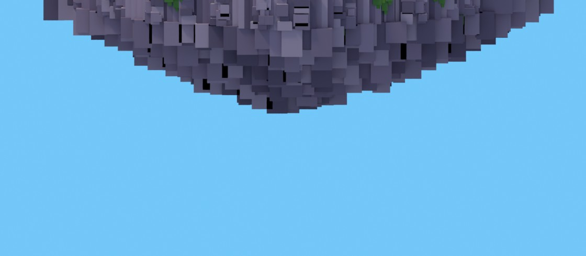

2. **Repeated block seams survive underneath.** Narrow black slots and repeated columns read as a grid rather than chunky geological masses. Offset each tier, vary chunk widths/depths and use a continuous buried core. Darken downward; retain moss only at the lip and a few deliberate root/debris accents.

   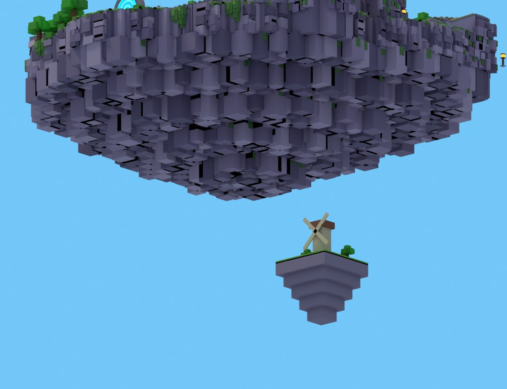

3. **The three-quarter view has too much equal-weight vegetation.** Many similar trees and stones fill the silhouette. The reference has larger focal masses and smaller planting that frames the next action. Remove redundant scatter; hand-author a modest set of groups of 3–7, with big/medium/small members.

   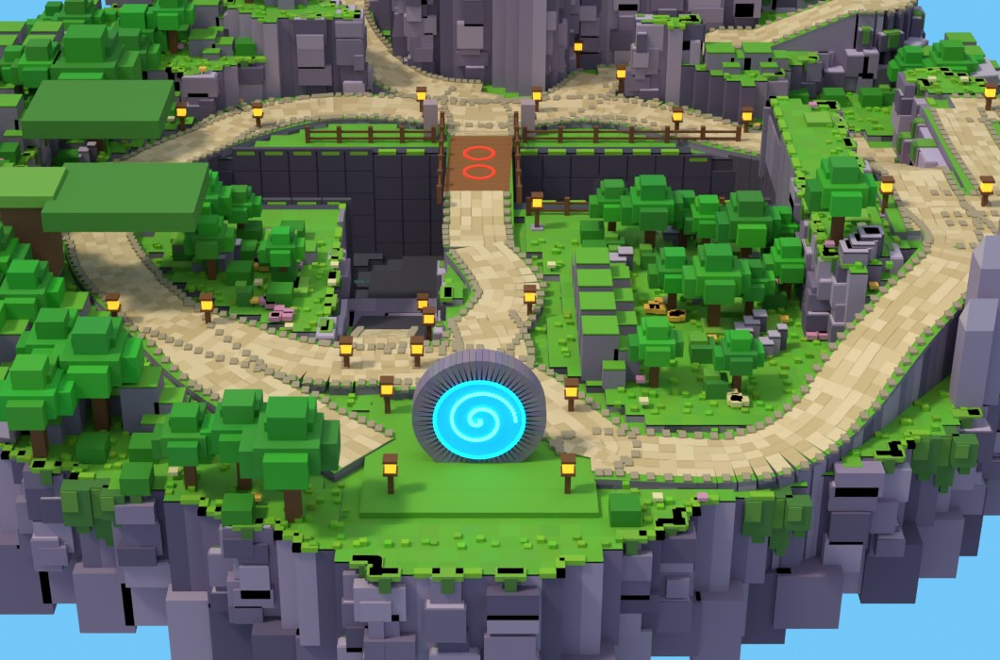

4. **Top view needs intentional negative space.** Plants occupy interiors without a route-framing purpose; flowers are not consistently at edges. Baseline re-audit with complete inventory including the 2,131 ground moss tufts and two banner assemblies: 3,040 assemblies / 3,955 prop parts; overlap pairs **3,116**, floating **361**, sunk **226**, unsupported **111**, path intrusions **27**, flowers outside the 0.3–6-stud edge band **289**, construction clipping parts **837**, fence gaps/stubs **0**. These categories can overlap; never add them as unique defects. Grounding uses five rays per root, tolerance 0.20 stud; overlaps use 15-axis OBB SAT. Old fence rail/post interiors are reconstructed as assemblies and excluded. Attached cliff vegetation and intentionally floating underside rock are construction, not ground props. Detailed IDs are in [raw before audit](ROUND5-PLACEMENT-BEFORE.json). The first written audit used narrower inventory and a projected-footprint implementation later corrected by technical review; the saved pre-edit scene was rechecked with the final method so before/after remain comparable.

   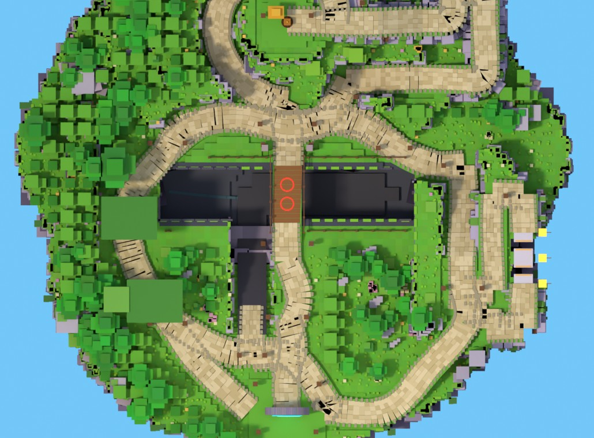

5. **Portal-to-west view is dominated by slabs and lanterns.** The flat canopy plates look unsupported and hide the west identity. Keep a lower west cover pocket, a recognizable rooted oak landmark visible from the portal and paired junction lamps outside the whole lane footprint.

   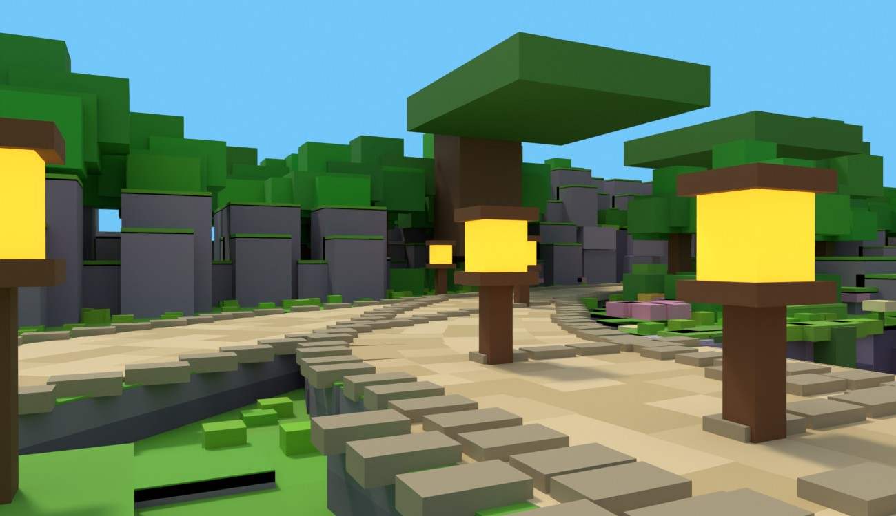

6. **West route is enclosed by a wall of trees/rocks.** Cover should create a few deliberate throw breaks, not a continuous screen. Leave crown gaps and preserve a view to the summit between cover pockets. Actual Keeper projectile sweeps remain UNKNOWN.

   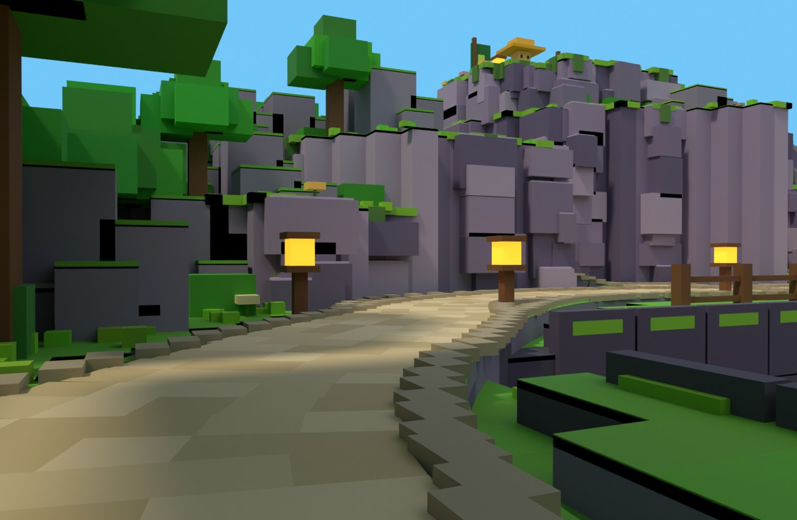

7. **Bridge approach has competing decoration.** The exposed route and ravine should be open. No new trees, flowers, boulders, fence stubs or lights belong in the bridge lane. Keep the existing ravine/crossing geometry; frame its ends from outside.

   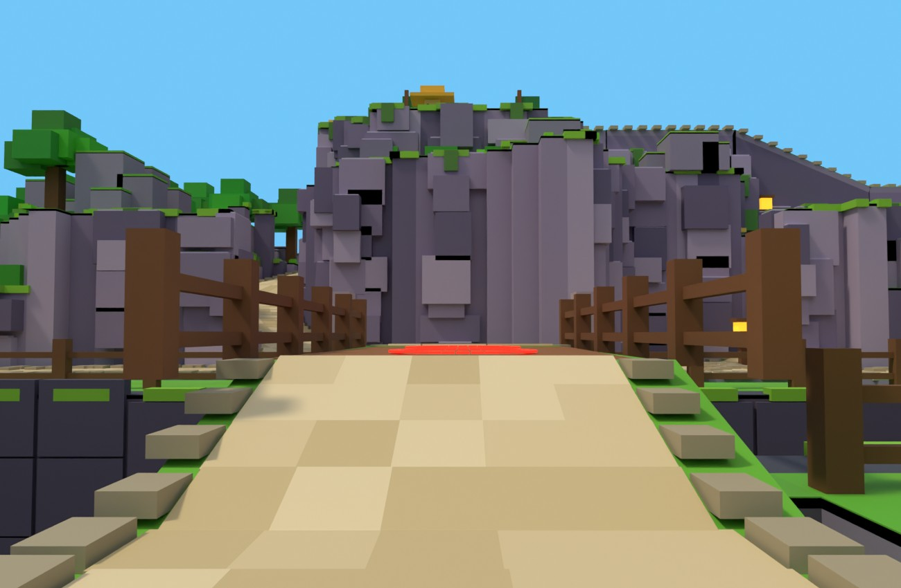

8. **East view needs a stronger endpoint and cleaner foreground.** Cliff noise and an isolated lamp compete with the destination. Retain the high route, contrast jump pads, and a grounded split-spire silhouette readable from the portal. Keep 18-stud walking lanes and 12-stud optional pads clear.

   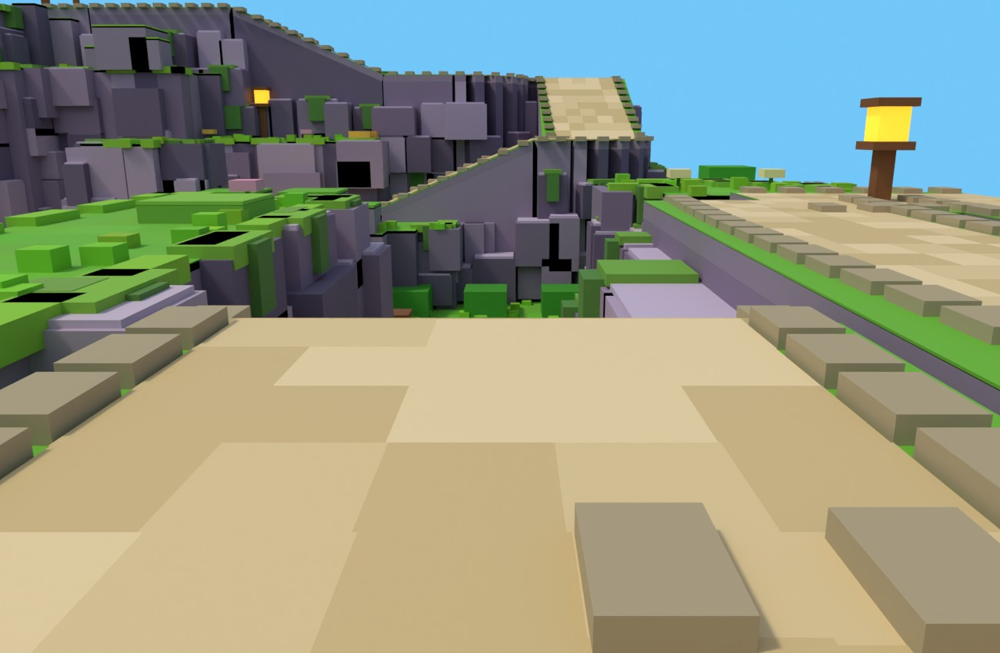

9. **Shared descent and recovery need player-height acceptance.** Elevated presentation renders conceal cliff walls and broken-looking joins. Inspect summit, shelf and ravine exit with the same eye height, repair only placement/support presentation within scope, and report retained terrain occlusion honestly. Fences need connected rails and terminal posts, not isolated stubs.

   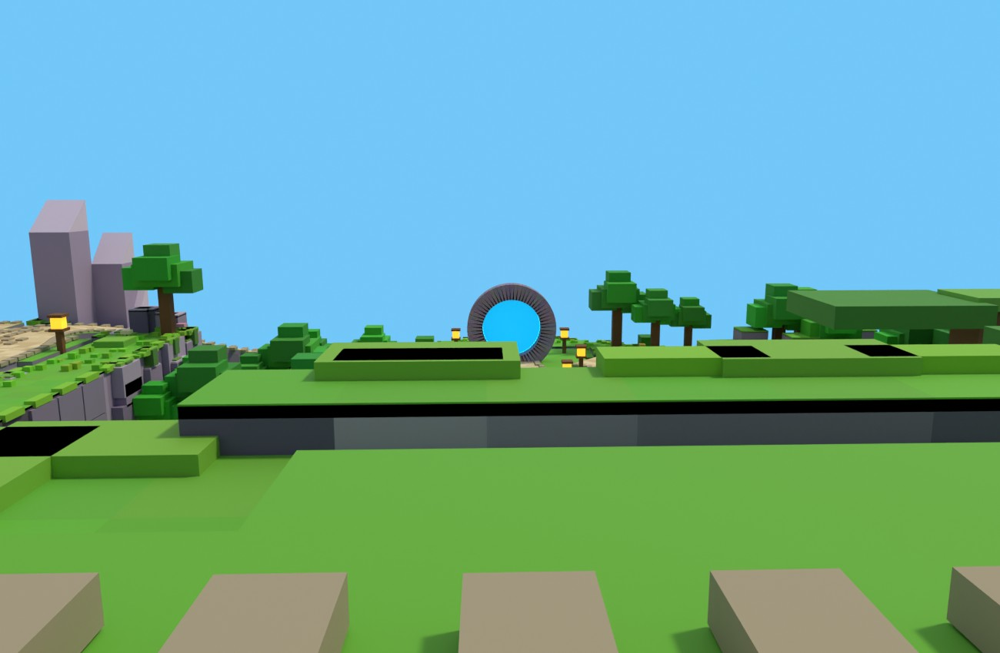
   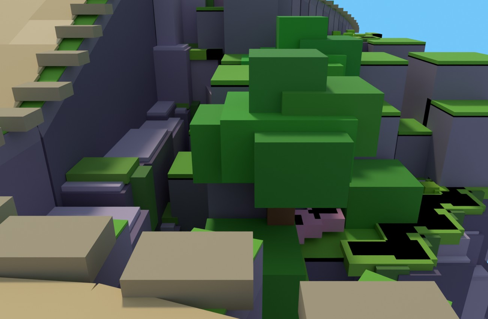
   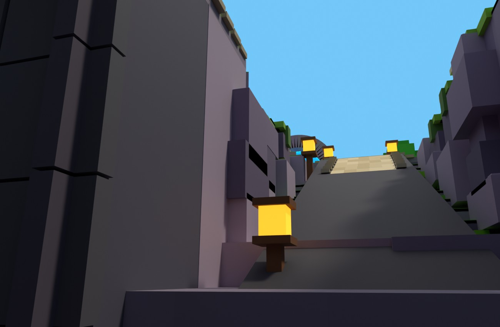

Fix gate: this audit and its pixel crops precede geometry changes. Afterward rerun placement, full-width clearance and route graph audits; target all defect counts zero. Re-render the same cameras, publish comparison files locally, and obtain up to three fresh blind critiques against the supplied references. Preserve guardian scripts/place and Keeper animations; no commit or publish.

Post-audit evidence correction: the first summit camera was inside the acorn and black. It was repaired at X8, keeping nominal eye height 5.5, and the saved pre-edit scene was re-rendered. The linked summit crop is that corrected baseline, not a claim that the original black shot established quality. All 18 individual route views are additionally paired in [route-eye sheet](build-route-ground.jpg). Final changes, full comparison renders and the bounded critic verdict are in [R5 result](ROUND5.md) and [independent reviews](ROUND5-CRITIC.md).

Studio must confirm exactly: (1) all 18 route surfaces plus 12-stud optional pads support an avatar without snags; (2) actual chase camera and 5.5-stud first-person views at all listed cameras show the summit/portal and each route landmark; (3) Keeper wind-up and full projectile arcs clear the tree crowns except intended west cover; (4) bridge/ravine falls, recovery, respawn and jumps work in Play; (5) every prop foot and fence endpoint touches the rendered Studio ground with no visible clipping; (6) dark lower tiers, grass/moss/roots and floating debris read from four sides under actual lighting; (7) parts, shadows and lights run acceptably on a real baseline phone, keyboard and gamepad. Runtime and performance are UNKNOWN until these checks.

Lessons: When cosmetic props do not collide, audit their visible footprints because collision-only clearance misses bad placement. When an island reads as a bowl, fix its large silhouette before adding surface detail because detail cannot supply depth. When judging route framing, use player-height cameras because spectator views hide occlusion.
